# Annexe A4 — Workflows des Work Items et des LiveDocs

> Document **généré** par `tools/generate_docs.py` depuis `model/*.yaml` — ne pas éditer à la main.

## Catalogue des conditions

| Condition | Implémentation | Correspondance Polarion | Description |
|---|---|---|---|
| `requiredFields` | native | <required><field name=.../></required> | Champs obligatoires renseignés à la transition |
| `requiredRoles` | builtin | RoleCondition(roles) | L'utilisateur détient l'un des rôles listés (OU logique ; rôles spéciaux workitem.assignee / workitem.author acceptés) |
| `fieldValue` | builtin | FieldNonEmpty(field.name, negate) ; ScriptCondition pour les comparaisons de valeur | Un champ a (ou n'a pas) une valeur donnée |
| `linkedItemsStatus` | builtin | LinkedWorkItemsStatus(link.roles \| back.link.roles, valid.states) | Les éléments liés par un rôle donné sont dans un des statuts listés |
| `hasLink` | builtin | LinkedWorkItem(link.role, backlink, target.work.item.type) ; ScriptCondition pour les cardinalités (exactly, min > 1) | Au moins N liens sortants / entrants d'un rôle donné |
| `approverNotAuthor` | script | ScriptCondition(engine=js, script=fra-independence.js) | Indépendance : l'utilisateur qui exécute la transition n'est ni l'auteur ni le dernier rédacteur (contrôle technique) |
| `allApprovalsDone` | builtin | ApprovalState(commonApprovalState=approved) ou AtLeastOneApprovedAndNooneDisapproved | Les approbateurs désignés ont approuvé (mécanisme Approvals) |
| `noSuspectLinks` | script | ScriptCondition(fra-no-suspect.js) pour un Work Item ; ContainsNoMatchingWorkItems(query='suspect:true') pour un LiveDoc | Aucun lien suspect sortant (rôles listés) sur l'élément / les éléments du document |
| `noForbiddenClassification` | script | ScriptCondition(fra-classification.js) ; ContainsNoMatchingWorkItems(query='informationClassification.KEY:(sensitiveSecurity restricted)') pour un LiveDoc | Classification ≠ sensibleSecurity / restricted (instance standard) |
| `allDocItemsInStatus` | builtin | ContainsNoMatchingWorkItems(query='NOT status:(...) AND NOT type:heading') | Tous les Work Items du LiveDoc sont dans un des statuts listés |
| `safetyApprovalIf` | script | ScriptCondition(fra-safety-approval.js) + AddDefaultApprovals(approvals.roles=safetyEngineer) à la transition amont | Si condition de sûreté vraie, une approbation par un détenteur du rôle safetyEngineer est présente |

## Catalogue des fonctions

| Fonction | Implémentation | Correspondance Polarion | Description |
|---|---|---|---|
| `setFieldValue` | builtin | ChangeField(field.name, field.value) | Positionne un champ |
| `clearField` | builtin | ClearField(field.name) ou <cleared> | Vide un champ |
| `setDueDateFromNow` | script | ScriptFunction(fra-sla.js) ; SetDate pour la date courante | Calcule une échéance (SLA) à partir de la date courante |
| `notifyRoles` | script | ScriptFunction(fra-notify.js) en complément des notifications natives | Notification ciblée |
| `recomputeVerificationStatus` | script | ScriptFunction + script planifié (2506+) nocturne | Recalcule verificationStatus des exigences liées |
| `createBaseline` | script | ScriptFunction(fra-baseline.js) | Crée une baseline nommée (référence de configuration) |
| `incrementRevisionIndex` | script | ScriptFunction(fra-revision-index.js) | Incrémente l'indice documentaire (A, B, C...) |
| `exportToEdms` | extension | Extension d'export PDF (ex. SBB pdf-exporter) + connecteur GED | Exporte le PDF signé + manifeste de signatures vers la GED (archivage de référence) |
| `createLinkedItem` | builtin | CreateLinkedWorkItem(type, link.role, backlink) | Crée un élément lié (ex. problème technique depuis risque survenu) |
| `lockFields` | script | Save hook (Polarion Scripting 2410+ ou extension d'interception) | Verrouille des champs (ex. texte original après acceptation) |
| `addApprovals` | builtin | AddDefaultApprovals(approvals.roles \| approvals.users) | Ajoute les approbateurs par défaut |
| `addSigners` | builtin | AddDefaultSigners(signedBy.roles, signer.role, target.status.id) – documents | Ajoute les signataires attendus d'un LiveDoc |
| `invokeOnDocItems` | builtin | InvokeAction(statusId, actionId, query) – documents | Applique une transition aux Work Items du document |

## Significations de signature

- `authored` : Rédigé par / *Authored by*
- `verified` : Vérifié par (contrôle technique) / *Verified by (technical check)*
- `approved` : Approuvé par / *Approved by*
- `safety` : Avis favorable Sûreté / *Safety endorsement*
- `quality` : Visa Qualité / *Quality endorsement*
- `ccb` : Décision CCB / *CCB decision*
- `accepted` : Accepté (levée) / *Accepted (closure)*

## wfRequirement

**Cycle de vie d'une exigence rédigée** (Work Item) — s'applique à : `stakeholderRequirement`, `systemRequirement`, `equipmentRequirement`, `softwareRequirement`, `hardwareRequirement`, `safetyRequirement`

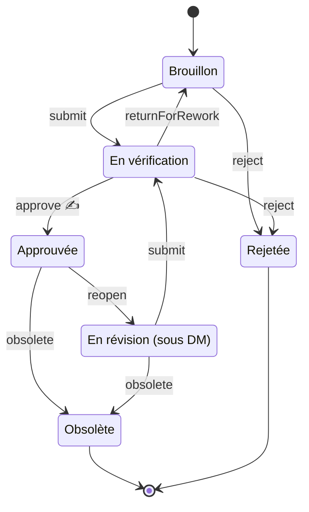

| Transition | De → vers | Rôles | Champs requis | Conditions | Fonctions | Signature |
|---|---|---|---|---|---|---|
| `submit` Soumettre à vérification | draft, inRevision → inReview | disciplineEngineer, requirementsManager, safetyEngineer | title, description, discipline, reqCategory, safetyRelevant, definedRequirement, informationClassification, exportControl | noForbiddenClassification |  |  |
| `returnForRework` Retourner pour reprise | inReview → draft | verifier, approver, safetyEngineer, requirementsManager | transitionNote |  |  |  |
| `approve` Approuver | inReview → approved | verifier, approver | verificationMethods, acceptanceCriteria | approverNotAuthor; noSuspectLinks(flowsDownFrom/refines/assumes/branched_from/derived_from); safetyApprovalIf(definedRequirement = yes OR safetyRelevant = yes); fieldValue(field=maturity, notIn=tbd) | setFieldValue; recomputeVerificationStatus | Vérifié par (contrôle technique) |
| `reopen` Rouvrir sous demande de modification | approved → inRevision | requirementsManager, configurationManager |  | hasLink(role=impacts, direction=incoming, fromType=changeRequest, linkedStatus=approved/implementation, min=1, onlyIfInBaseline=True) |  |  |
| `obsolete` Rendre obsolète | approved, inRevision → obsolete | configurationManager, requirementsManager | transitionNote | hasLink(role=impacts, direction=incoming, fromType=changeRequest, linkedStatus=approved/implementation/verification/closed, min=1) |  |  |
| `reject` Rejeter / abandonner | draft, inReview → rejected | requirementsManager, technicalLead | transitionNote |  |  |  |

## wfInputRequirement

**Exigence d'entrée (matrice de conformité)** (Work Item) — s'applique à : `sourceRequirement`

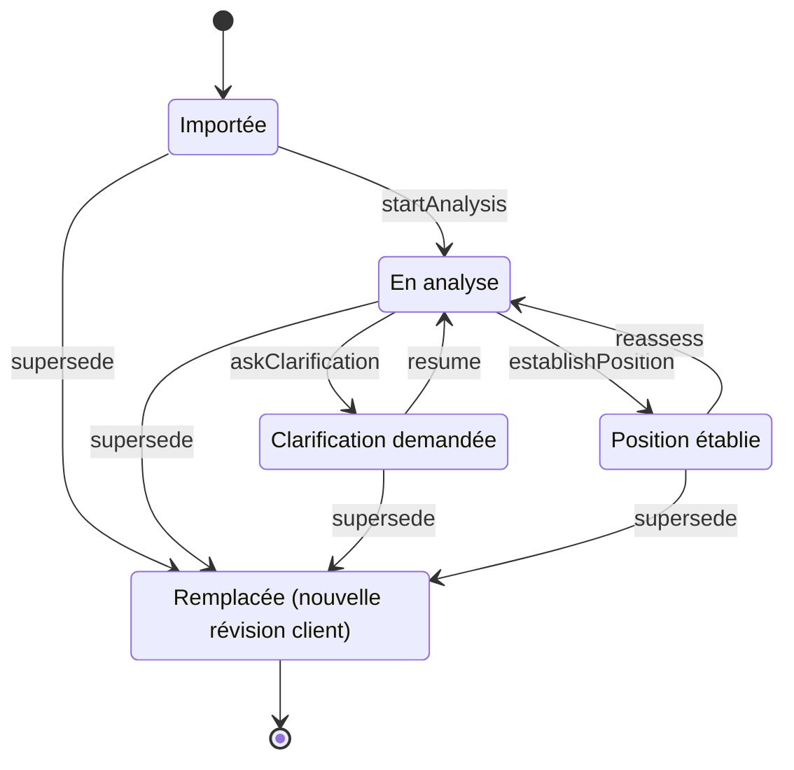

| Transition | De → vers | Rôles | Champs requis | Conditions | Fonctions | Signature |
|---|---|---|---|---|---|---|
| `startAnalysis` Prendre en analyse | imported → underAnalysis | requirementsManager, disciplineEngineer |  |  |  |  |
| `askClarification` Demander une clarification | underAnalysis → clarification | requirementsManager | complianceStatement |  | setFieldValue |  |
| `resume` Reprendre l'analyse | clarification → underAnalysis | requirementsManager |  |  |  |  |
| `establishPosition` Établir la position de conformité | underAnalysis → accepted | requirementsManager, technicalLead | complianceStatus, complianceStatement, safetyRelevant | fieldValue(field=complianceStatus, notIn=toBeAssessed); approverNotAuthor | lockFields |  |
| `reassess` Réévaluer | accepted → underAnalysis | requirementsManager | transitionNote |  |  |  |
| `supersede` Remplacer (nouvelle révision) | imported, underAnalysis, clarification, accepted → superseded | requirementsManager, configurationManager |  |  |  |  |

## wfLibraryItem

**Élément de bibliothèque (réglementaire, glossaire)** (Work Item) — s'applique à : `regulatoryRequirement`, `term`

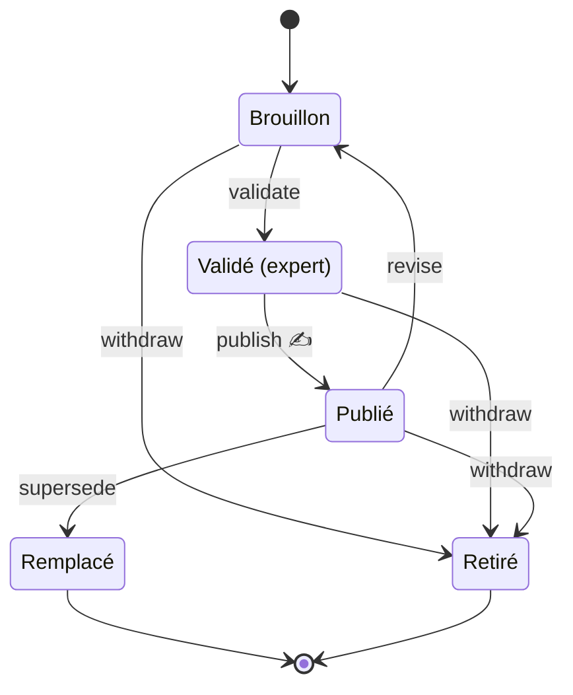

| Transition | De → vers | Rôles | Champs requis | Conditions | Fonctions | Signature |
|---|---|---|---|---|---|---|
| `validate` Valider (expert métier) | draft → validated | disciplineEngineer, safetyEngineer, licensingEngineer | title, description | approverNotAuthor |  |  |
| `publish` Publier | validated → published | libraryCurator |  |  |  | Approuvé par |
| `revise` Réviser (nouvelle édition) | published → draft | libraryCurator | transitionNote |  |  |  |
| `supersede` Remplacer | published → superseded | libraryCurator |  | hasLink(role=supersedes, direction=incoming, min=1) |  |  |
| `withdraw` Retirer | draft, validated, published → withdrawn | libraryCurator | transitionNote |  |  |  |

## wfAssumption

**Hypothèse / donnée d'entrée** (Work Item) — s'applique à : `assumption`

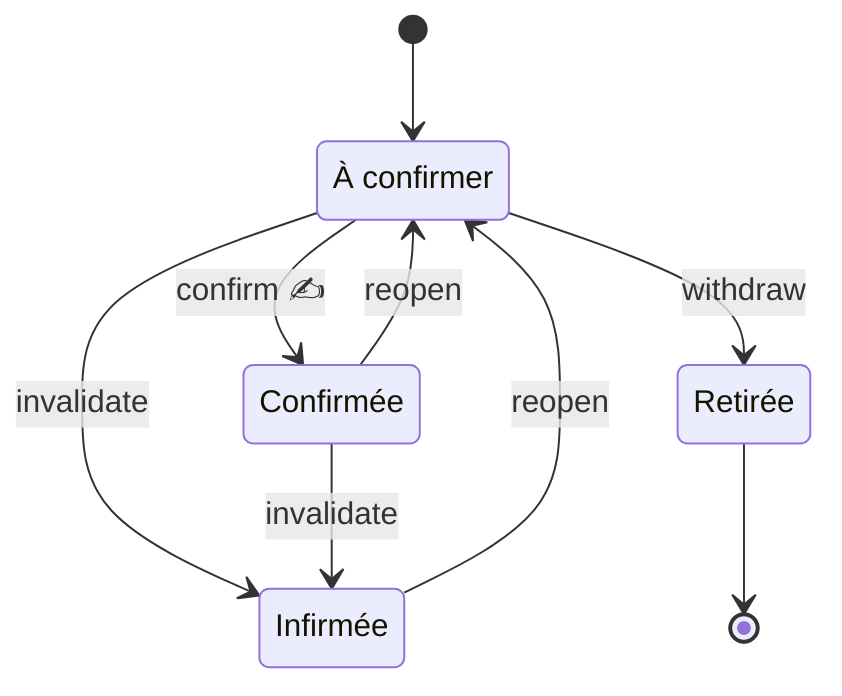

| Transition | De → vers | Rôles | Champs requis | Conditions | Fonctions | Signature |
|---|---|---|---|---|---|---|
| `confirm` Confirmer | open → confirmed | technicalLead, disciplineEngineer | validationMethod | approverNotAuthor |  | Vérifié par (contrôle technique) (si safetyRelevant = yes) |
| `invalidate` Infirmer | open, confirmed → invalidated | technicalLead, disciplineEngineer | transitionNote |  | notifyRoles |  |
| `reopen` Rouvrir (donnée modifiée) | confirmed, invalidated → open | technicalLead | transitionNote |  |  |  |
| `withdraw` Retirer | open → withdrawn | technicalLead |  |  |  |  |

## wfArchitecture

**Élément d'architecture** (Work Item) — s'applique à : `operationalScenario`, `function`, `logicalComponent`, `physicalComponent`, `designParameter`

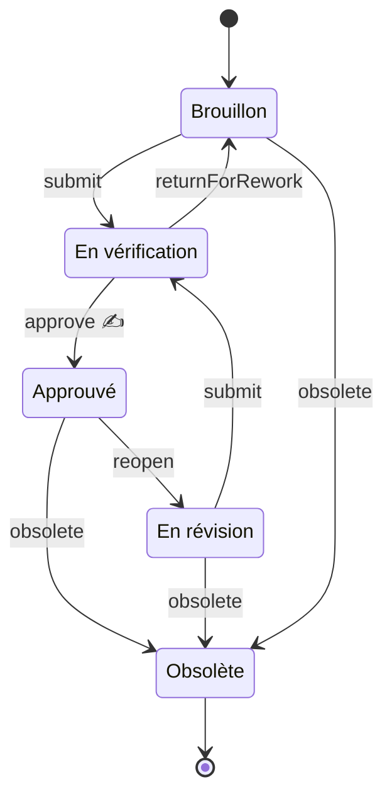

| Transition | De → vers | Rôles | Champs requis | Conditions | Fonctions | Signature |
|---|---|---|---|---|---|---|
| `submit` Soumettre | draft, inRevision → inReview | disciplineEngineer, technicalLead | title, discipline, informationClassification, exportControl | noForbiddenClassification |  |  |
| `returnForRework` Retourner pour reprise | inReview → draft | verifier, technicalLead | transitionNote |  |  |  |
| `approve` Approuver | inReview → approved | verifier, technicalLead, approver |  | approverNotAuthor; noSuspectLinks(realizes/satisfies/allocatedTo/assumes/branched_from/derived_from); fieldValue(field=classificationValidated, equals=True, onlyIf=type = physicalComponent AND eip = yes) |  | Vérifié par (contrôle technique) (si eip = yes OR functionCategory != nc) |
| `reopen` Rouvrir | approved → inRevision | technicalLead, configurationManager |  | hasLink(role=impacts, direction=incoming, fromType=changeRequest, linkedStatus=approved/implementation, min=1, onlyIfInBaseline=True) |  |  |
| `obsolete` Rendre obsolète | approved, inRevision, draft → obsolete | configurationManager, technicalLead | transitionNote |  |  |  |

## wfInterface

**Interface (registre ICD)** (Work Item) — s'applique à : `interface`

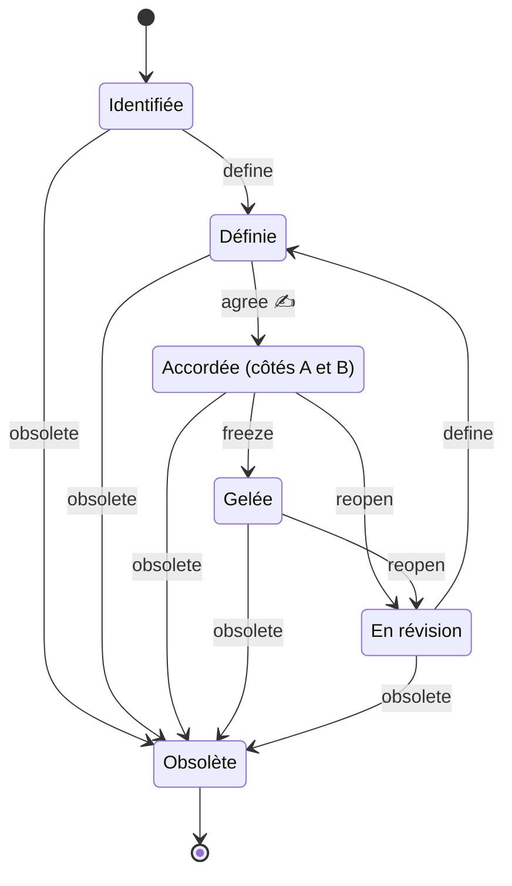

| Transition | De → vers | Rôles | Champs requis | Conditions | Fonctions | Signature |
|---|---|---|---|---|---|---|
| `define` Déclarer définie | identified, inRevision → defined | interfaceManager, disciplineEngineer | interfaceType, interfaceScope, interfaceData, sideAOwner, sideBOwner | hasLink(role=sideA, direction=outgoing, exactly=1); hasLink(role=sideB, direction=outgoing, exactly=1) |  |  |
| `agree` Accorder (approbations A et B) | defined → agreed | interfaceManager |  | allApprovalsDone(minApprovers=2) |  | Approuvé par |
| `freeze` Geler (référence) | agreed → frozen | interfaceManager, configurationManager |  | noSuspectLinks(sideA/sideB/satisfies) | setFieldValue |  |
| `reopen` Rouvrir | agreed, frozen → inRevision | interfaceManager, configurationManager | transitionNote | hasLink(role=impacts, direction=incoming, fromType=changeRequest, min=1, onlyIfFrozen=True) |  |  |
| `obsolete` Rendre obsolète | identified, defined, agreed, frozen, inRevision → obsolete | interfaceManager, configurationManager | transitionNote |  |  |  |

## wfDecision

**Décision de conception** (Work Item) — s'applique à : `designDecision`

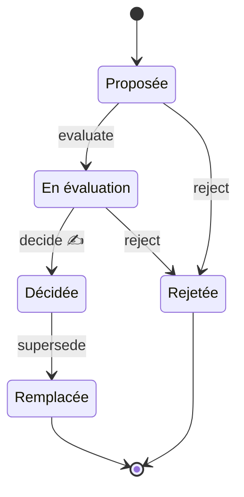

| Transition | De → vers | Rôles | Champs requis | Conditions | Fonctions | Signature |
|---|---|---|---|---|---|---|
| `evaluate` Évaluer | proposed → evaluation | technicalLead, disciplineEngineer | alternatives, selectionCriteria |  |  |  |
| `decide` Décider | evaluation → decided | technicalLead, approver | decisionRationale, decisionAuthority, decisionDate | approverNotAuthor |  | Approuvé par |
| `supersede` Remplacer | decided → superseded | technicalLead |  | hasLink(role=supersedes, direction=incoming, min=1) |  |  |
| `reject` Rejeter | proposed, evaluation → rejected | technicalLead | transitionNote |  |  |  |

## wfSafetyAnalysisItem

**Élément d'analyse de sûreté (agression, revendication, AMDEC)** (Work Item) — s'applique à : `hazard`, `safetyClaim`, `fmeaItem`


| Transition | De → vers | Rôles | Champs requis | Conditions | Fonctions | Signature |
|---|---|---|---|---|---|---|
| `submit` Soumettre | draft, inRevision → inReview | safetyEngineer, disciplineEngineer | title, description |  |  |  |
| `returnForRework` Retourner pour reprise | inReview → draft | safetyLead, verifier | transitionNote |  |  |  |
| `approve` Approuver | inReview → approved | safetyLead, verifier |  | approverNotAuthor; noSuspectLinks(supportedBy/assumes/causes) |  | Avis favorable Sûreté |
| `reopen` Rouvrir | approved → inRevision | safetyLead | transitionNote |  |  |  |
| `obsolete` Rendre obsolète | approved, inRevision, draft → obsolete | safetyLead | transitionNote |  |  |  |

## wfAnalysis

**Analyse / étude / note de calcul (AIP)** (Work Item) — s'applique à : `analysis`

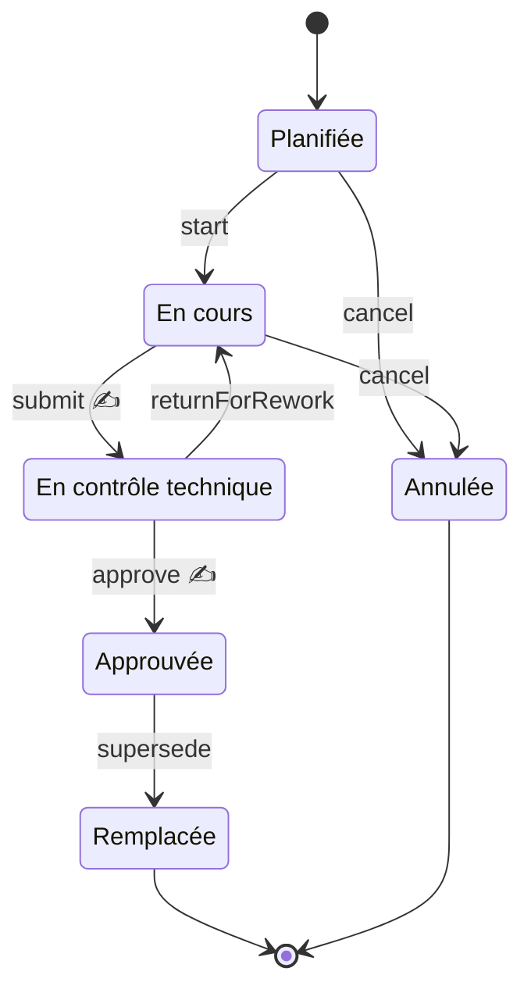

| Transition | De → vers | Rôles | Champs requis | Conditions | Fonctions | Signature |
|---|---|---|---|---|---|---|
| `start` Démarrer | planned → inProgress | disciplineEngineer |  |  |  |  |
| `submit` Soumettre au contrôle technique | inProgress → inVerification | disciplineEngineer | analysisType, calculationCode, codeQualification, conclusion, analysisResult, documentNumber |  |  | Rédigé par |
| `returnForRework` Retourner pour reprise | inVerification → inProgress | verifier | transitionNote |  |  |  |
| `approve` Approuver | inVerification → approved | verifier, approver |  | approverNotAuthor; noSuspectLinks(assumes/satisfies/flowsDownFrom); fieldValue(field=codeQualification, notIn=notQualified, unlessFieldNonEmpty=rationale) |  | Vérifié par (contrôle technique) |
| `supersede` Remplacer (nouvel indice) | approved → superseded | disciplineEngineer, configurationManager |  | hasLink(role=supersedes, direction=incoming, min=1) |  |  |
| `cancel` Annuler | planned, inProgress → cancelled | technicalLead | transitionNote |  |  |  |

## wfRisk

**Risque / opportunité** (Work Item) — s'applique à : `risk`

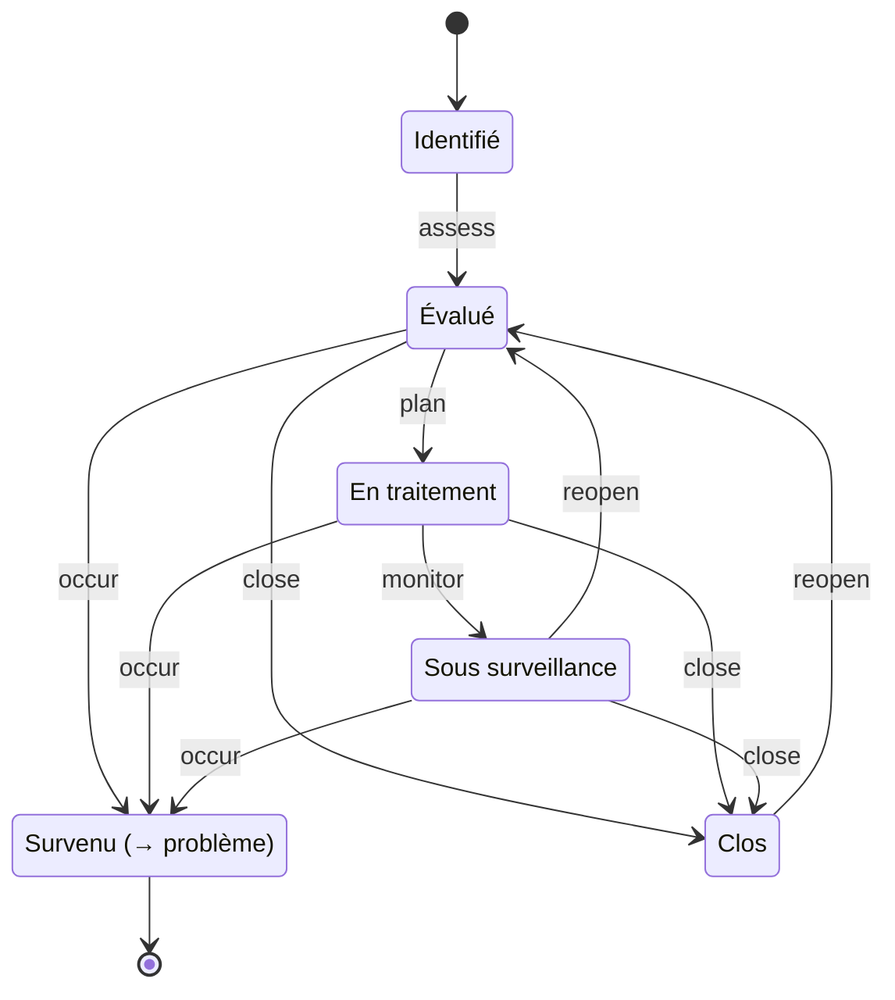

| Transition | De → vers | Rôles | Champs requis | Conditions | Fonctions | Signature |
|---|---|---|---|---|---|---|
| `assess` Évaluer | identified → assessed | projectManager, workitem.assignee | probability, impact, riskCategory |  |  |  |
| `plan` Planifier le traitement | assessed → treatment | projectManager, workitem.assignee | riskStrategy | hasLink(role=mitigates, direction=incoming, min=1, unlessFieldIn=riskStrategy=accept) |  |  |
| `monitor` Mettre sous surveillance | treatment → monitored | projectManager, workitem.assignee | residualProbability, residualImpact |  |  |  |
| `occur` Déclarer survenu | assessed, treatment, monitored → occurred | projectManager, workitem.assignee |  |  | createLinkedItem |  |
| `close` Clore | assessed, treatment, monitored → closed | projectManager | transitionNote |  |  |  |
| `reopen` Réévaluer | closed, monitored → assessed | projectManager, workitem.assignee |  |  |  |  |

## wfCommitment

**Engagement / demande de l'autorité** (Work Item) — s'applique à : `regulatoryCommitment`

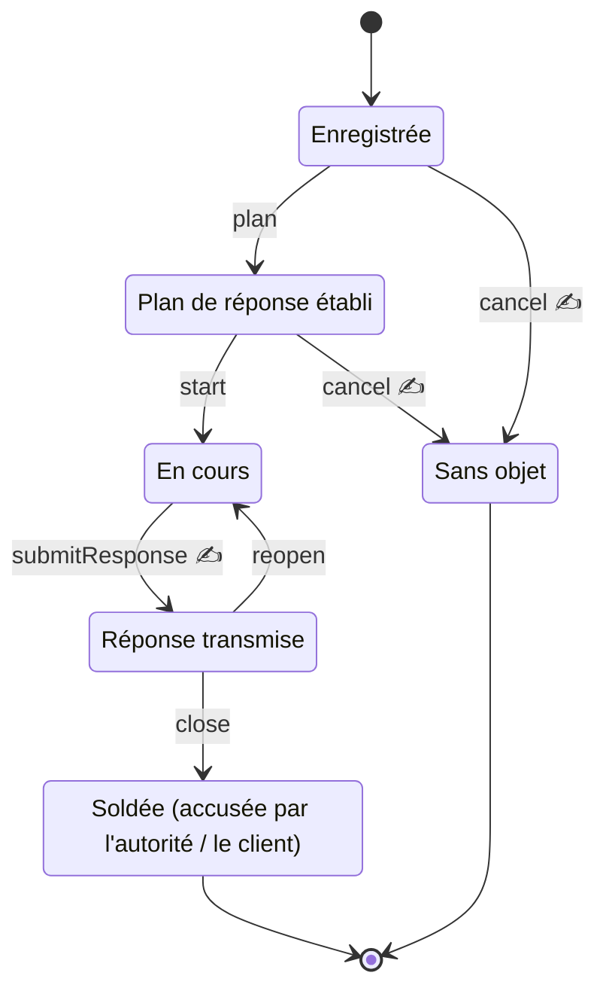

| Transition | De → vers | Rôles | Champs requis | Conditions | Fonctions | Signature |
|---|---|---|---|---|---|---|
| `plan` Établir le plan de réponse | registered → planned | licensingEngineer, projectManager | commitmentDueDate, assignee |  |  |  |
| `start` Démarrer | planned → inProgress | licensingEngineer, disciplineEngineer |  |  |  |  |
| `submitResponse` Transmettre la réponse | inProgress → responseSubmitted | licensingEngineer | commitmentText, responseReference | hasLink(role=resolves, direction=incoming, min=1); approverNotAuthor |  | Approuvé par |
| `reopen` Compléter (réponse jugée insuffisante) | responseSubmitted → inProgress | licensingEngineer | transitionNote |  |  |  |
| `close` Solder | responseSubmitted → closed | licensingEngineer | transitionNote |  |  |  |
| `cancel` Déclarer sans objet | registered, planned → cancelled | licensingEngineer | transitionNote |  |  | Approuvé par |

## wfVerificationCase

**Cas de vérification / validation** (Work Item) — s'applique à : `verificationCase`

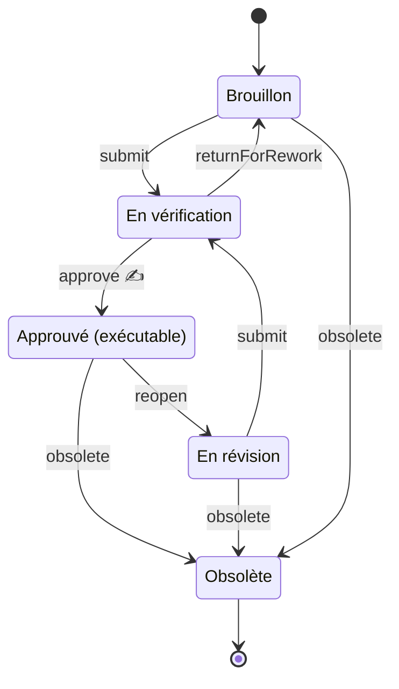

| Transition | De → vers | Rôles | Champs requis | Conditions | Fonctions | Signature |
|---|---|---|---|---|---|---|
| `submit` Soumettre | draft, inRevision → inReview | vvEngineer, disciplineEngineer | verificationMethod, vvStage, acceptanceCriteria | hasLink(role=verifies/validates, direction=outgoing, min=1) |  |  |
| `returnForRework` Retourner pour reprise | inReview → draft | verifier, vvLead | transitionNote |  |  |  |
| `approve` Approuver | inReview → approved | verifier, vvLead |  | approverNotAuthor; noSuspectLinks(verifies/validates) |  | Vérifié par (contrôle technique) (si lié à une exigence définie ou inspectionPoint ∈ {hold, witness}) |
| `reopen` Rouvrir | approved → inRevision | vvLead, configurationManager | transitionNote |  |  |  |
| `obsolete` Rendre obsolète | approved, inRevision, draft → obsolete | vvLead | transitionNote |  |  |  |

## wfAnomaly

**Fiche d'anomalie V&V** (Work Item) — s'applique à : `anomaly`

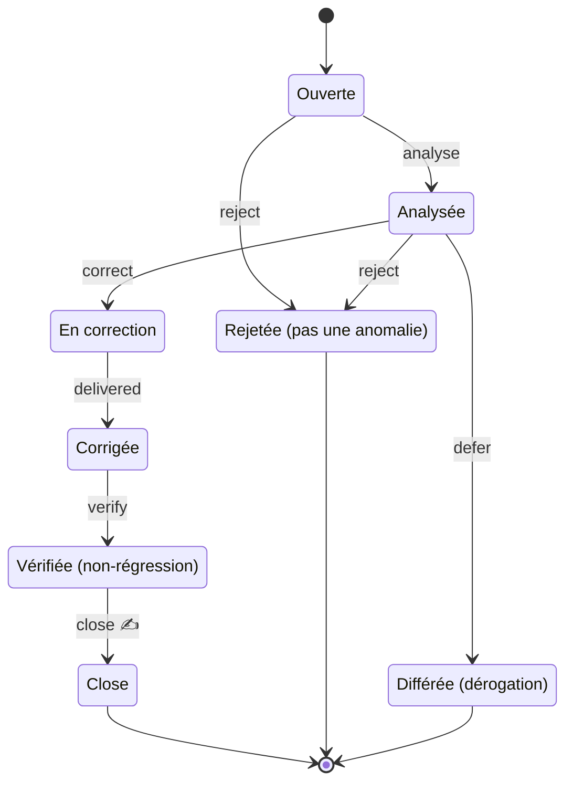

| Transition | De → vers | Rôles | Champs requis | Conditions | Fonctions | Signature |
|---|---|---|---|---|---|---|
| `analyse` Analyser | open → analysed | vvEngineer, disciplineEngineer | anomalyType, safetyImpact, severity |  |  |  |
| `correct` Engager la correction | analysed → inCorrection | technicalLead |  |  |  |  |
| `delivered` Correction livrée | inCorrection → corrected | disciplineEngineer | fixVersion |  |  |  |
| `verify` Vérifier | corrected → verified | vvEngineer, verifier |  | approverNotAuthor |  |  |
| `close` Clore | verified → closed | vvLead |  |  |  | Accepté (levée) (si safetyImpact = yes) |
| `reject` Rejeter | open, analysed → rejected | vvLead | transitionNote |  |  |  |
| `defer` Différer | analysed → deferred | technicalLead | transitionNote | hasLink(role=resolves, direction=incoming, fromType=waiver, min=1, onlyIf=safetyImpact = yes) |  |  |

## wfChangeRequest

**Demande de modification (ECM)** (Work Item) — s'applique à : `changeRequest`

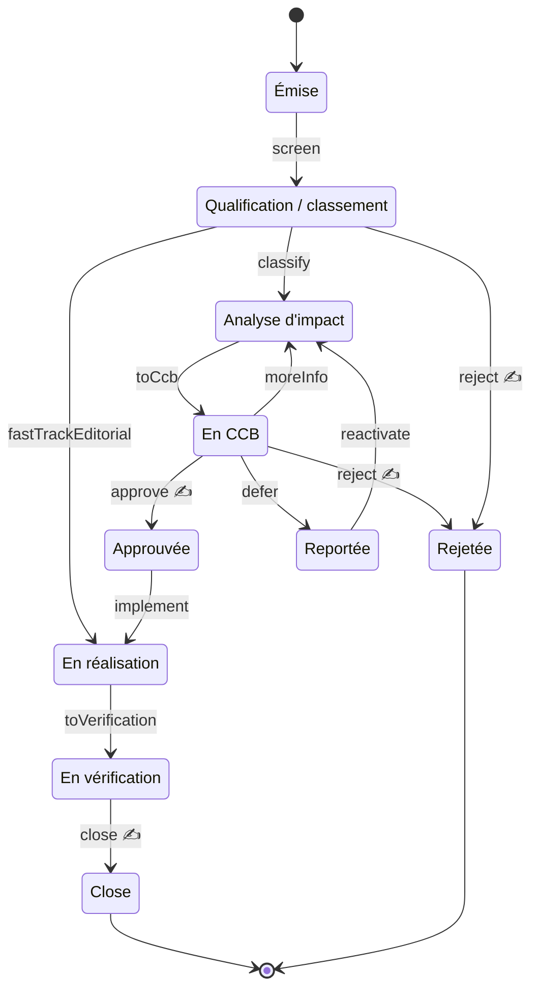

| Transition | De → vers | Rôles | Champs requis | Conditions | Fonctions | Signature |
|---|---|---|---|---|---|---|
| `screen` Prendre en charge | submitted → screening | configurationManager |  |  |  |  |
| `classify` Classer et lancer l'analyse d'impact | screening → impactAnalysis | configurationManager | changeClass, changeOrigin, safetyImpact, urgency |  |  |  |
| `fastTrackEditorial` Traitement éditorial direct | screening → implementation | configurationManager | transitionNote | fieldValue(field=changeClass, in=editorial) |  |  |
| `toCcb` Présenter en CCB | impactAnalysis → ccbReview | technicalLead, configurationManager | impactAnalysis, impactedDisciplines, affectsEip, regulatoryModificationClass | hasLink(role=impacts, direction=outgoing, min=1); fieldValue(field=safetyImpact, notIn=tbd); safetyApprovalIf(safetyImpact = yes OR affectsEip = yes) |  |  |
| `approve` Approuver (CCB) | ccbReview → approved | ccbChair | ccbDecision, ccbDate, ccbReference |  | setFieldValue | Décision CCB |
| `reject` Rejeter | ccbReview, screening → rejected | ccbChair | transitionNote |  |  | Décision CCB |
| `defer` Reporter | ccbReview → deferred | ccbChair | transitionNote |  |  |  |
| `moreInfo` Demander un complément | ccbReview → impactAnalysis | ccbChair | transitionNote |  |  |  |
| `implement` Lancer la réalisation | approved → implementation | projectManager, configurationManager |  | fieldValue(field=customerApprovalReference, nonEmptyIf=customerApprovalRequired = yes) |  |  |
| `toVerification` Réalisation terminée | implementation → verification | technicalLead |  | linkedItemsStatus(role=parent, direction=incoming, type=action, statuses=done/verified/closed/cancelled) |  |  |
| `close` Clore | verification → closed | configurationManager |  | noSuspectLinks(scope=impactedItems); approverNotAuthor | createBaseline | Approuvé par |
| `reactivate` Réactiver | deferred → impactAnalysis | configurationManager |  |  |  |  |

## wfNonConformance

**Écart / FNC** (Work Item) — s'applique à : `nonConformance`

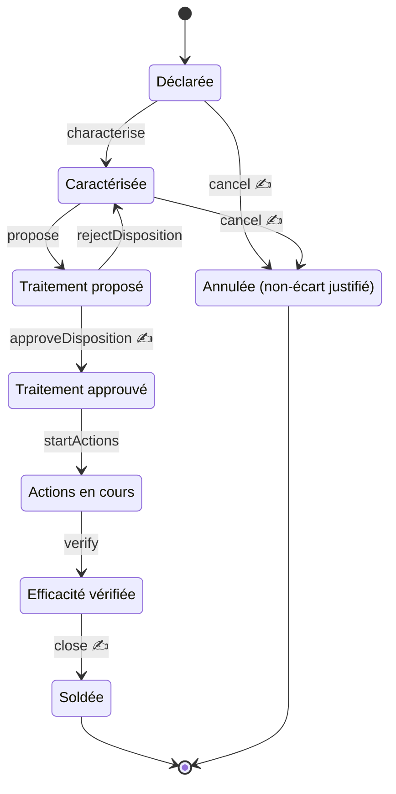

| Transition | De → vers | Rôles | Champs requis | Conditions | Fonctions | Signature |
|---|---|---|---|---|---|---|
| `characterise` Caractériser (examen sans délai) | open → characterised | disciplineEngineer, qualityEngineer | ncOrigin, ncDetectionPhase, ncSeverity, affectsEip, cfsiSuspected, containmentAction, requirementViolated |  | setDueDateFromNow; notifyRoles |  |
| `propose` Proposer un traitement | characterised → dispositionProposed | disciplineEngineer, technicalLead | ncDisposition, dispositionJustification, rootCauseCategory | hasLink(role=impacts, direction=outgoing, min=1, onlyIf=affectsEip = yes) |  |  |
| `approveDisposition` Approuver le traitement | dispositionProposed → dispositionApproved | approver, technicalLead |  | approverNotAuthor; safetyApprovalIf(affectsEip = yes OR ncSeverity = critical); fieldValue(field=customerDecisionReference, nonEmptyIf=customerApprovalRequired = yes); fieldValue(field=authorityReference, nonEmptyIf=authorityNotificationRequired = yes) |  | Approuvé par |
| `rejectDisposition` Refuser le traitement | dispositionProposed → characterised | approver, safetyEngineer, qualityEngineer | transitionNote |  |  |  |
| `startActions` Engager les actions | dispositionApproved → actionsInProgress | technicalLead, qualityEngineer |  |  |  |  |
| `verify` Vérifier l'efficacité | actionsInProgress → verified | qualityEngineer |  | linkedItemsStatus(role=parent, direction=incoming, type=action, statuses=done/verified/closed/cancelled); approverNotAuthor |  |  |
| `close` Solder | verified → closed | qualityEngineer |  |  |  | Visa Qualité |
| `cancel` Annuler (non-écart) | open, characterised → cancelled | qualityEngineer | transitionNote |  |  | Visa Qualité |

## wfWaiver

**Dérogation / concession** (Work Item) — s'applique à : `waiver`

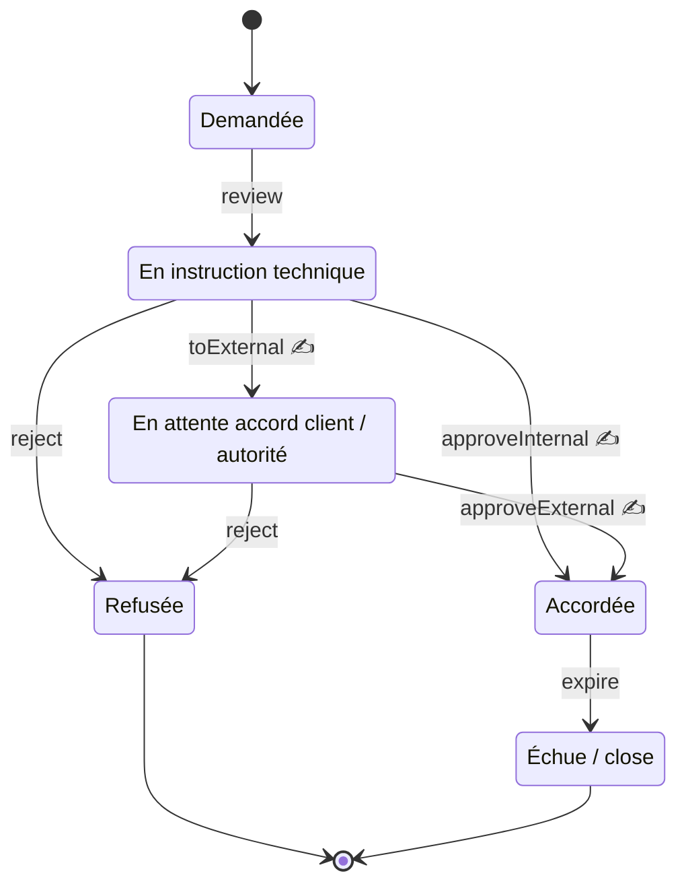

| Transition | De → vers | Rôles | Champs requis | Conditions | Fonctions | Signature |
|---|---|---|---|---|---|---|
| `review` Instruire | requested → technicalReview | technicalLead, configurationManager | waiverType, waiverJustification, affectsEip, effectivity |  |  |  |
| `toExternal` Soumettre au client / à l'autorité | technicalReview → pendingExternal | technicalLead |  | approverNotAuthor; safetyApprovalIf(affectsEip = yes) |  | Vérifié par (contrôle technique) |
| `approveInternal` Accorder (interne, sans accord externe requis) | technicalReview → approved | approver |  | fieldValue(field=affectsEip, in=False); approverNotAuthor |  | Approuvé par |
| `approveExternal` Enregistrer l'accord | pendingExternal → approved | technicalLead, configurationManager | customerApprovalReference |  |  | Approuvé par |
| `reject` Refuser | technicalReview, pendingExternal → rejected | approver, technicalLead | transitionNote |  |  |  |
| `expire` Clore / échoir | approved → expired | configurationManager |  |  |  |  |

## wfTechnicalIssue

**Problème technique / fortuit (express)** (Work Item) — s'applique à : `technicalIssue`

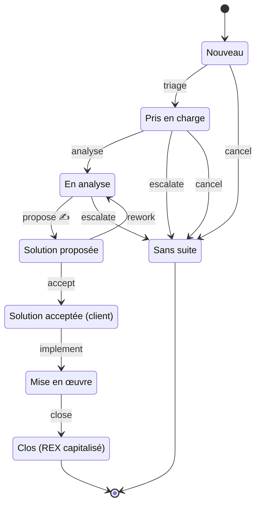

| Transition | De → vers | Rôles | Champs requis | Conditions | Fonctions | Signature |
|---|---|---|---|---|---|---|
| `triage` Prendre en charge (triage) | new → triaged | projectManager, technicalLead | issueCategory, urgency, safetyImpact, assignee |  | setDueDateFromNow; notifyRoles |  |
| `analyse` Analyser | triaged → inAnalysis | disciplineEngineer, technicalLead |  |  |  |  |
| `propose` Proposer la solution | inAnalysis → solutionProposed | disciplineEngineer, technicalLead | solutionType, affectsEip, espnImpact, genericImpact | approverNotAuthor; safetyApprovalIf(affectsEip = yes OR safetyImpact = yes); hasLink(role=resolves, direction=incoming, min=1, note=analyse / livrable de justification lié) |  | Vérifié par (contrôle technique) (si affectsEip = yes OR safetyImpact = yes) |
| `accept` Enregistrer l'acceptation client | solutionProposed → solutionAccepted | projectManager, technicalLead | customerRequestReference |  |  |  |
| `rework` Reprendre l'analyse | solutionProposed → inAnalysis | technicalLead | transitionNote |  |  |  |
| `implement` Déclarer mise en œuvre | solutionAccepted → implemented | technicalLead |  |  |  |  |
| `close` Clore | implemented → closed | projectManager | lessonsLearnedCaptured | fieldValue(field=lessonsLearnedCaptured, equals=True) |  |  |
| `escalate` Requalifier (en FNC / DM / projet) | triaged, inAnalysis → cancelled | technicalLead | transitionNote | hasLink(role=relatesTo, direction=any, toType=nonConformance/changeRequest, min=1) |  |  |
| `cancel` Classer sans suite | new, triaged → cancelled | projectManager | transitionNote |  |  |  |

## wfDeliverable

**Livrable / document (visa client)** (Work Item) — s'applique à : `deliverable`

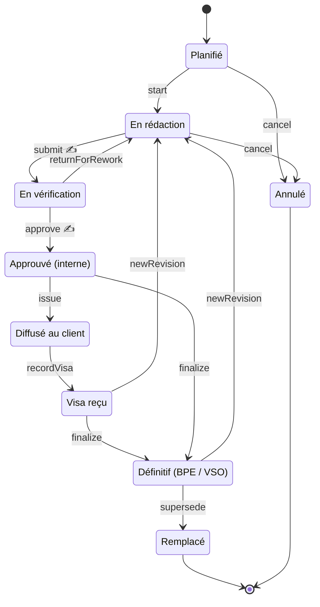

| Transition | De → vers | Rôles | Champs requis | Conditions | Fonctions | Signature |
|---|---|---|---|---|---|---|
| `start` Démarrer | planned → inProgress | disciplineEngineer |  |  |  |  |
| `submit` Soumettre à vérification | inProgress → inVerification | disciplineEngineer | documentNumber, revisionIndex, docVerifier, docApprover, aip |  |  | Rédigé par |
| `returnForRework` Retourner pour reprise | inVerification → inProgress | verifier | transitionNote |  |  |  |
| `approve` Vérifier et approuver | inVerification → approved | verifier, approver |  | approverNotAuthor; noSuspectLinks(documents/dependsOn) |  | Approuvé par |
| `issue` Diffuser | approved → issued | projectManager, documentController |  |  | exportToEdms |  |
| `recordVisa` Enregistrer le visa | issued → customerReviewed | documentController, projectManager | customerVisa |  |  |  |
| `finalize` Rendre définitif | customerReviewed, approved → final | projectManager, documentController |  | fieldValue(field=customerVisa, in=vso/vsoSr/vao/forInformation) |  |  |
| `newRevision` Nouvel indice | customerReviewed, final → inProgress | disciplineEngineer, projectManager |  |  | incrementRevisionIndex; setFieldValue |  |
| `supersede` Remplacer | final → superseded | documentController |  |  |  |  |
| `cancel` Annuler | planned, inProgress → cancelled | projectManager | transitionNote |  |  |  |

## wfReview

**Revue / jalon** (Work Item) — s'applique à : `review`

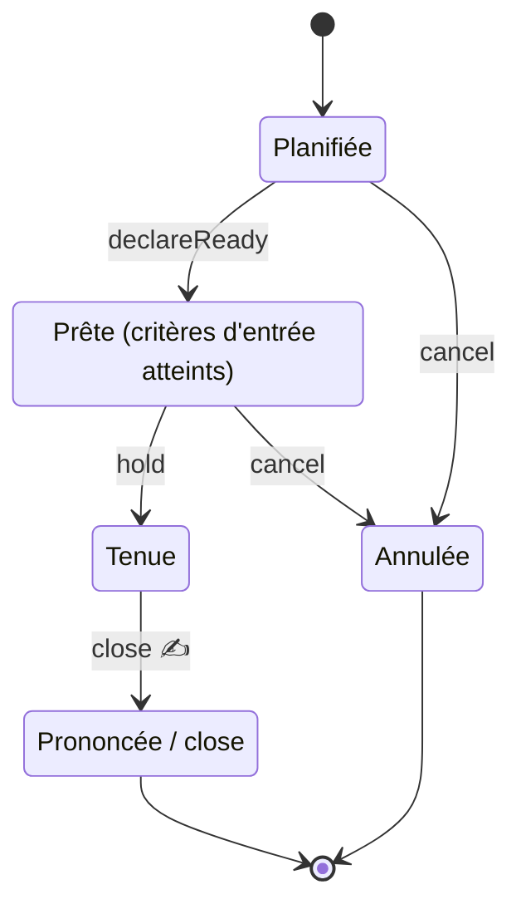

| Transition | De → vers | Rôles | Champs requis | Conditions | Fonctions | Signature |
|---|---|---|---|---|---|---|
| `declareReady` Déclarer prête | planned → ready | projectManager, technicalLead | reviewScope, entryCriteria |  |  |  |
| `hold` Tenir la revue | ready → held | technicalLead | participants |  |  |  |
| `close` Prononcer | held → closed | technicalLead, approver | reviewDecision, minutesReference | linkedItemsStatus(role=raisedIn, direction=incoming, type=reviewFinding, severity=blocking, statuses=closed/accepted) |  | Approuvé par |
| `cancel` Annuler | planned, ready → cancelled | projectManager | transitionNote |  |  |  |

## wfReviewFinding

**Remarque de revue / observation** (Work Item) — s'applique à : `reviewFinding`

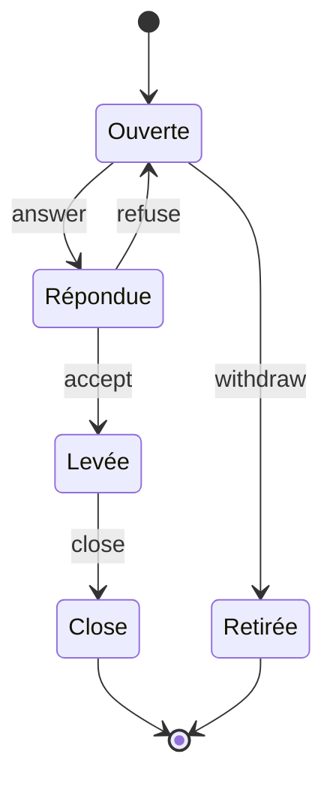

| Transition | De → vers | Rôles | Champs requis | Conditions | Fonctions | Signature |
|---|---|---|---|---|---|---|
| `answer` Répondre | open → answered | disciplineEngineer, technicalLead | findingResponse |  |  |  |
| `accept` Lever | answered → accepted | reviewer, customerReviewer, technicalLead |  |  | setFieldValue |  |
| `refuse` Refuser la réponse | answered → open | reviewer, customerReviewer, technicalLead | transitionNote |  |  |  |
| `close` Clore | accepted → closed | technicalLead, documentController |  |  |  |  |
| `withdraw` Retirer | open → withdrawn | reviewer, customerReviewer |  |  |  |  |

## wfAction

**Action** (Work Item) — s'applique à : `action`

```mermaid
stateDiagram-v2
    [*] --> open
    open : Ouverte
    inProgress : En cours
    done : Réalisée
    verified : Efficacité vérifiée
    closed : Close
    cancelled : Annulée
    open --> inProgress : start
    inProgress --> done : complete
    open --> done : complete
    done --> verified : verify
    done --> closed : close
    done --> inProgress : reopen
    verified --> inProgress : reopen
    closed --> inProgress : reopen
    open --> cancelled : cancel
    inProgress --> cancelled : cancel
    cancelled --> [*]
```

| Transition | De → vers | Rôles | Champs requis | Conditions | Fonctions | Signature |
|---|---|---|---|---|---|---|
| `start` Démarrer | open → inProgress | anyProjectMember |  |  |  |  |
| `complete` Déclarer réalisée | inProgress, open → done | anyProjectMember | closureEvidence |  |  |  |
| `verify` Vérifier l'efficacité | done → verified | qualityEngineer, technicalLead | effectivenessCheck | approverNotAuthor |  |  |
| `close` Clore (sans vérification d'efficacité requise) | done → closed | projectManager, technicalLead |  | fieldValue(field=actionType, notIn=corrective/preventive) |  |  |
| `reopen` Rouvrir | done, verified, closed → inProgress | projectManager, qualityEngineer | transitionNote |  |  |  |
| `cancel` Annuler | open, inProgress → cancelled | projectManager | transitionNote |  |  |  |

## wfDocumentFull

**Document formel (R/V/A + diffusion)** (LiveDoc)

```mermaid
stateDiagram-v2
    [*] --> draft
    draft : En rédaction
    inReview : En relecture
    inVerification : En vérification
    inApproval : En approbation
    approved : Approuvé (référence)
    superseded : Remplacé
    draft --> inReview : startReview
    draft --> inVerification : submitVerification ✍
    inReview --> inVerification : submitVerification ✍
    inReview --> draft : returnToDraft
    inVerification --> draft : returnToDraft
    inApproval --> draft : returnToDraft
    inVerification --> inApproval : verify ✍
    inApproval --> approved : approve ✍
    approved --> draft : revise
    approved --> superseded : supersede
    superseded --> [*]
```

| Transition | De → vers | Rôles | Champs requis | Conditions | Fonctions | Signature |
|---|---|---|---|---|---|---|
| `startReview` Lancer la relecture | draft → inReview | documentOwner |  |  |  |  |
| `submitVerification` Soumettre à vérification | draft, inReview → inVerification | documentOwner |  | allDocItemsInStatus(statuses=inReview/approved, excludeTypes=heading); noForbiddenClassification |  | Rédigé par |
| `returnToDraft` Retour en rédaction | inReview, inVerification, inApproval → draft | documentOwner, verifier, approver | transitionNote |  |  |  |
| `verify` Vérifier | inVerification → inApproval | verifier |  | approverNotAuthor; noSuspectLinks(scope=documentItems) |  | Vérifié par (contrôle technique) |
| `approve` Approuver | inApproval → approved | approver |  | approverNotAuthor; allDocItemsInStatus(statuses=approved/accepted/frozen/published/decided/confirmed, excludeTypes=heading) | createBaseline; exportToEdms | Approuvé par |
| `revise` Nouvelle révision | approved → draft | documentOwner, configurationManager |  |  | incrementRevisionIndex |  |
| `supersede` Remplacer | approved → superseded | configurationManager |  |  |  |  |

## wfDocumentLight

**Document express (classe D : fortuit, petite adaptation)** (LiveDoc)

```mermaid
stateDiagram-v2
    [*] --> draft
    draft : En rédaction
    inVerification : En vérification
    approved : Approuvé
    superseded : Remplacé
    draft --> inVerification : submit ✍
    inVerification --> draft : returnToDraft
    inVerification --> approved : approve ✍
    approved --> draft : revise
    approved --> superseded : supersede
    superseded --> [*]
```

| Transition | De → vers | Rôles | Champs requis | Conditions | Fonctions | Signature |
|---|---|---|---|---|---|---|
| `submit` Soumettre | draft → inVerification | documentOwner |  |  |  | Rédigé par |
| `returnToDraft` Retour en rédaction | inVerification → draft | verifier | transitionNote |  |  |  |
| `approve` Vérifier et approuver | inVerification → approved | verifier, approver |  | approverNotAuthor; noSuspectLinks(scope=documentItems) | createBaseline; exportToEdms | Approuvé par |
| `revise` Nouvelle révision | approved → draft | documentOwner |  |  | incrementRevisionIndex |  |
| `supersede` Remplacer | approved → superseded | documentOwner, configurationManager |  |  |  |  |

## wfDocumentLibrary

**Document de bibliothèque / produit générique** (LiveDoc)

```mermaid
stateDiagram-v2
    [*] --> draft
    draft : En préparation
    inApproval : En approbation
    published : Publié
    superseded : Remplacé
    draft --> inApproval : submit ✍
    inApproval --> published : publish ✍
    published --> draft : revise
    published --> superseded : supersede
    superseded --> [*]
```

| Transition | De → vers | Rôles | Champs requis | Conditions | Fonctions | Signature |
|---|---|---|---|---|---|---|
| `submit` Soumettre | draft → inApproval | libraryCurator |  |  |  | Rédigé par |
| `publish` Publier (nouvelle version de référence) | inApproval → published | designAuthority |  | approverNotAuthor | createBaseline; notifyRoles | Approuvé par |
| `revise` Réviser | published → draft | libraryCurator |  |  | incrementRevisionIndex |  |
| `supersede` Remplacer | published → superseded | designAuthority |  |  |  |  |

## Statuts des Test Runs et résultats d'enregistrement

- Test Run `planned` : Planifiée
- Test Run `inProgress` : En cours d'exécution
- Test Run `executed` : Exécutée
- Test Run `resultsApproved` : Résultats approuvés (PV signé)
- Test Run `aborted` : Interrompue
- Résultat `passed` : Satisfaisant
- Résultat `passedWithReserves` : Satisfaisant avec réserves
- Résultat `failed` : Non satisfaisant (→ anomalie / FNC)
- Résultat `blocked` : Bloqué
- Résultat `notApplicable` : Non applicable (justifié)
