# Annexe A7 — Tailoring (approche graduée)

> Document **généré** par `tools/generate_docs.py` depuis `model/*.yaml` — ne pas éditer à la main.

## Grille de cotation

Chaque critère est coté 0 à 3. Score total → classe. Un critère 'éliminatoire' fixe une classe minimale.

| Critère | 0 | 1 | 2 | 3 |
|---|---|---|---|---|
| **Enjeu de sûreté (fonctions catégorisées, EIP, exigences définies)** | aucun EIP | EIP non classés / F2 / cat. 3 | F1B / cat. 2 / classe 2 | F1A / cat. 1 / classe 1 / ESPN N1 |
| **Nouveauté (FOAK vs répétitif)** | réplique à l'identique | adaptation mineure | adaptation significative | première de série / nouvelle technologie |
| **Taille (charge d'ingénierie)** | < 1 000 h | 1 000 – 20 000 h | 20 000 – 200 000 h | > 200 000 h |
| **Nombre de disciplines / interfaces** | 1-2 | 3-5 | 6-10 | > 10 ou multi-partenaires |
| **Instruction réglementaire** | aucune | information de l'exploitant | dossier soumis (déclaration, ESPN N2/N3) | autorisation / instruction approfondie / licensing export |
| **Exigences contractuelles de traçabilité** | aucune | matrice de conformité | échanges ReqIF / livrables de traçabilité | traçabilité intégrale auditée par le client |
| **Durée / pérennité des données** | < 3 mois | 3-12 mois | 1-5 ans | > 5 ans / produit générique |

Seuils : **classA** >= 15 ; **classB** 9 – 14 ; **classC** 4 – 8 ; **classD** <= 3 ou urgence (fortuit) – le socle non négociable reste dû

## Socle non négociable

- **NN-01** — Identification des EIP concernés et des exigences définies (champ definedRequirement / eip renseigné, jamais laissé 'À déterminer' à l'approbation).
- **NN-02** — Contrôle technique des AIP par une personne différente de l'auteur (condition approverNotAuthor), avec signature électronique.
- **NN-03** — Traçabilité exigence définie → vérification → preuve (règle TR-03).
- **NN-04** — Gestion des écarts : tout écart détecté est enregistré, caractérisé (impact EIP), traité et soldé (workflow FNC).
- **NN-05** — Gestion de configuration : toute modification d'un élément approuvé passe par une demande de modification ou une révision tracée.
- **NN-06** — Classification de l'information et contrôle export renseignés ; aucune donnée sensible sécurité / DR sur l'instance standard.
- **NN-07** — Archivage du livrable approuvé (PDF signé) dans la GED de référence.
- **NN-08** — Hypothèses de sûreté explicitées et confirmées avant clôture.

## Profils par classe

| Aspect | classA | classB | classC | classD |
|---|---|---|---|---|
| fr | Programme majeur | Projet significatif | Projet courant / récurrent | Express (fortuit, petite adaptation) |
| documentWorkflow | wfDocumentFull | wfDocumentFull | wfDocumentFull | wfDocumentLight |
| reviews | kickoff, requirementsReview, preliminaryDesign, criticalDesign, manufacturingReadiness, testReadiness, qualificationReview, acceptance, safetyReview, gate | kickoff, requirementsReview, criticalDesign, testReadiness, acceptance, safetyReview | kickoff, criticalDesign, acceptance | interventionReadiness |
| mbse | Obligatoire (Capella / SysML) pour l'architecture ; synchronisation fonctions / composants / interfaces | Recommandé pour les architectures multi-disciplines | Non requis | Non requis |
| icd | Registre d'interfaces complet + ICD par périmètre contractuel | Registre d'interfaces (site / existant / partenaires) | Interfaces portées par les exigences d'interface | Non requis (interfaces décrites dans la note) |
| variants | Ligne de produits (spécification maître + variantes) si plusieurs tranches / paires | Attributs d'applicabilité (paliers / tranches) | Réutilisation de gabarits / documents génériques (branches) | Non requis |
| safetyCase | Argumentaire CAE/GSN structuré | Chapitres de démonstration sans GSN formel | Note de justification | Note de justification signée |
| ccb | CCB à 2 niveaux (projet + programme) ; Design Authority | CCB projet | CCB projet allégé (gestionnaire de configuration + responsable technique) | Décision par le responsable technique + avis sûreté si EIP |
| vvIndependence | Selon catégorie ; V&V indépendante pour logiciel cat. A | Personne différente minimum | Personne différente | Personne différente (non négociable) |
| kpiReview | Mensuelle | Mensuelle | Trimestrielle | Au fil de l'eau (SLA) |

### Types de Work Items actifs par classe

| Type | classA | classB | classC | classD |
|---|---|---|---|---|
| `sourceRequirement` | ● | ● | ● |  |
| `regulatoryRequirement` | ● | ● | ● | ● |
| `stakeholderRequirement` | ● | ● |  |  |
| `systemRequirement` | ● | ● | ● | ● |
| `equipmentRequirement` | ● | ● | ● | ● |
| `softwareRequirement` | ● | ● |  |  |
| `hardwareRequirement` | ● | ● |  |  |
| `safetyRequirement` | ● | ● | ● |  |
| `assumption` | ● | ● | ● | ● |
| `operationalScenario` | ● | ● |  |  |
| `function` | ● | ● |  |  |
| `logicalComponent` | ● |  |  |  |
| `physicalComponent` | ● | ● | ● | ● |
| `interface` | ● | ● |  |  |
| `designParameter` | ● | ● | ● |  |
| `designDecision` | ● | ● |  |  |
| `hazard` | ● | ● |  |  |
| `safetyClaim` | ● |  |  |  |
| `risk` | ● | ● | ● |  |
| `fmeaItem` | ● | ● |  |  |
| `analysis` | ● | ● | ● | ● |
| `regulatoryCommitment` | ● | ● |  |  |
| `verificationCase` | ● | ● | ● | ● |
| `anomaly` | ● | ● |  |  |
| `changeRequest` | ● | ● | ● | ● |
| `nonConformance` | ● | ● | ● | ● |
| `waiver` | ● | ● | ● | ● |
| `technicalIssue` | ● | ● | ● | ● |
| `deliverable` | ● | ● | ● | ● |
| `review` | ● | ● |  |  |
| `reviewFinding` | ● | ● | ● |  |
| `action` | ● | ● | ● | ● |
| `workPackage` | ● | ● | ● |  |
| `term` | ● |  |  |  |
| `unitDeployment` | ● | ● | ● |  |
| `lessonLearned` | ● | ● | ● | ● |

## Typologie de projet → classe, gabarit et compléments

| Typologie | Classe | Archétype | Gabarit | BU | Types ajoutés | Documents ajoutés |
|---|---|---|---|---|---|---|
| Nouveau nucléaire – grand réacteur (EPR, EPR2) (`newBuildLarge`) | classA | `TPL-01-PRODUCT` | `TPL-NEWBUILD` | pcm, dti, ics, fuel | — | — |
| Nouveau nucléaire – SMR (NUWARD) (`newBuildSmr`) | classA | `TPL-01-PRODUCT` | `TPL-NEWBUILD` | dti, pcm, ics, fuel | — | — |
| Remplacement de gros composants (RGV/SGR, MCR CANDU, couvercles...) (`steamGeneratorReplacement`) | classB | `TPL-02-IB` | `TPL-IB-PROJECT` | ib, pcm | — | — |
| Réexamen périodique / VD / dossier de réexamen (RDS) (`periodicSafetyReview`) | classB | `TPL-02-IB` | `TPL-IB-PSR` | ib, dti | safetyClaim | — |
| Étude de modification base installée (`plantModification`) | classC | `TPL-02-IB` | `TPL-IB-MOD` | ib, dti, ics | function, operationalScenario, interface, hazard, regulatoryCommitment, review | modificationFile |
| Fortuit / aléa en arrêt de tranche (cycle court) (`fortuit`) | classD | `TPL-03-EXPRESS` | `TPL-IB-FORTUIT` | ib | hazard, fmeaItem | — |
| Outillage spécial (mécatronique, robotique, manutention) (`specialTooling`) | classC | `TPL-04-SERVICES` | `TPL-TOOLING` | ib | stakeholderRequirement, operationalScenario, function, logicalComponent, interface, hazard, fmeaItem, designDecision, review | toolingSpec, fmeaWorksheet, vvPlan |
| Prestation d'inspection / CND / ISI (`inspectionService`) | classC | `TPL-04-SERVICES` | `TPL-TOOLING` | ib | stakeholderRequirement, operationalScenario, function, logicalComponent, interface, hazard, fmeaItem, designDecision, review | toolingSpec, fmeaWorksheet, vvPlan |
| Conception combustible (nouvel assemblage, ATF) (`fuelDesign`) | classA | `TPL-01-PRODUCT` | `TPL-FUEL-DESIGN` | fuel | — | — |
| Contrat de recharge (études de cœur) (`fuelReload`) | classC | `TPL-05-SERIES` | `TPL-FUEL-RELOAD` | fuel | — | reloadSafetyReport |
| Plateforme C-C (produit générique) (`icPlatform`) | classA | `TPL-01-PRODUCT` | `TPL-IC-PLATFORM` | ics | — | — |
| Application / projet C-C (`icApplication`) | classB | `TPL-01-PRODUCT` | `TPL-IC-PROJECT` | ics | logicalComponent | softwareRequirementsSpec, systemDesignManual |
| Rénovation C-C base installée (`icRefurbishment`) | classB | `TPL-01-PRODUCT` | `TPL-IC-PROJECT` | ics, ib | logicalComponent | softwareRequirementsSpec, systemDesignManual |
| Conception de composant (GV, pressuriseur, RCP, MCG...) (`componentDesign`) | classB | `TPL-05-SERIES` | `TPL-COMPONENT` | pcm, dti | — | systemDesignManual |
| Fabrication de composant (ESPN) (`componentManufacturing`) | classC | `TPL-05-SERIES` | `TPL-COMPONENT` | pcm | fmeaItem, regulatoryCommitment, review | fmeaWorksheet, vvPlan |
| Programme R&D / innovation (`rdProgram`) | classC | `TPL-01-PRODUCT` | `TPL-RD` | dti | stakeholderRequirement, operationalScenario, function, designDecision, review | — |
| Projet bibliothèque / référentiel (`library`) | classA | `TPL-06-LIBRARY` | `TPL-06-LIBRARY` | corp | — | — |
| Augmentation de puissance d'une tranche existante (`powerUprate`) | classB | `TPL-02-IB` | `TPL-IB-PROJECT` | ib, dti, fuel, pcm | — | — |
| Pièces de rechange, obsolescence, qualification d'équivalents (CGD) (`sparePartsEquivalence`) | classC | `TPL-05-SERIES` | `TPL-QUALIF` | ib, pcm, ics | fmeaItem | qualificationDossier |
| Réparation en atelier chaud (équipements contaminés) (`hotWorkshopRepair`) | classC | `TPL-04-SERVICES` | `TPL-04-SERVICES` | ib | operationalScenario, hazard, fmeaItem | — |
| Démantèlement / découpe (cycle en V inversé) (`decommissioning`) | classB | `TPL-02-IB` | `TPL-IB-DECOM` | ib, dti | — | — |
| Services combustible sur site (inspection, réparation d'assemblages) (`fuelSiteServices`) | classC | `TPL-04-SERVICES` | `TPL-04-SERVICES` | fuel, ib | operationalScenario, hazard, fmeaItem | fmeaWorksheet |
| Combustible et cibles de réacteurs de recherche (MTR) (`researchReactorFuel`) | classC | `TPL-05-SERIES` | `TPL-05-SERIES` | fuel | regulatoryCommitment | qualificationDossier |
| Licensing usine / transport (criticité, LEU+/HALEU, emballages) (`facilityLicensing`) | classB | `TPL-01-PRODUCT` | `TPL-LICENSING` | fuel, ib | safetyClaim | — |
| Qualification de procédé / matériau (alliage Zr, fabrication additive, soudage) (`processQualification`) | classC | `TPL-05-SERIES` | `TPL-QUALIF` | pcm, fuel, dti | designDecision, fmeaItem, review | qualificationDossier, fmeaWorksheet, vvPlan |
| Simulateur pleine échelle / plateforme de validation (`simulator`) | classB | `TPL-01-PRODUCT` | `TPL-SOFTWARE` | ics, ib | logicalComponent | softwareRequirementsSpec |
| Mise en conformité cybersécurité d'une installation (`cybersecurityCompliance`) | classB | `TPL-02-IB` | `TPL-CYBER` | ics, ib | logicalComponent | — |
| Développement et qualification d'un code de calcul scientifique (`calculationCode`) | classB | `TPL-01-PRODUCT` | `TPL-SOFTWARE` | dti, fuel | logicalComponent | softwareRequirementsSpec |
| Essais de laboratoire / cellules chaudes (ISO/IEC 17025) (`labTesting`) | classC | `TPL-04-SERVICES` | `TPL-04-SERVICES` | ib, fuel, dti | — | vvPlan |
| Produit catalogue configuré à la commande (FCCS, PAR, instrumentation...) (`configureToOrder`) | classC | `TPL-05-SERIES` | `TPL-CTO` | pcm, ics, ib | designDecision | — |
| Système de production d'isotopes médicaux (sûreté + BPF/GMP) (`isotopeProduction`) | classB | `TPL-01-PRODUCT` | `TPL-01-PRODUCT` | healthcare, ib | logicalComponent | — |
| Programme défense / propulsion (instance dédiée isolée) (`defenseProgram`) | classA | `TPL-01-PRODUCT` | `TPL-DEFENSE` | defense | — | — |

## Gabarits : master → archétypes → spécialisations

```mermaid
flowchart LR
  TPL_00_MASTER["TPL-00-MASTER<br/>Master Template – socle commun (non instanciable seul)"]
  TPL_01_PRODUCT["TPL-01-PRODUCT<br/>Archétype 1 – Programme / produit neuf (V complet, MBSE, ligne de produits)"]
  TPL_00_MASTER --> TPL_01_PRODUCT
  TPL_02_IB["TPL-02-IB<br/>Archétype 2 – Ingénierie base installée (projet daté, effectivité par tranche / arrêt)"]
  TPL_00_MASTER --> TPL_02_IB
  TPL_03_EXPRESS["TPL-03-EXPRESS<br/>Archétype 3 – Conteneur express (affaires courtes, un Space par affaire, classe D)"]
  TPL_00_MASTER --> TPL_03_EXPRESS
  TPL_04_SERVICES["TPL-04-SERVICES<br/>Archétype 4 – Outillages, interventions & services (exemplaires, campagnes, essais)"]
  TPL_00_MASTER --> TPL_04_SERVICES
  TPL_05_SERIES["TPL-05-SERIES<br/>Archétype 5 – Fabrication, série & configuration à la commande (commande, lot, n° de série)"]
  TPL_00_MASTER --> TPL_05_SERIES
  TPL_06_LIBRARY["TPL-06-LIBRARY<br/>Archétype 6 – Bibliothèque / référentiel (publication versionnée)"]
  TPL_00_MASTER --> TPL_06_LIBRARY
  TPL_NEWBUILD["TPL-NEWBUILD<br/>Nouveau nucléaire (classe A)"]
  TPL_01_PRODUCT --> TPL_NEWBUILD
  TPL_FUEL_DESIGN["TPL-FUEL-DESIGN<br/>Conception combustible"]
  TPL_01_PRODUCT --> TPL_FUEL_DESIGN
  TPL_IC_PLATFORM["TPL-IC-PLATFORM<br/>Plateforme C-C"]
  TPL_01_PRODUCT --> TPL_IC_PLATFORM
  TPL_IC_PROJECT["TPL-IC-PROJECT<br/>Projet C-C (IEC 61513)"]
  TPL_01_PRODUCT --> TPL_IC_PROJECT
  TPL_RD["TPL-RD<br/>R&D (V allégé)"]
  TPL_01_PRODUCT --> TPL_RD
  TPL_SOFTWARE["TPL-SOFTWARE<br/>Logiciel scientifique & simulateurs (V&V&UQ, versions qualifiées)"]
  TPL_01_PRODUCT --> TPL_SOFTWARE
  TPL_LICENSING["TPL-LICENSING<br/>Licensing usine / emballage (criticité, transport)"]
  TPL_01_PRODUCT --> TPL_LICENSING
  TPL_DEFENSE["TPL-DEFENSE<br/>Programme défense (instance DEF – contenu non modélisé)"]
  TPL_01_PRODUCT --> TPL_DEFENSE
  TPL_IB_PROJECT["TPL-IB-PROJECT<br/>Projet base installée (RGV, rénovation, augmentation de puissance)"]
  TPL_02_IB --> TPL_IB_PROJECT
  TPL_IB_PSR["TPL-IB-PSR<br/>Réexamen périodique"]
  TPL_02_IB --> TPL_IB_PSR
  TPL_IB_MOD["TPL-IB-MOD<br/>Modifications (conteneur, un Space par modification)"]
  TPL_02_IB --> TPL_IB_MOD
  TPL_IB_DECOM["TPL-IB-DECOM<br/>Démantèlement (V inversé : état initial → scénarios → déchets → état final)"]
  TPL_02_IB --> TPL_IB_DECOM
  TPL_CYBER["TPL-CYBER<br/>Mise en conformité cybersécurité (instance SENS)"]
  TPL_02_IB --> TPL_CYBER
  TPL_IB_FORTUIT["TPL-IB-FORTUIT<br/>Fortuits (conteneur, express)"]
  TPL_03_EXPRESS --> TPL_IB_FORTUIT
  TPL_TOOLING["TPL-TOOLING<br/>Outillages / services d'inspection"]
  TPL_04_SERVICES --> TPL_TOOLING
  TPL_FUEL_RELOAD["TPL-FUEL-RELOAD<br/>Recharges (conteneur ; un document par tranche × cycle)"]
  TPL_05_SERIES --> TPL_FUEL_RELOAD
  TPL_COMPONENT["TPL-COMPONENT<br/>Composant (conception / fabrication ESPN)"]
  TPL_05_SERIES --> TPL_COMPONENT
  TPL_CTO["TPL-CTO<br/>Produit catalogue configuré à la commande (branche de la spécification maître)"]
  TPL_05_SERIES --> TPL_CTO
  TPL_QUALIF["TPL-QUALIF<br/>Qualification de procédé / équivalence (CGD)"]
  TPL_05_SERIES --> TPL_QUALIF
  TPL_EXT["TPL-EXT<br/>Sas de collaboration externe"]
  TPL_00_MASTER --> TPL_EXT
```

## Profils effectifs (classe ∪ compléments) : types de Work Items par typologie

| Type | `newBuildLarge` | `newBuildSmr` | `steamGeneratorReplacement` | `periodicSafetyReview` | `plantModification` | `fortuit` | `specialTooling` | `inspectionService` | `fuelDesign` | `fuelReload` | `icPlatform` | `icApplication` | `icRefurbishment` | `componentDesign` | `componentManufacturing` | `rdProgram` | `library` | `powerUprate` | `sparePartsEquivalence` | `hotWorkshopRepair` | `decommissioning` | `fuelSiteServices` | `researchReactorFuel` | `facilityLicensing` | `processQualification` | `simulator` | `cybersecurityCompliance` | `calculationCode` | `labTesting` | `configureToOrder` | `isotopeProduction` | `defenseProgram` |
|---|---|---|---|---|---|---|---|---|---|---|---|---|---|---|---|---|---|---|---|---|---|---|---|---|---|---|---|---|---|---|---|---|
| `sourceRequirement` | ● | ● | ● | ● | ● |  | ● | ● | ● | ● | ● | ● | ● | ● | ● | ● | ● | ● | ● | ● | ● | ● | ● | ● | ● | ● | ● | ● | ● | ● | ● | ● |
| `regulatoryRequirement` | ● | ● | ● | ● | ● | ● | ● | ● | ● | ● | ● | ● | ● | ● | ● | ● | ● | ● | ● | ● | ● | ● | ● | ● | ● | ● | ● | ● | ● | ● | ● | ● |
| `stakeholderRequirement` | ● | ● | ● | ● |  |  | ● | ● | ● |  | ● | ● | ● | ● |  | ● | ● | ● |  |  | ● |  |  | ● |  | ● | ● | ● |  |  | ● | ● |
| `systemRequirement` | ● | ● | ● | ● | ● | ● | ● | ● | ● | ● | ● | ● | ● | ● | ● | ● | ● | ● | ● | ● | ● | ● | ● | ● | ● | ● | ● | ● | ● | ● | ● | ● |
| `equipmentRequirement` | ● | ● | ● | ● | ● | ● | ● | ● | ● | ● | ● | ● | ● | ● | ● | ● | ● | ● | ● | ● | ● | ● | ● | ● | ● | ● | ● | ● | ● | ● | ● | ● |
| `softwareRequirement` | ● | ● | ● | ● |  |  |  |  | ● |  | ● | ● | ● | ● |  |  | ● | ● |  |  | ● |  |  | ● |  | ● | ● | ● |  |  | ● | ● |
| `hardwareRequirement` | ● | ● | ● | ● |  |  |  |  | ● |  | ● | ● | ● | ● |  |  | ● | ● |  |  | ● |  |  | ● |  | ● | ● | ● |  |  | ● | ● |
| `safetyRequirement` | ● | ● | ● | ● | ● |  | ● | ● | ● | ● | ● | ● | ● | ● | ● | ● | ● | ● | ● | ● | ● | ● | ● | ● | ● | ● | ● | ● | ● | ● | ● | ● |
| `assumption` | ● | ● | ● | ● | ● | ● | ● | ● | ● | ● | ● | ● | ● | ● | ● | ● | ● | ● | ● | ● | ● | ● | ● | ● | ● | ● | ● | ● | ● | ● | ● | ● |
| `operationalScenario` | ● | ● | ● | ● | ● |  | ● | ● | ● |  | ● | ● | ● | ● |  | ● | ● | ● |  | ● | ● | ● |  | ● |  | ● | ● | ● |  |  | ● | ● |
| `function` | ● | ● | ● | ● | ● |  | ● | ● | ● |  | ● | ● | ● | ● |  | ● | ● | ● |  |  | ● |  |  | ● |  | ● | ● | ● |  |  | ● | ● |
| `logicalComponent` | ● | ● |  |  |  |  | ● | ● | ● |  | ● | ● | ● |  |  |  | ● |  |  |  |  |  |  |  |  | ● | ● | ● |  |  | ● | ● |
| `physicalComponent` | ● | ● | ● | ● | ● | ● | ● | ● | ● | ● | ● | ● | ● | ● | ● | ● | ● | ● | ● | ● | ● | ● | ● | ● | ● | ● | ● | ● | ● | ● | ● | ● |
| `interface` | ● | ● | ● | ● | ● |  | ● | ● | ● |  | ● | ● | ● | ● |  |  | ● | ● |  |  | ● |  |  | ● |  | ● | ● | ● |  |  | ● | ● |
| `designParameter` | ● | ● | ● | ● | ● |  | ● | ● | ● | ● | ● | ● | ● | ● | ● | ● | ● | ● | ● | ● | ● | ● | ● | ● | ● | ● | ● | ● | ● | ● | ● | ● |
| `designDecision` | ● | ● | ● | ● |  |  | ● | ● | ● |  | ● | ● | ● | ● |  | ● | ● | ● |  |  | ● |  |  | ● | ● | ● | ● | ● |  | ● | ● | ● |
| `hazard` | ● | ● | ● | ● | ● | ● | ● | ● | ● |  | ● | ● | ● | ● |  |  | ● | ● |  | ● | ● | ● |  | ● |  | ● | ● | ● |  |  | ● | ● |
| `safetyClaim` | ● | ● |  | ● |  |  |  |  | ● |  | ● |  |  |  |  |  | ● |  |  |  |  |  |  | ● |  |  |  |  |  |  |  | ● |
| `risk` | ● | ● | ● | ● | ● |  | ● | ● | ● | ● | ● | ● | ● | ● | ● | ● | ● | ● | ● | ● | ● | ● | ● | ● | ● | ● | ● | ● | ● | ● | ● | ● |
| `fmeaItem` | ● | ● | ● | ● |  | ● | ● | ● | ● |  | ● | ● | ● | ● | ● |  | ● | ● | ● | ● | ● | ● |  | ● | ● | ● | ● | ● |  |  | ● | ● |
| `analysis` | ● | ● | ● | ● | ● | ● | ● | ● | ● | ● | ● | ● | ● | ● | ● | ● | ● | ● | ● | ● | ● | ● | ● | ● | ● | ● | ● | ● | ● | ● | ● | ● |
| `regulatoryCommitment` | ● | ● | ● | ● | ● |  |  |  | ● |  | ● | ● | ● | ● | ● |  | ● | ● |  |  | ● |  | ● | ● |  | ● | ● | ● |  |  | ● | ● |
| `verificationCase` | ● | ● | ● | ● | ● | ● | ● | ● | ● | ● | ● | ● | ● | ● | ● | ● | ● | ● | ● | ● | ● | ● | ● | ● | ● | ● | ● | ● | ● | ● | ● | ● |
| `anomaly` | ● | ● | ● | ● |  |  |  |  | ● |  | ● | ● | ● | ● |  |  | ● | ● |  |  | ● |  |  | ● |  | ● | ● | ● |  |  | ● | ● |
| `changeRequest` | ● | ● | ● | ● | ● | ● | ● | ● | ● | ● | ● | ● | ● | ● | ● | ● | ● | ● | ● | ● | ● | ● | ● | ● | ● | ● | ● | ● | ● | ● | ● | ● |
| `nonConformance` | ● | ● | ● | ● | ● | ● | ● | ● | ● | ● | ● | ● | ● | ● | ● | ● | ● | ● | ● | ● | ● | ● | ● | ● | ● | ● | ● | ● | ● | ● | ● | ● |
| `waiver` | ● | ● | ● | ● | ● | ● | ● | ● | ● | ● | ● | ● | ● | ● | ● | ● | ● | ● | ● | ● | ● | ● | ● | ● | ● | ● | ● | ● | ● | ● | ● | ● |
| `technicalIssue` | ● | ● | ● | ● | ● | ● | ● | ● | ● | ● | ● | ● | ● | ● | ● | ● | ● | ● | ● | ● | ● | ● | ● | ● | ● | ● | ● | ● | ● | ● | ● | ● |
| `deliverable` | ● | ● | ● | ● | ● | ● | ● | ● | ● | ● | ● | ● | ● | ● | ● | ● | ● | ● | ● | ● | ● | ● | ● | ● | ● | ● | ● | ● | ● | ● | ● | ● |
| `review` | ● | ● | ● | ● | ● |  | ● | ● | ● |  | ● | ● | ● | ● | ● | ● | ● | ● |  |  | ● |  |  | ● | ● | ● | ● | ● |  |  | ● | ● |
| `reviewFinding` | ● | ● | ● | ● | ● |  | ● | ● | ● | ● | ● | ● | ● | ● | ● | ● | ● | ● | ● | ● | ● | ● | ● | ● | ● | ● | ● | ● | ● | ● | ● | ● |
| `action` | ● | ● | ● | ● | ● | ● | ● | ● | ● | ● | ● | ● | ● | ● | ● | ● | ● | ● | ● | ● | ● | ● | ● | ● | ● | ● | ● | ● | ● | ● | ● | ● |
| `workPackage` | ● | ● | ● | ● | ● |  | ● | ● | ● | ● | ● | ● | ● | ● | ● | ● | ● | ● | ● | ● | ● | ● | ● | ● | ● | ● | ● | ● | ● | ● | ● | ● |
| `term` | ● | ● |  |  |  |  |  |  | ● |  | ● |  |  |  |  |  | ● |  |  |  |  |  |  |  |  |  |  |  |  |  |  | ● |
| `unitDeployment` | ● | ● | ● | ● | ● |  | ● | ● | ● | ● | ● | ● | ● | ● | ● | ● | ● | ● | ● | ● | ● | ● | ● | ● | ● | ● | ● | ● | ● | ● | ● | ● |
| `lessonLearned` | ● | ● | ● | ● | ● | ● | ● | ● | ● | ● | ● | ● | ● | ● | ● | ● | ● | ● | ● | ● | ● | ● | ● | ● | ● | ● | ● | ● | ● | ● | ● | ● |

| **Documents** | `newBuildLarge` | `newBuildSmr` | `steamGeneratorReplacement` | `periodicSafetyReview` | `plantModification` | `fortuit` | `specialTooling` | `inspectionService` | `fuelDesign` | `fuelReload` | `icPlatform` | `icApplication` | `icRefurbishment` | `componentDesign` | `componentManufacturing` | `rdProgram` | `library` | `powerUprate` | `sparePartsEquivalence` | `hotWorkshopRepair` | `decommissioning` | `fuelSiteServices` | `researchReactorFuel` | `facilityLicensing` | `processQualification` | `simulator` | `cybersecurityCompliance` | `calculationCode` | `labTesting` | `configureToOrder` | `isotopeProduction` | `defenseProgram` |
|---|---|---|---|---|---|---|---|---|---|---|---|---|---|---|---|---|---|---|---|---|---|---|---|---|---|---|---|---|---|---|---|---|
| `stakeholderSpec` | ● | ● | ● | ● |  |  |  |  | ● |  | ● | ● | ● | ● |  |  | ● | ● |  |  | ● |  |  | ● |  | ● | ● | ● |  |  | ● | ● |
| `systemSpec` | ● | ● | ● | ● | ● |  | ● | ● | ● | ● | ● | ● | ● | ● | ● | ● | ● | ● | ● | ● | ● | ● | ● | ● | ● | ● | ● | ● | ● | ● | ● | ● |
| `systemDesignManual` | ● | ● |  |  |  |  |  |  | ● |  | ● | ● | ● | ● |  |  | ● |  |  |  |  |  |  |  |  |  |  |  |  |  |  | ● |
| `equipmentSpec` | ● | ● | ● | ● | ● |  | ● | ● | ● | ● | ● | ● | ● | ● | ● | ● | ● | ● | ● | ● | ● | ● | ● | ● | ● | ● | ● | ● | ● | ● | ● | ● |
| `softwareRequirementsSpec` | ● | ● |  |  |  |  |  |  | ● |  | ● | ● | ● |  |  |  | ● |  |  |  |  |  |  |  |  | ● |  | ● |  |  |  | ● |
| `interfaceControlDocument` | ● | ● | ● | ● |  |  |  |  | ● |  | ● | ● | ● | ● |  |  | ● | ● |  |  | ● |  |  | ● |  | ● | ● | ● |  |  | ● | ● |
| `safetyCase` | ● | ● | ● | ● |  |  |  |  | ● |  | ● | ● | ● | ● |  |  | ● | ● |  |  | ● |  |  | ● |  | ● | ● | ● |  |  | ● | ● |
| `classificationList` | ● | ● | ● | ● |  |  |  |  | ● |  | ● | ● | ● | ● |  |  | ● | ● |  |  | ● |  |  | ● |  | ● | ● | ● |  |  | ● | ● |
| `complianceMatrix` | ● | ● | ● | ● | ● |  | ● | ● | ● | ● | ● | ● | ● | ● | ● | ● | ● | ● | ● | ● | ● | ● | ● | ● | ● | ● | ● | ● | ● | ● | ● | ● |
| `vvPlan` | ● | ● | ● | ● |  |  | ● | ● | ● |  | ● | ● | ● | ● | ● |  | ● | ● |  |  | ● |  |  | ● | ● | ● | ● | ● | ● |  | ● | ● |
| `testProcedure` | ● | ● | ● | ● | ● | ● | ● | ● | ● | ● | ● | ● | ● | ● | ● | ● | ● | ● | ● | ● | ● | ● | ● | ● | ● | ● | ● | ● | ● | ● | ● | ● |
| `toolingSpec` | ● | ● | ● | ● |  |  | ● | ● | ● |  | ● | ● | ● | ● |  |  | ● | ● |  |  | ● |  |  | ● |  | ● | ● | ● |  |  | ● | ● |
| `fmeaWorksheet` | ● | ● | ● | ● |  |  | ● | ● | ● |  | ● | ● | ● | ● | ● |  | ● | ● |  |  | ● | ● |  | ● | ● | ● | ● | ● |  |  | ● | ● |
| `justificationNote` | ● | ● | ● | ● | ● | ● | ● | ● | ● | ● | ● | ● | ● | ● | ● | ● | ● | ● | ● | ● | ● | ● | ● | ● | ● | ● | ● | ● | ● | ● | ● | ● |
| `reloadSafetyReport` | ● | ● |  |  |  |  |  |  | ● | ● | ● |  |  |  |  |  | ● |  |  |  |  |  |  |  |  |  |  |  |  |  |  | ● |
| `modificationFile` | ● | ● | ● | ● | ● |  |  |  | ● |  | ● | ● | ● | ● |  |  | ● | ● |  |  | ● |  |  | ● |  | ● | ● | ● |  |  | ● | ● |
| `managementPlan` | ● | ● | ● | ● |  |  |  |  | ● |  | ● | ● | ● | ● |  |  | ● | ● |  |  | ● |  |  | ● |  | ● | ● | ● |  |  | ● | ● |
| `regulatoryLibrary` | ● | ● |  |  |  |  |  |  | ● |  | ● |  |  |  |  |  | ● |  |  |  |  |  |  |  |  |  |  |  |  |  |  | ● |
| `genericProductSpec` | ● | ● |  |  |  |  |  |  | ● |  | ● |  |  |  |  |  | ● |  |  |  |  |  |  |  |  |  |  |  |  |  |  | ● |
| `glossary` | ● | ● |  |  |  |  |  |  | ● |  | ● |  |  |  |  |  | ● |  |  |  |  |  |  |  |  |  |  |  |  |  |  | ● |
| `qualificationDossier` | ● | ● | ● | ● |  |  |  |  | ● |  | ● | ● | ● | ● |  |  | ● | ● | ● |  | ● |  | ● | ● | ● | ● | ● | ● |  |  | ● | ● |
| `workPackageHandover` | ● | ● | ● | ● | ● |  | ● | ● | ● | ● | ● | ● | ● | ● | ● | ● | ● | ● | ● | ● | ● | ● | ● | ● | ● | ● | ● | ● | ● | ● | ● | ● |
