# Annexe A8 — Méta-modèle (vue graphique)

> Document **généré** par `tools/generate_docs.py` depuis `model/*.yaml` — ne pas éditer à la main.

Vue simplifiée des principaux rôles de liens entre types (source → cible amont).

```mermaid
flowchart BT
  subgraph requirements["Exigences"]
    sourceRequirement["Exigence d'entrée"]
    regulatoryRequirement["Exigence réglementaire / normative"]
    stakeholderRequirement["Exigence de besoin (parties prenantes)"]
    systemRequirement["Exigence système"]
    equipmentRequirement["Exigence équipement"]
    softwareRequirement["Exigence logicielle"]
    hardwareRequirement["Exigence matérielle / HDL"]
    safetyRequirement["Exigence de sûreté"]
    assumption["Hypothèse / donnée d'entrée"]
  end
  subgraph architecture["Architecture (RFLP)"]
    operationalScenario["Scénario opérationnel"]
    function["Fonction"]
    logicalComponent["Élément logique"]
    physicalComponent["Élément physique (SSC)"]
    interface["Interface"]
    designParameter["Paramètre de conception"]
    designDecision["Décision de conception"]
  end
  subgraph safety["Sûreté, risques, analyses"]
    hazard["Agression / événement initiateur"]
    safetyClaim["Revendication de sûreté (argumentaire)"]
    risk["Risque / opportunité"]
    fmeaItem["Ligne d'AMDEC (mode de défaillance)"]
    analysis["Analyse / étude / calcul"]
    regulatoryCommitment["Engagement / demande de l'autorité"]
  end
  subgraph vv["Vérification & validation"]
    verificationCase["Cas de vérification / validation"]
    anomaly["Fiche d'anomalie (V&V)"]
  end
  subgraph change["Modifications, écarts, fortuits"]
    changeRequest["Demande de modification"]
    nonConformance["Écart / fiche de non-conformité (FNC)"]
    waiver["Dérogation / concession"]
    technicalIssue["Problème technique / fortuit"]
    unitDeployment["Déploiement par tranche / cycle (effectivité)"]
  end
  subgraph project["Projet, livrables, revues"]
    deliverable["Livrable / document"]
    review["Revue / jalon"]
    reviewFinding["Remarque de revue / observation client"]
    action["Action"]
    workPackage["Lot de travaux (UO réalisatrice)"]
    lessonLearned["Fiche REX (retour d'expérience)"]
  end
  subgraph library["Bibliothèque"]
    term["Terme du glossaire"]
  end
  action -->|mitigates| fmeaItem
  action -->|mitigates| hazard
  action -->|mitigates| risk
  analysis -->|satisfies| equipmentRequirement
  analysis -->|satisfies| hardwareRequirement
  analysis -->|satisfies| regulatoryRequirement
  analysis -->|satisfies| safetyRequirement
  analysis -->|satisfies| softwareRequirement
  analysis -->|satisfies| sourceRequirement
  analysis -->|satisfies| stakeholderRequirement
  analysis -->|satisfies| systemRequirement
  deliverable -->|satisfies| equipmentRequirement
  deliverable -->|satisfies| hardwareRequirement
  deliverable -->|satisfies| regulatoryRequirement
  deliverable -->|satisfies| safetyRequirement
  deliverable -->|satisfies| softwareRequirement
  deliverable -->|satisfies| sourceRequirement
  deliverable -->|satisfies| stakeholderRequirement
  deliverable -->|satisfies| systemRequirement
  designDecision -->|satisfies| equipmentRequirement
  designDecision -->|mitigates| fmeaItem
  designDecision -->|satisfies| hardwareRequirement
  designDecision -->|mitigates| hazard
  designDecision -->|satisfies| regulatoryRequirement
  designDecision -->|mitigates| risk
  designDecision -->|satisfies| safetyRequirement
  designDecision -->|satisfies| softwareRequirement
  designDecision -->|satisfies| sourceRequirement
  designDecision -->|satisfies| stakeholderRequirement
  designDecision -->|satisfies| systemRequirement
  designParameter -->|refines| equipmentRequirement
  designParameter -->|satisfies| equipmentRequirement
  designParameter -->|refines| hardwareRequirement
  designParameter -->|satisfies| hardwareRequirement
  designParameter -->|refines| regulatoryRequirement
  designParameter -->|satisfies| regulatoryRequirement
  designParameter -->|refines| safetyRequirement
  designParameter -->|satisfies| safetyRequirement
  designParameter -->|refines| softwareRequirement
  designParameter -->|satisfies| softwareRequirement
  designParameter -->|refines| sourceRequirement
  designParameter -->|satisfies| sourceRequirement
  designParameter -->|refines| stakeholderRequirement
  designParameter -->|satisfies| stakeholderRequirement
  designParameter -->|refines| systemRequirement
  designParameter -->|satisfies| systemRequirement
  equipmentRequirement -->|flowsDownFrom| analysis
  equipmentRequirement -->|assumes| assumption
  equipmentRequirement -->|mitigates| fmeaItem
  equipmentRequirement -->|mitigates| hazard
  equipmentRequirement -->|flowsDownFrom| regulatoryRequirement
  equipmentRequirement -->|mitigates| risk
  equipmentRequirement -->|flowsDownFrom| safetyRequirement
  equipmentRequirement -->|flowsDownFrom| sourceRequirement
  equipmentRequirement -->|flowsDownFrom| systemRequirement
  function -->|satisfies| equipmentRequirement
  function -->|mitigates| fmeaItem
  function -->|satisfies| hardwareRequirement
  function -->|mitigates| hazard
  function -->|satisfies| regulatoryRequirement
  function -->|mitigates| risk
  function -->|satisfies| safetyRequirement
  function -->|satisfies| softwareRequirement
  function -->|satisfies| sourceRequirement
  function -->|satisfies| stakeholderRequirement
  function -->|satisfies| systemRequirement
  hardwareRequirement -->|assumes| assumption
  hardwareRequirement -->|flowsDownFrom| equipmentRequirement
  hardwareRequirement -->|mitigates| fmeaItem
  hardwareRequirement -->|mitigates| hazard
  hardwareRequirement -->|flowsDownFrom| regulatoryRequirement
  hardwareRequirement -->|mitigates| risk
  hardwareRequirement -->|flowsDownFrom| safetyRequirement
  hardwareRequirement -->|flowsDownFrom| systemRequirement
  interface -->|satisfies| equipmentRequirement
  interface -->|sideA| function
  interface -->|satisfies| hardwareRequirement
  interface -->|sideA| logicalComponent
  interface -->|sideA| physicalComponent
  interface -->|satisfies| regulatoryRequirement
  interface -->|satisfies| safetyRequirement
  interface -->|satisfies| softwareRequirement
  interface -->|satisfies| sourceRequirement
  interface -->|satisfies| stakeholderRequirement
  interface -->|satisfies| systemRequirement
  logicalComponent -->|satisfies| equipmentRequirement
  logicalComponent -->|mitigates| fmeaItem
  logicalComponent -->|realizes| function
  logicalComponent -->|satisfies| hardwareRequirement
  logicalComponent -->|mitigates| hazard
  logicalComponent -->|satisfies| regulatoryRequirement
  logicalComponent -->|mitigates| risk
  logicalComponent -->|satisfies| safetyRequirement
  logicalComponent -->|satisfies| softwareRequirement
  logicalComponent -->|satisfies| sourceRequirement
  logicalComponent -->|satisfies| stakeholderRequirement
  logicalComponent -->|satisfies| systemRequirement
  operationalScenario -->|refines| sourceRequirement
  operationalScenario -->|refines| stakeholderRequirement
  operationalScenario -->|refines| systemRequirement
  physicalComponent -->|satisfies| equipmentRequirement
  physicalComponent -->|mitigates| fmeaItem
  physicalComponent -->|realizes| function
  physicalComponent -->|satisfies| hardwareRequirement
  physicalComponent -->|mitigates| hazard
  physicalComponent -->|realizes| logicalComponent
  physicalComponent -->|satisfies| regulatoryRequirement
  physicalComponent -->|mitigates| risk
  physicalComponent -->|satisfies| safetyRequirement
  physicalComponent -->|satisfies| softwareRequirement
  physicalComponent -->|satisfies| sourceRequirement
  physicalComponent -->|satisfies| stakeholderRequirement
  physicalComponent -->|satisfies| systemRequirement
  safetyClaim -->|supportedBy| analysis
  safetyClaim -->|supportedBy| deliverable
  safetyClaim -->|supportedBy| designDecision
  safetyClaim -->|supportedBy| regulatoryCommitment
  safetyClaim -->|supportedBy| safetyRequirement
  safetyClaim -->|supportedBy| verificationCase
  safetyRequirement -->|flowsDownFrom| analysis
  safetyRequirement -->|assumes| assumption
  safetyRequirement -->|mitigates| fmeaItem
  safetyRequirement -->|flowsDownFrom| hazard
  safetyRequirement -->|mitigates| hazard
  safetyRequirement -->|flowsDownFrom| regulatoryRequirement
  safetyRequirement -->|mitigates| risk
  safetyRequirement -->|flowsDownFrom| sourceRequirement
  safetyRequirement -->|flowsDownFrom| stakeholderRequirement
  softwareRequirement -->|assumes| assumption
  softwareRequirement -->|flowsDownFrom| equipmentRequirement
  softwareRequirement -->|mitigates| fmeaItem
  softwareRequirement -->|mitigates| hazard
  softwareRequirement -->|flowsDownFrom| regulatoryRequirement
  softwareRequirement -->|mitigates| risk
  softwareRequirement -->|flowsDownFrom| safetyRequirement
  softwareRequirement -->|flowsDownFrom| sourceRequirement
  softwareRequirement -->|flowsDownFrom| stakeholderRequirement
  softwareRequirement -->|flowsDownFrom| systemRequirement
  stakeholderRequirement -->|assumes| assumption
  stakeholderRequirement -->|mitigates| fmeaItem
  stakeholderRequirement -->|mitigates| hazard
  stakeholderRequirement -->|flowsDownFrom| regulatoryRequirement
  stakeholderRequirement -->|mitigates| risk
  stakeholderRequirement -->|flowsDownFrom| sourceRequirement
  systemRequirement -->|flowsDownFrom| analysis
  systemRequirement -->|assumes| assumption
  systemRequirement -->|mitigates| fmeaItem
  systemRequirement -->|mitigates| hazard
  systemRequirement -->|flowsDownFrom| regulatoryRequirement
  systemRequirement -->|mitigates| risk
  systemRequirement -->|flowsDownFrom| safetyRequirement
  systemRequirement -->|flowsDownFrom| sourceRequirement
  systemRequirement -->|flowsDownFrom| stakeholderRequirement
  verificationCase -->|verifies| assumption
  verificationCase -->|verifies| designParameter
  verificationCase -->|verifies| equipmentRequirement
  verificationCase -->|mitigates| fmeaItem
  verificationCase -->|verifies| function
  verificationCase -->|verifies| hardwareRequirement
  verificationCase -->|mitigates| hazard
  verificationCase -->|verifies| interface
  verificationCase -->|verifies| logicalComponent
  verificationCase -->|validates| operationalScenario
  verificationCase -->|verifies| physicalComponent
  verificationCase -->|verifies| regulatoryRequirement
  verificationCase -->|mitigates| risk
  verificationCase -->|verifies| safetyRequirement
  verificationCase -->|verifies| softwareRequirement
  verificationCase -->|validates| sourceRequirement
  verificationCase -->|verifies| sourceRequirement
  verificationCase -->|validates| stakeholderRequirement
  verificationCase -->|verifies| stakeholderRequirement
  verificationCase -->|verifies| systemRequirement
  verificationCase -->|verifies| unitDeployment
```

