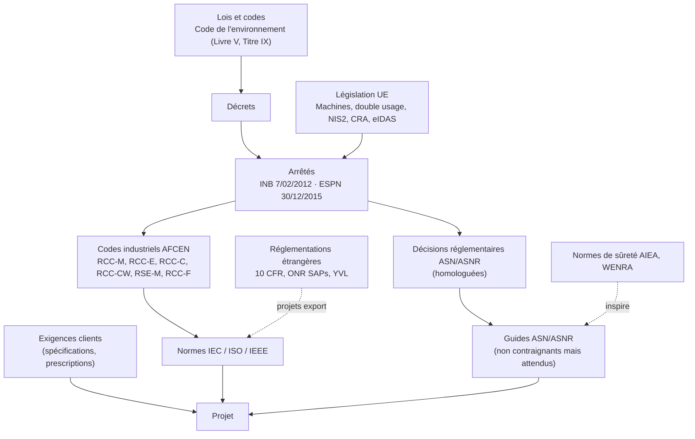

# Partie 1.4 — Référentiels normatifs et réglementaires : impacts sur le modèle de données et les workflows

> Confiance : **[C]** confirmé (extrait de source officielle ou ≥ 2 sources) · **[P]** probable · **[P\*]** connaissance non revérifiée lors de la campagne OSINT d'octobre 2026, à revérifier en priorité (Partie 2, lot R-REG).
> Les textes protégés par le droit d'auteur (AFCEN, IEC, ISO, ASME) ne sont **jamais** intégralement chargés dans Polarion sans licence. Le projet `LIB-REG` stocke la référence, la clause et une paraphrase (`copyrightRestricted = true`).

## 1. Hiérarchie des référentiels

## 2. Socle réglementaire français

### 2.1 Code de l'environnement [C]

| Article | Objet | Impact Polarion |
|---|---|---|
| L.593-1 | Intérêts protégés : sécurité, santé et salubrité publiques, protection de la nature et de l'environnement | Énumération `protectedInterest` |
| L.593-7 | Démonstration de sûreté de l'installation (support des définitions d'EIP et d'AIP) | `safetyClaim`, `safetyCase` |
| L.593-14 | Modification **substantielle** : nouvelle autorisation | `regulatoryModificationClass = substantial` |
| L.593-15 | Modification **notable** : déclaration ou autorisation de l'ASNR | `notableDeclaration` / `notableAuthorization` |
| L.593-18 / L.593-19 | Réexamen périodique tous les 10 ans ; rapport de conclusions (enquête publique au-delà de 35 ans de fonctionnement d'un réacteur) | Gabarit `TPL-IB-PSR`, `regulatoryCommitment` |
| R.593-55 à R.593-58 | Modifications soumises à autorisation | Dossier `modificationFile` |
| R.593-59 et R.593-60 | Modifications soumises à déclaration | idem |

### 2.2 Arrêté du 7 février 2012 fixant les règles générales relatives aux INB (« arrêté INB ») [C]

Modifié notamment en 2013, 2015 (arrêté ESPN, article 14) et 2018. Aucune modification 2024-2025 trouvée [P]. C'est **le texte le plus structurant pour le modèle de données**.

| Article | Exigence (paraphrase) | Traduction dans le modèle Polarion |
|---|---|---|
| 1.3 | Définitions : **écart** (non-respect d'une exigence définie ou d'une exigence du SMI), **exigence définie**, **EIP**, **AIP**, intervenant extérieur | Champs `eip`, `definedRequirement`, `aip` ; type `nonConformance` |
| 2.2.1 à 2.2.4 | Surveillance des intervenants extérieurs : proportionnée aux enjeux, documentée, réalisée par des personnes compétentes | `actionType = surveillance` ; rôles externes cloisonnés ; preuves |
| 2.3.1 / 2.3.3 | Politique de protection des intérêts et son évaluation | Gouvernance (document 17) |
| 2.4.1 / 2.4.2 | Système de management intégré : les exigences de protection sont systématiquement prises en compte dans toute décision ; organisation et ressources adaptées | Processus IS outillé ; revue de la configuration ALM |
| **2.5.1** | Identification des **EIP** et de leurs **exigences définies**, liste tenue à jour ; qualification des EIP proportionnée | `eip`, `definedRequirement` (jamais « À déterminer » à l'approbation, socle NN-01), document `classificationList`, `qualificationStatus` |
| **2.5.2** | Identification des **AIP** et de leurs exigences définies ; réalisation permettant de satisfaire *a priori* les exigences | `aip` sur `analysis`, `deliverable`, LiveDocs |
| **2.5.3** | **Contrôle technique** de chaque AIP, réalisé par une **personne différente** de celle qui a accompli l'activité | Condition `approverNotAuthor` sur toutes les transitions d'approbation, signature `verified` (socle NN-02) |
| **2.5.4** | Vérifications par sondage et évaluation périodique, par des personnes différentes de celles qui ont réalisé **ou contrôlé** l'activité | Rôle `qualityEngineer` ; audits ; rapport d'échantillonnage (document 13) |
| 2.5.5 | Compétences et qualification des personnes réalisant les AIP, les contrôles et les vérifications | Rôles alimentés par l'annuaire selon les habilitations (document 17) |
| **2.5.6** | AIP, contrôles techniques, vérifications et évaluations **documentés et tracés**, pour démontrer *a priori* et vérifier *a posteriori* ; enregistrements à jour, accessibles, lisibles, protégés, archivés pendant une durée justifiée | Historique SVN immuable, signatures, baselines, interdiction de suppression (PR-01), export PDF signé en GED (NN-07), politique de conservation |
| **2.6.1** | Détection des écarts, y compris chez les intervenants extérieurs | `nonConformance` ouverte par tout contributeur, y compris les fournisseurs |
| **2.6.2** | Examen sans délai : importance pour la protection, qualification éventuelle en événement significatif, mesures conservatoires | Transition `characterise` : `affectsEip`, `significantEventType`, `containmentAction`, échéance |
| **2.6.3** | Traitement dans des délais adaptés aux enjeux : causes, actions curatives, préventives, correctives, efficacité | `rootCauseCategory`, actions enfants, transition `verify` (efficacité) |
| 2.6.4 / 2.6.5 | Déclaration des événements significatifs et rapport d'analyse (rôle de l'exploitant) | `significantEventType` (information de l'exploitant) |
| 2.7.1 | Revue périodique des écarts non soldés (effet cumulé, récurrence) [P] | Tableau de bord des écarts (âge, cumul par EIP, récurrence) |

### 2.3 Décisions et guides ASN / ASNR

| Référence | Objet | Conf. | Impact |
|---|---|---|---|
| Loi n° 2024-450 du 21/05/2024 | Création de l'**ASNR** (fusion ASN + IRSN) au 1er janvier 2025 | C | Énumération `authority = asnr` |
| Décision 2015-DC-0532 (dite « décision RDS »), modifiée par la décision 2026-DC-041 | Rapport de sûreté des INB (phase de construction précisée en 2026) | C | Gabarit `safetyCase` |
| Décision 2017-DC-0616, modifiée par la décision 2023-DC-0770 | Modifications notables des INB | C | `regulatoryModificationClass`, `modificationFile` |
| Décision 2021-DC-0706 | 4e réexamen des 900 MWe (phase générique) | C | `regulatoryCommitment` (prescriptions) |
| Décision ASNR 2025-DC-016 | 4e réexamen des 1300 MWe (phase générique) | C | idem |
| Décision 2020-DC-0688 | Agrément des organismes ESPN (ISO/CEI 17020) | C | `witnessParty = notifiedBody` |
| Guide ASN n° 21 (2015) | Traitement des écarts de conformité à une exigence définie d'un EIP ; clôture après évaluation de l'efficacité | C | Workflow `wfNonConformance` (états `verified` → `closed`) |
| Guide ASN n° 22 (2017) | Conception des REP ; base du classement EPR2 | C | `safetyClassScheme = epr2` |
| Guide n° 8 / n° 8 bis (mars 2026) | Conformité des ESPN / ESPN N1 des REP | C | `espnLevel`, dossier ESPN |
| Guide n° 30 | Politique de protection des intérêts et SMI | P | Gouvernance |
| Dispositif CFSI (courrier de 2018, portail de signalement, plan d'action poursuivi en 2026) | Contrefaçons, falsifications, suspicions de fraude | C | `cfsiSuspected` (obligatoire sur les FNC), `rootCauseCategory = cfsi` |

> Le **format de numérotation** des décisions a changé (« 2021-DC-0706 » puis « 2025-DC-016 »). Le champ `authorityReference` est donc une chaîne libre (aucun contrôle de format).

### 2.4 Équipements sous pression nucléaires : arrêté du 30 décembre 2015 modifié (2018) [C]

| Point | Contenu | Modèle |
|---|---|---|
| Article 3 | Niveaux **N1, N2, N3** par sensibilité décroissante ; catégories **0 à IV** | `espnLevel`, `espnCategory` |
| N1 | Défaillance pouvant conduire à des situations accidentelles non couvertes par le rapport de sûreté ; inclut les circuits primaire et secondaire principaux [P] | `espnLevel = n1` → points d'arrêt, accord autorité pour les FNC |
| N2 | Non N1, défaillance pouvant conduire à un rejet supérieur à 370 GBq | `n2` |
| Évaluation de conformité | N1 : ASNR ou ses mandataires ; N2 et la plupart des N3 : organismes agréés | `witnessParties`, `authorityNotificationRequired` |
| Annexe I | Exigences essentielles de sécurité | `regulatoryRequirement` (LIB-REG) + matrice de conformité |

## 3. Codes industriels AFCEN : éditions en vigueur [C sauf mention]

| Code | Dernière édition | Remarques pour l'ALM |
|---|---|---|
| RCC-M | **2024** (RCC-M 2018 + fiches 2020/2022/2024 comme référentiel ESPN ; addendum EPR2 2025) | Exigences de conception (partie B), matériaux (M), soudage (S), fabrication (F), contrôles (MC) → `equipmentRequirement.designCode`, `verificationCase` (manufacturing) |
| RCC-MRx | **2025** | Réacteurs de recherche et de fusion (CERCA, R&D) |
| RCC-E | **2025**, **au format « Requirement Engineering »** (guide PTAN-05002-2025, analyse d'écarts PTAN-05003-2025) | **Opportunité majeure** : exigences structurées et identifiées, importables comme `regulatoryRequirement` si la licence le permet (ADR-14) |
| RCC-CW (et ETC-C pour l'EPR) | **2025** | Génie civil |
| RCC-C | 2022 confirmé ; 2025 probable [P] | Combustible (`designCriterion`) |
| RSE-M | **2024** | Surveillance en service, critères de nocivité (fortuits, réexamen) |
| RCC-F (et ETC-F pour l'EPR) | **2024** | Incendie (`hazardType = intFire`) |

## 4. Normes IEC de C-C nucléaire (SC 45A) [C sauf mention]

| Norme | Édition | Objet | Impact modèle |
|---|---|---|---|
| IEC 61513 | **Ed. 3.0, 2026** | Exigences générales des systèmes de C-C (alignée sur SSR-2/1 et SSG-39) | Gabarit `TPL-IC-PROJECT` (étapes du cycle) |
| IEC 61226 | Ed. 4.0, 2020 | Catégorisation des fonctions A/B/C, classes de systèmes 1/2/3 | `functionCategory = iecCatA/B/C`, `icSystemClass` |
| IEC 60880 | Ed. 2.0, 2006 (éd. 3 en cours) | Logiciel de catégorie A | `softwareRequirement`, V&V indépendante |
| IEC 62138 | Ed. 2.0, 2018 | Logiciel de catégories B / C | idem, indépendance graduée |
| IEC 60987 | Ed. 3.0, 2021 [P] | Matériel | `hardwareRequirement` |
| IEC 62566 / 62566-2 | 2012 [P] / 2020 | Circuits HDL (catégorie A / B-C) | `hardwareRequirement`, `componentNature = hdlDevice` |
| IEC 62340 | 2007 | Défaillances de cause commune | `analysisType = ccfDiversity` |
| IEC 60709 | 2018 | Séparation | `reqCategory = designConstraint` |
| IEC 62645 / 63096 / 62859 | 2019 / 2020 / 2016+A1:2019 | Cybersécurité ; mesures ; coordination sûreté-sécurité | `securityDegree`, `analysisType = cyberRisk` |
| IEC 60964 / 61772 / 62241 | 2018 / 2009 [P] / 2004 [P\*] | Salle de commande, écrans, alarmes | `reqCategory = humanFactors` |
| IEC/IEEE 60780-323 / 60980-344 | 2016 / 2020 | Qualification (ambiances, séisme) | `verificationCase.qualificationStandard` |
| IEC 62003 / 61500 / 62671 | 2020 / 2018 / 2013 | CEM ; communications de catégorie A ; appareils numériques à fonctionnalité limitée | idem |

## 5. Normes de sûreté de l'AIEA [C sauf mention]

| Référence | Objet | Usage dans le modèle |
|---|---|---|
| SSR-2/1 Rev.1 (2016, révision DS562 en cours) | Conception des centrales | Fonctions fondamentales de sûreté (`fundamentalSafetyFunction`), défense en profondeur |
| SSR-2/2 Rev.1 [P\*] | Mise en service et exploitation | Essais, modifications |
| GSR Part 2 (2016) | Leadership et management pour la sûreté ; **approche graduée** | Tailoring (document 07) |
| GSR Part 4 Rev.1 [P\*] | Évaluation de sûreté | `analysis` |
| SSG-30 (2014) | Classement de sûreté des SSC | `safetyClassScheme = iaeaSsg30` |
| SSG-39 [P\*] / SSG-51 (2019) / SSG-52 / SSG-56 (2020) | C-C ; facteurs humains ; cœur ; circuit primaire | Catégories d'exigences |
| SSG-71 (2022) | Modifications des centrales | `changeRequest` |
| SSG-25 (2013) | Réexamen périodique de sûreté | `TPL-IB-PSR` |
| SSG-48 (2018) | Vieillissement et exploitation à long terme | `ageingMechanism`, `analysisType = ageingLto` |
| SSG-61 (2021) | Format et contenu du rapport de sûreté | Plan type `safetyCase` |
| NSS 17-T Rev.1 (2021) | Techniques de sécurité informatique | `cybersecurity` |
| TECDOC-1335 (2003), TECDOC-1651 (2010) | Gestion de configuration des centrales | Document 09 |
| GS-G-3.5 (2009 ; DS513 en cours) | Système de management | Gouvernance |
| NHSI (2022 →) | Harmonisation des SMR | NUWARD (bibliothèque multi-juridictions) |

## 6. Ingénierie système, qualité et gestion de configuration [P\* — lot de revérification R-REG-SE]

| Référence | Édition présumée | Impact |
|---|---|---|
| ISO/IEC/IEEE 15288 | 2023 | Processus du cycle de vie (document 07) |
| ISO/IEC/IEEE 29148 | 2018 | Qualité des exigences, méthodes IADT (`verificationMethod`) |
| ISO/IEC/IEEE 42010 | 2022 | Description d'architecture (points de vue RFLP) |
| ISO/IEC/IEEE 15289 | 2019 | Contenu des éléments d'information (gabarits) |
| ISO 10007 | 2017 | Gestion de configuration (`changeClass`, baselines) |
| SAE EIA-649C | 2019 | Gestion de configuration (classes I / II) |
| **ISO 19443** | 2018 | ISO 9001 appliquée à la chaîne nucléaire : **ITNS**, **CFSI** | `itns`, `cfsiSuspected` |
| ISO 9001 | 2015 + Amd 1:2024 (révision 2026 en cours) | SMQ |
| ASME NQA-1 / 10 CFR 50 App. B | 2022 ou plus récent | Projets US : `qaProgramLevel = nqa1AppB` |
| 10 CFR Part 21 | — | `part21Evaluation` |
| 10 CFR 50.59 | — | Modifications US (équivalent de `regulatoryModificationClass`) |
| 10 CFR Part 810 / Part 110 | — | `exportControl = us810 / us110` |
| INCOSE SE Handbook éd. 5 (2023) ; Guide to Writing Requirements v4 | — | Règles de rédaction, contrôles qualité des exigences (document 13) |
| SysML v2 (OMG, adopté en 2025) | — | Interopérabilité MBSE (document 14) |

## 7. Législation européenne et cadre transverse [P\*]

| Texte | Échéance clé | Impact |
|---|---|---|
| Règlement Machines (UE) 2023/1230 | Application au **20 janvier 2027** (abroge la directive 2006/42/CE) | Outillages : `toolingSpec`, `hazardType = machinery`, analyse EN ISO 12100 |
| Règlement double usage (UE) 2021/821, annexe I catégorie 0 | Mise à jour annuelle | `exportControl = euDualUse` |
| Directive NIS2 (UE) 2022/2555 | Transposition française à vérifier (projet de loi « résilience » 2025) | Sécurité de la plateforme ALM (document 15) |
| Cyber Resilience Act (UE) 2024/2847 | Signalement au 11/09/2026 ; application complète au 11/12/2027 | Produits numériques livrés (C-C, outillages logiciels) : exigences de cybersécurité produit |
| eIDAS (UE) 910/2014 et eIDAS 2 (2024/1183) | En vigueur | Valeur probante des signatures électroniques (ADR-11) |
| RGPD | En vigueur | Minimisation des données personnelles dans l'ALM (identité des signataires uniquement) |

## 8. Réglementations étrangères (projets export) [P\*]

| Pays | Références | Impact modèle |
|---|---|---|
| Royaume-Uni | ONR SAPs (éd. 2014, rév. 1 de 2020) ; TAG NS-TAST-GD-051 (*safety case* : revendication, argument, preuve) ; TAG NS-TAST-GD-094 (catégorisation) | `safetyClaim` (CAE), `safetyClassScheme = eprUk` |
| États-Unis | 10 CFR 50 App. B, Part 21, 50.59, Part 810 ; NQA-1 ; Regulatory Guides C-C | Instance US, `qaProgramLevel`, `part21Evaluation` |
| Finlande | Guides YVL (STUK) | `authority = stuk`, LIB-REG |
| International | WENRA : objectifs de sûreté des nouveaux réacteurs (2010) ; niveaux de référence (2020) | LIB-REG |

## 9. Matrice de synthèse : exigence réglementaire → impact Polarion

| # | Exigence source | Mécanisme Polarion | Élément du modèle | Contrôle |
|---|---|---|---|---|
| R1 | EIP identifiés, liste à jour (2.5.1) | Champ obligatoire + rapport | `eip`, `classificationList` | TR-07, tableau de bord EIP |
| R2 | Exigences définies (2.5.1) | Champ obligatoire, socle NN-01 | `definedRequirement` | TR-03 |
| R3 | Contrôle technique par une personne différente (2.5.3) | Condition de workflow + signature | `approverNotAuthor`, signature `verified` | Bloquant |
| R4 | Vérification par d'autres que les auteurs ou contrôleurs (2.5.4) | Rôle qualité, échantillonnage | `qualityEngineer` | Rapport d'échantillonnage |
| R5 | Documentation, traçabilité, archivage (2.5.6) | Historique, baselines, GED | PR-01, `createBaseline`, `exportToEdms` | Audit |
| R6 | Détection et examen des écarts (2.6.1-2.6.2) | Workflow FNC, SLA | `nonConformance` | Âge des FNC |
| R7 | Traitement et efficacité (2.6.3) | Actions enfants, vérification | `action`, état `verified` | Bloquant (clôture) |
| R8 | Revue périodique des écarts (2.7.1) | Tableau de bord | Requêtes FNC | Revue trimestrielle |
| R9 | Surveillance des intervenants extérieurs (2.2.x) | Actions de surveillance, droits fournisseurs | `actionType = surveillance` | Rapport |
| R10 | Modifications notables (L.593-15, 2017-DC-0616) | Champ de classement + dossier | `regulatoryModificationClass` | Requis en CCB |
| R11 | Réexamen périodique (L.593-18) | Gabarit + engagements | `TPL-IB-PSR`, `regulatoryCommitment` | TR-15 |
| R12 | ESPN : niveaux, conformité, EES | Champs + bibliothèque EES + points H/W | `espnLevel`, `inspectionPoint` | Matrice de conformité |
| R13 | Prescriptions / lettres de suite | Suivi d'engagements | `regulatoryCommitment` | Échéances |
| R14 | CFSI (ISO 19443, dispositif ASNR) | Champ obligatoire FNC | `cfsiSuspected` | Notification qualité |
| R15 | Catégorisation C-C (IEC 61226) | Champs | `functionCategory`, `icSystemClass` | TR-06 |
| R16 | Indépendance de la V&V logicielle catégorie A (IEC 60880) | Rôle et niveau d'indépendance | `independentVerifier`, `independenceLevel` | Rapport |
| R17 | Cybersécurité (IEC 62645) | Degrés, exigences | `securityDegree` | Couverture |
| R18 | Machines (2023/1230) | Analyse de risques, exigences | `hazard` (machinery) | Revue |
| R19 | Contrôle export | Champ obligatoire + ségrégation | `exportControl`, instances | PR-07 |
| R20 | Signatures électroniques (eIDAS, procédure qualité) | Ré-authentification, signification | Signatures | Validation de l'outil (document 15) |

## 10. Veille réglementaire outillée (processus LIB-REG)

1. Toute nouvelle édition d'un texte (ex. RCC-M 2024 → éditions suivantes ; IEC 61513 éd. 3) est créée dans `LIB-REG` comme nouveaux `regulatoryRequirement`. Ils sont reliés par `supersedes` aux anciens, qui passent à l'état `superseded`.
2. Le document de bibliothèque est publié (`wfDocumentLibrary.publish`). Les projets qui l'ont branché voient leurs liens `branched_from` devenir suspects.
3. Le `requirementsManager` de chaque projet analyse l'impact : applicabilité contractuelle de la nouvelle édition, dispositions transitoires (`transitionalProvisions`). Il fusionne (3-way), ou décide le maintien de l'édition contractuelle avec justification (`designDecision`).
4. Indicateurs :
   - projets sur une édition périmée ;
   - suspects ouverts depuis plus de N jours sur les liens vers LIB-REG.
