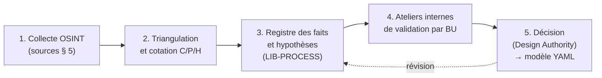

# Partie 2.1 — Plan de recherche et matrice d'acquisition de connaissances

## 1. Objectif

Collecter, vérifier et consolider les **règles métier exactes** nécessaires au paramétrage, **avant toute implémentation** :
- classements ;
- cycles de vie ;
- livrables ;
- visas ;
- interfaces ;
- obligations réglementaires ;
- outillage existant.

La démarche combine deux sources :
1. **OSINT** (sources ouvertes), pour construire des hypothèses argumentées ;
2. **Ateliers internes de validation**, conduits par l'équipe projet chez Framatome, sans transfert de données internes vers des outils externes, pour confirmer, corriger ou rejeter chaque hypothèse.

## 2. Principes et garde-fous

| # | Principe |
|---|---|
| G1 | **Sources ouvertes uniquement.** Aucune ingénierie sociale, aucun contournement de contrôle d'accès, aucune collecte de données personnelles au-delà de la fonction publique d'une personne (RGPD). Pas de profilage nominatif des salariés. |
| G2 | **Droit d'auteur.** Les normes (AFCEN, IEC, ISO, ASME) sont acquises sous licence. L'OSINT ne sert qu'à identifier leurs références, éditions et sommaires publics. |
| G3 | **Contrôle export et sensibilité.** Aucune recherche ne vise des informations de sécurité nucléaire (protection physique) ou classifiées. Une information de ce type rencontrée fortuitement n'est ni copiée ni stockée. |
| G4 | **Traçabilité.** Chaque fait est enregistré avec sa source (URL, date de consultation), son extrait et son niveau de confiance. |
| G5 | **Triangulation.** Un fait est « Confirmé » s'il provient d'une source officielle ou d'au moins deux sources indépendantes concordantes. |
| G6 | **Date de validité.** Les organisations, éditions de normes et statuts de projets évoluent. Chaque fait porte une date de collecte et une date de revue. |
| G7 | **Hypothèse ≠ décision.** Une hypothèse OSINT n'est jamais paramétrée en production sans validation interne tracée. |

## 3. Échelle de confiance

| Code | Signification | Règle d'usage dans le modèle |
|---|---|---|
| **C** | Confirmé : source officielle, ou ≥ 2 sources concordantes | Paramétrable après revue du référent métier |
| **P** | Probable : une source crédible, ou sources divergentes | Paramétrable en pilote seulement ; validation interne requise |
| **P\*** | Connaissance antérieure non revérifiée lors de la dernière campagne | À revérifier en priorité (lot R-REG) |
| **H** | Hypothèse de modélisation (aucune source) | Atelier interne obligatoire |
| **NT** | Non trouvé | Question ouverte en atelier |

## 4. Méthode en cinq étapes

- **Registre.** Chaque hypothèse est un Work Item `assumption` (`assumptionType = « hypothèse OSINT »`) dans le projet `LIB-PROCESS`. Le modèle s'applique ainsi à lui-même (*dogfooding*).
  - Une hypothèse confirmée passe à l'état `confirmed`, avec une preuve qui est le compte rendu d'atelier.
  - Une hypothèse infirmée passe à l'état `invalidated` et déclenche la mise à jour du YAML via une demande de modification du modèle.
- **Ateliers.** Durée de 2 à 3 h, 6 à 10 participants : référents métier, sûreté, qualité, gestion de configuration, utilisateurs clés.
  - Entrée : fiche d'hypothèses par thème, issue de ce dépôt.
  - Sortie : verdict par hypothèse, règles complémentaires, valeurs d'énumérations réelles (BL, UO, codes documentaires, visas).

## 5. Catalogue de sources ouvertes

| Catégorie | Sources | Intérêt principal | BU concernées |
|---|---|---|---|
| Réglementaire France | Légifrance (Code de l'environnement, arrêtés INB et ESPN) ; site ASNR : décisions, guides, **lettres de suite d'inspection** (dont inspections des fabricants ESPN et de l'ingénierie Framatome), avis d'expertise (ex-IRSN), positions | Règles exactes ; constats d'inspection qui révèlent les pratiques attendues (documentation ESPN, visas, surveillance) | Toutes |
| Codes industriels | AFCEN : catalogues, sommaires, fiches de modification, rapports annuels, guides PTAN | Éditions, structure des codes, format RE du RCC-E 2025 | PCM, DTI, FUEL, ICS |
| Normes | Catalogues IEC, ISO, AFNOR, DIN ; aperçus gratuits (sommaires, domaine d'application) | Éditions, domaines d'application | ICS, toutes |
| International | AIEA (normes de sûreté, TECDOC, NHSI, base ARIS pour les SMR), WENRA, NEA/MDEP (groupe de travail EPR) | Principes, classement, gestion de configuration | DTI, toutes |
| Autorités étrangères | NRC ADAMS (dossier de certification de l'US EPR retiré, avec FSAR public : chapitres 3 classement, 7 C-C, 14 essais ; rapports topiques TXS et combustible), ONR (évaluation générique UK EPR, catégorisation HPC), STUK (OL3), SÚJB | Description détaillée et publique d'une conception EPR et de méthodes Framatome | DTI, ICS, FUEL, PCM |
| Entreprise | framatome.com (gouvernance, implantations, offres), communiqués et résultats annuels, document d'enregistrement universel EDF (segment Framatome), résultats semestriels EDF | Organisation, périmètres, projets | Toutes |
| Écosystème EDF | Communiqués EDF / Edvance, programme SWITCH, dossiers de concertation publique EPR2 (CNDP), dossiers d'enquête publique | Cycle de vie des nouveaux réacteurs, outillage du client | PCM, DTI |
| Contrôle public | Cour des comptes (rapports sur l'EPR et la filière), rapports parlementaires (OPECST, commissions d'enquête) | Constats sur la gestion de projet, la qualité, la configuration | PCM, DTI |
| Communauté technique | SFEN (RGN), conférences ICONE, ICAPP, NPIC&HMIT, INCOSE IS, Capella Days ; brevets (Espacenet) | Méthodes d'ingénierie, MBSE, outils | DTI, ICS |
| Offres d'emploi | Sites carrières Framatome, EDF Recrute, agrégateurs | **Outillage réel** (3DEXPERIENCE Core Model, Capella), organisation (BL, piliers), localisations | Toutes |
| Outil Polarion | Documentation Siemens (aide en ligne, notes de version 2304→2606, réponse de conformité ERES), communauté, dépôts open source (extensions SBB, gabarit et capella2polarion de DB InfraGO, docker communautaire), documentation Nextedy | Formats de configuration, capacités et limites | Projet ALM |
| Presse spécialisée | WNN, NEI, NucNet, Usine Nouvelle, Connaissance des énergies, Reuters | Actualité des projets et de l'organisation | Toutes |

## 6. Matrice d'acquisition de connaissances (questions → sources → validation)

Priorité : **P1** = bloquant pour la configuration du pilote ; **P2** = requis avant l'industrialisation ; **P3** = amélioration.

### 6.1 Organisation et périmètres (ORG)

| ID | Question | Sources OSINT | Statut OSINT | Validation interne | Prio. | Élément du modèle |
|---|---|---|---|---|---|---|
| Q-ORG-01 | Liste exacte des BU, BL et UO, et leur rattachement | framatome.com, communiqués 2025-2026, ≈ 80 offres d'emploi (campagne du 15/10/2026, annexe C § 1) | BU [C] ; BL [C] pour IBE, IBM-F, IBC, IBS-F, IBT, FCEE, DOC, DTIM ; UO = sites [C], découpage interne NT | Direction de l'organisation | P1 | `businessUnit`, `businessLine`, `operationalUnit` |
| Q-ORG-02 | Frontière de responsabilité Framatome / Edvance sur l'îlot nucléaire EPR2 en 2026 | Communiqués Framatome, EDF, Edvance, presse | Contradictoire [P] | Direction PCM / juridique | P1 | ADR-12, topologie PCM |
| Q-ORG-03 | Entités juridiques et périmètres de données (FR, DE, US, UK, CA, IN) | Pages implantations | [C] partiel | Juridique / contrôle export | P1 | ADR-03, `region` |
| Q-ORG-04 | Activités sensibles nécessitant cloisonnement (défense, VVER, sécurité) | Communiqués, presse | [C] existence | Sécurité / RSSI | P1 | Instance SENS, `informationClassification` |
| Q-ORG-05 | Rattachement de Montbard (tubes GV) : DOC / BU Fuel ou BU PCM ? Sources contradictoires | Offres d'emploi, page composants | Contradictoire [P] | Direction PCM / Fuel | P2 | `businessLine`, `operationalUnit` |
| Q-ORG-06 | Liste officielle des codes IB-F (IBE, IBM-F, IBC / IBCO-F, IBS-F, IBSE-F, IBSED-F, IBT, IBTM-F…) et signification des lettres ; existence d'entités IBM internationales ; rapport exact entre « Business Line Maintenance », « Unité Support Technique (IBS-F) » et le CEDEM (libellés divergents 2023-2026 : réorganisation ?) | Offres d'emploi (annexe C § 1) | [C] partiel | Direction IB | P1 | `businessLine`, `operationalUnit` |
| Q-ORG-07 | IBC : Business Line de la BU IB ou entité partagée avec PCM (EPR2 en EPCC) ? Que recouvre le « O » d'IBCO-F ? | Offres, page EPR2 | [P] | Directions IB / PCM | P1 | `projectTypeDefaults`, topologie |
| Q-ORG-08 | Lignes de reporting : IBE ↔ Edvance (mise à disposition), IBE ↔ DTI (qui est Design Authority sur la base installée ?), DTI ↔ E&DA (R&D, centre technique) ; NUWARD porté par PCM ou par la DTI ? | Offres, LinkedIn, gouvernance | [P] | Comex / organisation | P1 | ADR-24, pilote NUWARD (`businessUnit`) |
| Q-ORG-09 | BU Fuel en France : organisation (conception, physique du cœur, contrats, Romans, DOC, CERCA, services sur site) et codes « FL-… » ; « Fuel Products » n'existe pas publiquement | Offres | [P] / NT | Direction Fuel | P2 | `businessLine` |
| Q-ORG-10 | BU I&C : structure interne (plateformes, projets, produits, services, cyber) ; signification des codes IC_SPIC, ICT, ICTNMU, ICE-U ; rattachement de Corys | Offres, résultats 2025 | [P] / NT | Direction I&C | P2 | `businessLine` |
| Q-ORG-11 | Définition interne du niveau « UO » (≈ 40 unités annoncées) : lesquelles sont des UO au sens du modèle (les BL américaines ? les divisions de Framatome GmbH ?) ; référentiel organisationnel à synchroniser dans l'annuaire | — | NT | Direction de l'organisation / DSI | P1 | `operationalUnit`, connecteur CX-DIRECTORY |
| Q-ORG-12 | Statut juridique des entités Defense (division ?), Healthcare, Space, CERCA, Cezus, FDJV, Framatome Belgium / EOOD ; effectifs publics incohérents (IB 4 000 / 4 600 ; I&C 2 400 à 2 800 ; Framatome Inc. 2 260 à 2 700 ; Romans 1 045 à 1 300) | Communiqués, pages implantations | [P] / NT | Juridique, RH | P3 | `businessUnit`, dimensionnement des licences |
| Q-ORG-13 | Rôle de Framatome à Taishan, Flamanville 3 et dans la nouvelle conception NUWARD | Communiqués, presse | NT | Directions de projets | P3 | Topologie PL |

### 6.2 Base installée (IB)

| ID | Question | Sources OSINT | Statut | Validation interne | Prio. | Élément du modèle |
|---|---|---|---|---|---|---|
| Q-IB-01 | Cycle de vie et livrables d'une étude de modification (phases, jalons, documents) | Dossiers ASNR, décision 2017-DC-0616, guides | [P] | Ingénierie BI | P1 | `TPL-IB-MOD`, `modificationFile` |
| Q-IB-02 | Processus fortuit : délais, circuit de décision client, contenu de la note de justification | Lettres de suite ASNR, RSE-M (sommaire) | [H] | BI, sûreté | P1 | `wfTechnicalIssue`, SLA, `justificationNote` |
| Q-IB-03 | Codes de visa client (VSO, VSO-SR, VAO, VAOB, REF) et circuit documentaire | Lettres de suite ASN (VSO, VSO-SR attestés) | [C] partiel | Gestion documentaire | P1 | `customerVisa` |
| Q-IB-04 | Structure d'un projet RGV (lots, interfaces site, requalification) | Avis ASNR RGV, presse | [P] | Projets RGV | P2 | `TPL-IB-PROJECT` |
| Q-IB-05 | Contenu des réexamens (conformité, réévaluation, vieillissement) et rôle de Framatome | Décisions 2021-DC-0706 et 2025-DC-016, avis | [C] cadre / [H] rôle | BI, DTI | P2 | `TPL-IB-PSR` |
| Q-IB-06 | Qualification des procédés CND et des outillages (référentiel, dossier) | Intercontrôle, RSE-M | [P] | Intercontrôle | P2 | `inspectionService`, `verificationCase` |
| Q-IB-07 | Exigences machines (règlement 2023/1230) appliquées aux outillages nucléaires | EUR-Lex, guides | [P\*] | Outillage, juridique | P2 | `toolingSpec`, `hazard` |

### 6.3 Combustible (FUEL)

| ID | Question | Sources OSINT | Statut | Validation interne | Prio. | Élément du modèle |
|---|---|---|---|---|---|---|
| Q-FUEL-01 | Structure d'un dossier de recharge et liste des paramètres de sûreté de recharge | Rapports topiques NRC (méthodes), publications | [P] | Études de cœur | P1 | `reloadSafetyReport`, `designParameter` |
| Q-FUEL-02 | Critères de conception combustible (édition RCC-C en vigueur) | AFCEN | [P] | Conception combustible | P2 | `designCriterion` |
| Q-FUEL-03 | Programme de qualification ATF (étapes, preuves, autorités) | WNN, NRC | [C] | ATF | P2 | `TPL-FUEL-DESIGN` |
| Q-FUEL-04 | Codes de calcul et statut de qualification | Publications, NRC | [P] | Méthodes | P2 | `codeQualification` |

### 6.4 Contrôle-commande (ICS)

| ID | Question | Sources OSINT | Statut | Validation interne | Prio. | Élément du modèle |
|---|---|---|---|---|---|---|
| Q-ICS-01 | Cycle de développement d'un projet TXS (étapes, documents, revues, FAT/SAT) | NRC (rapports topiques TXS, SPACE, SIVAT) | [C] partiel | BU ICS | P1 | `TPL-IC-PROJECT` |
| Q-ICS-02 | Modalités de V&V indépendante (organisation, livrables) | IEC 60880 (sommaire), NRC | [P] | Qualité ICS | P1 | `independentVerifier` |
| Q-ICS-03 | Gestion des anomalies génériques de plateforme et propagation aux projets | Publications | [H] | Plateformes | P2 | `genericImpact`, `impacts` inter-projets |
| Q-ICS-04 | Exigences de cybersécurité produit (IEC 62645, CRA) | IEC, EUR-Lex | [C] / [P\*] | BL Cybersécurité | P2 | `securityDegree` |
| Q-ICS-05 | Échanges avec SPACE / SIVAT (identifiants, exports) | NRC | [C] existence | Outillage ICS | P2 | `modelElementId`, document 14 |

### 6.5 Projets et composants (PCM)

| ID | Question | Sources OSINT | Statut | Validation interne | Prio. | Élément du modèle |
|---|---|---|---|---|---|---|
| Q-PCM-01 | Flux d'exigences entre l'architecte-ensemblier et Framatome (format, fréquence, outil) | Programme SWITCH, communiqués | [P] | Projets EPR2 | P1 | ADR-12, ReqIF |
| Q-PCM-02 | Contenu des dossiers ESPN N1 et rôle des points d'arrêt | Guide 8 bis, lettres de suite | [C] | Qualité PCM | P1 | `equipmentSpec`, `inspectionPoint` |
| Q-PCM-03 | Frontière Polarion / 3DEXPERIENCE Core Model / MES (preuves de fabrication) | Offres d'emploi, blog 3DS | [C] existence | DSI, PLM | P1 | ADR-07 |
| Q-PCM-04 | Schéma de classement EPR2 détaillé (catégories, classes, exigences associées) | Avis ASNR 2025-00047, IRSN 2022-00195 | [C] | DTI sûreté | P1 | `safetyClassScheme = epr2` |
| Q-PCM-05 | Processus FNC / dérogations avec client et autorité | Lettres de suite, guide 21 | [C] cadre | Qualité | P1 | `wfNonConformance`, `wfWaiver` |

### 6.6 DTI et transverse (DTI, REG, TOOL, ARCH)

| ID | Question | Sources OSINT | Statut | Validation interne | Prio. | Élément du modèle |
|---|---|---|---|---|---|---|
| Q-DTI-01 | Usage de Capella : périmètre, points de vue, liens avec le PLM | Étude de cas Capella, INCOSE IS2018 | [C] | DTI MBSE | P1 | ADR-08 |
| Q-DTI-02 | Méthode d'établissement de la liste des EIP et exigences définies | Guide 22, avis | [P] | Sûreté | P1 | `classificationList` |
| Q-REG-01 | Textes exacts des articles 2.2.3 et 2.4.3 de l'arrêté INB ; définitions EIP / AIP | Légifrance (lecture directe) | Partiel | Juridique / sûreté | P1 | Document 04 |
| Q-REG-02 | Lot R-REG : revérifier toutes les références [P\*] (ISO/IEC/IEEE, NQA-1, SysML v2, NIS2, CRA, eIDAS, ONR, WENRA) | Sites des éditeurs | P\* | Normalisation interne | P2 | Document 04 |
| Q-REG-03 | Seuil de définition d'un ESPN (R.557-12-1) | Légifrance | NT | Juridique | P3 | `espnLevel` |
| Q-REG-04 | Durées de conservation des enregistrements par catégorie | Arrêté INB 2.5.6, procédures | [H] | Qualité, archives | P1 | Politique d'archivage |
| Q-TOOL-01 | Version Polarion cible (2606 ou suivante) et support de SAML / OIDC avec e-signatures | Notes de version Siemens, support | [C] versions / NT SAML | DSI, Siemens | P1 | ADR-21, document 15 |
| Q-TOOL-02 | Comportement exact du suspect (UI vs API / import) et faisabilité du filtrage par champ | Aide Polarion, extension « Advanced Suspect » | [P] | Intégrateur | P1 | ADR-20 |
| Q-TOOL-03 | Capacités de signature des licences REVIEWER sur la version cible | Matrice des fonctionnalités Siemens | [P] | Siemens | P1 | ADR-18 |
| Q-TOOL-04 | Limites de performance (éléments par projet ou document, projets par serveur) | Guide Enterprise Setup (Siemens) | NT | Siemens | P1 | Document 15 |
| Q-ARCH-01 | Inventaire de l'existant : outils d'exigences, tableurs, bases documentaires, GED, MES, ERP | Interne uniquement | NT | DSI | P1 | ADR-23 |
| Q-ARCH-02 | Politique d'usage de l'IA générative sur données d'ingénierie | Interne | NT | RSSI, juridique | P2 | ADR-17 |

## 7. Lot de revérification issu de la campagne d'octobre 2026

Limites rencontrées :
- accès direct à certains sites impossible (Légifrance, framatome.com, documentation Siemens) depuis l'environnement de recherche ;
- quota de recherches atteint.

Points à revérifier en priorité :
1. Références ISO/IEC/IEEE, NQA-1, INCOSE, SysML v2, règlement Machines, double usage, NIS2 (statut de la transposition française), CRA, eIDAS 2, ONR SAPs, WENRA (marquées [P\*]).
2. Arrêté INB : articles 2.2.3, 2.4.3 ; texte exact des définitions EIP / AIP.
3. Codes de visa VAOB et REF.
4. Activités des sites de Pierrelatte et Maubeuge ; gamme AFA 3G.
5. Statut de Cezus en France.
6. Rôle exact de Framatome à Taishan et dans NUWARD (nouveau design).
7. Polarion :
   - identifiants XML exacts des types `date-time`, `time`, `duration`, `boolean` ;
   - syntaxe XML des rôles requis sur une action de workflow ;
   - politiques de signature « au moins un » ;
   - SAML / OIDC.

## 8. Plan de charge indicatif

| Lot | Contenu | Effort indicatif | Durée |
|---|---|---|---|
| R-ORG | Organisation, périmètres, frontières contractuelles | 5 j | 2 semaines |
| R-REG | Revérification réglementaire et normative | 8 j | 3 semaines |
| R-BU (× 5) | Fiches d'hypothèses par BU + préparation des ateliers | 5 j par BU | 4 semaines (en parallèle) |
| Ateliers | 3 à 4 ateliers par BU + 4 ateliers transverses (sûreté, qualité, configuration, DSI) | 20 à 24 ateliers | 6 semaines |
| Consolidation | Mise à jour du YAML, ADR validés, version 1.0 du modèle | 10 j | 2 semaines |

## 9. Livrables du plan de recherche

1. Registre des faits et hypothèses (projet `LIB-PROCESS`, type `assumption`) avec statut de confirmation.
2. Fiches de validation d'atelier (une par atelier) en preuve de confirmation.
3. ADR validés (document 06) par la Design Authority.
4. Modèle YAML version 1.0 (ce dépôt, étiquette `v1.0`) et rapport de changements depuis la version OSINT 0.x.
