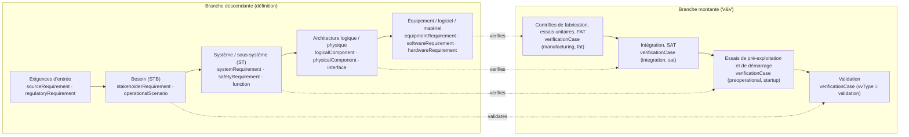
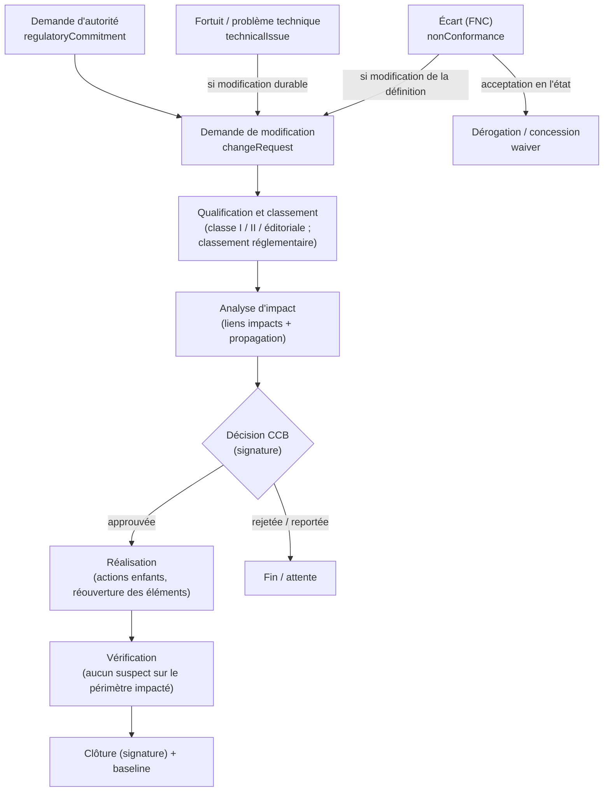

# Partie 3.1 — Méthodologie d'ingénierie système et tailoring

> *Version du plan : 0.5 (octobre 2026) · Dépendance à l'outil Polarion : **faible** · Historique : [CHANGELOG](../../CHANGELOG.md) · Carte du dépôt : [guide de lecture](../GUIDE_DE_LECTURE.md).*
>
> **En bref**
> - Ce document décrit comment l'ingénierie système (IS) de Framatome est pratiquée dans Polarion : processus de la norme ISO/IEC/IEEE 15288, cycle en V, exigences, architecture, vérification et validation (V&V), gestion de configuration, démonstration de sûreté.
> - Il définit le **tailoring** (adaptation graduée des moyens aux enjeux) : socle non négociable NN-01..NN-08, classes de projet A à D, profils effectifs par typologie.
> - Lecteurs : SE Referents (référents ingénierie système), chefs de projet, responsables techniques, Sûreté et Qualité ; support des ateliers d'onboarding (doc. 24).
> - À lire avant : doc. 02 (typologie des projets). Les détails outillés sont dans les doc. 08 (modèle de données), 09 (liens et traçabilité), 10 (workflows et signatures) et l'annexe A7 (profils de tailoring).
> - Les identifiants en `code` (types, attributs, états, rôles) sont ceux du modèle `model/*.yaml`.

## 1. Cadre de processus : ISO/IEC/IEEE 15288 décliné dans Polarion

ISO/IEC/IEEE 15288 est la norme internationale qui définit les processus du cycle de vie d'un système. Le tableau indique, pour chaque processus retenu, comment il est pratiqué et avec quels objets Polarion : *Work Items* (éléments de travail typés : exigence, fonction, cas de vérification…), *LiveDocs* (documents vivants composés de Work Items et de texte) et rôles pilotes (doc. 10 § 6).

| Processus 15288 | Déclinaison opérationnelle | Artefacts Polarion | LiveDocs | Rôles pilotes |
|---|---|---|---|---|
| Analyse de la mission / du besoin métier | Contexte, parties prenantes, concept d'emploi (description de la manière dont le système sera utilisé) | `operationalScenario`, `sourceRequirement` | `stakeholderSpec` | technicalLead |
| Définition des besoins et des exigences des parties prenantes | Reformulation selon les règles INCOSE (§ 3.2), validation | `stakeholderRequirement`, `assumption` | `stakeholderSpec`, `complianceMatrix` | requirementsManager |
| Définition des exigences système | Déclinaison, catégorisation, méthodes de vérification | `systemRequirement`, `safetyRequirement`, `designParameter` | `systemSpec` | requirementsManager, safetyEngineer |
| Définition de l'architecture | RFLP (Capella maître), allocations, interfaces, décisions | `function`, `logicalComponent`, `physicalComponent`, `interface`, `designDecision` | `systemDesignManual`, `interfaceControlDocument` | technicalLead, interfaceManager |
| Définition de la conception | Exigences équipement, logiciel, matériel ; spécifications d'approvisionnement | `equipmentRequirement`, `softwareRequirement`, `hardwareRequirement` | `equipmentSpec`, `softwareRequirementsSpec` | disciplineEngineer |
| Analyse système | Études, calculs, analyses de sûreté, AMDEC | `analysis`, `hazard`, `fmeaItem`, `safetyClaim` | `safetyCase`, `fmeaWorksheet` | disciplineEngineer, safetyEngineer |
| Réalisation, intégration | Fabrication, montage, intégration (hors Polarion : MES / 3DX) | `verificationCase` (manufacturing, integration) | `testProcedure` | vvLead |
| Vérification | Plan, cas, campagnes, résultats, anomalies | `verificationCase`, Test Runs, `anomaly` | `vvPlan`, `testProcedure` | vvLead |
| Transition / mise en service | Essais de démarrage, requalification | `verificationCase` (startup, requalification) | `testProcedure` | vvLead |
| Validation | Validation dans le contexte d'emploi (scénarios) | `verificationCase` (`vvType = validation`) | `vvPlan` | technicalLead |
| Exploitation, maintenance | Support, fortuits (aléas techniques découverts en arrêt de tranche), modifications, REX | `technicalIssue`, `changeRequest` | `justificationNote`, `modificationFile` | projectManager |
| Retrait / démantèlement | Exigences de démantèlement (dès la conception) | `reqCategory = decommissioning` | — | — |
| Planification, pilotage | Plans Polarion, jalons, revues | `review`, `action`, Plans | `managementPlan` | projectManager |
| Gestion des décisions | Registre de décisions | `designDecision` | — | technicalLead |
| Gestion des risques | Registre, traitement, suivi | `risk` | — | projectManager |
| **Gestion de configuration** | Identification, baselines, modifications, état, audits | `changeRequest`, baselines, collections | — | configurationManager |
| Gestion de l'information | LiveDocs, GED, classification | LiveDocs, `deliverable` | — | documentController |
| Mesure | Indicateurs (doc. 13) | LiveReports | — | projectManager |
| Assurance qualité | Contrôle technique, vérifications, écarts | `nonConformance`, `action` | — | qualityEngineer |

Sigles du tableau : STB = spécification technique de besoin (`stakeholderSpec`) ; ST = spécification technique système / sous-système (`systemSpec`) ; STE = spécification technique d'équipement (`equipmentSpec`) ; SDM = dossier de conception système (*System Design Manual*) ; ICD = document de contrôle d'interfaces (*Interface Control Document*) ; RFLP = *Requirements – Functional – Logical – Physical*, méthode d'architecture décrite au § 3.3 ; Capella = atelier libre de modélisation d'architecture (MBSE, ingénierie système fondée sur les modèles) ; AMDEC = analyse des modes de défaillance, de leurs effets et de leur criticité ; MES = système d'exécution de la fabrication ; 3DX = 3DEXPERIENCE, le PLM (gestion du cycle de vie produit) de référence [C] ; Test Runs = campagnes d'exécution d'essais, objets natifs de Polarion ; REX = retour d'expérience ; GED = gestion électronique des documents, archive de référence ; LiveReports = pages de rapport Polarion (doc. 13).

## 2. Le cycle en V outillé (RFLP)

Le cycle en V enchaîne une branche descendante (du besoin vers la définition détaillée) et une branche montante (vérification de chaque niveau, puis validation du besoin). Les niveaux sont reliés par des liens typés (doc. 09). FAT / SAT = essais de réception en usine / sur site (*Factory / Site Acceptance Test*).

**Règles de passage d'un niveau à l'autre** :
- chaque exigence **aval** (plus détaillée, plus proche de la réalisation) **découle de** (`flowsDownFrom`) une exigence **amont** (plus générale), ou porte une justification d'origine interne (règle TR-01, doc. 09 § 4) ;
- chaque exigence est **satisfaite par** (`satisfies`) un élément d'architecture ;
- chaque exigence est **vérifiée par** (`verifies`) un cas de vérification au niveau approprié (TR-03, TR-04) ;
- chaque fonction catégorisée est **réalisée par** (`realizes`) un élément logique ou physique (TR-06).

## 3. Processus détaillés

### 3.1 Gestion des exigences

1. **Capture** : import ReqIF (format standard OMG d'échange d'exigences), Word ou Excel des exigences d'entrée (`sourceRequirement`, état `imported`) ; branchement des bibliothèques réglementaires (`LIB-REG`). Le texte original (`originalText`) est verrouillé après la transition `establishPosition` par les permissions par état (règle PR-03, doc. 10 § 6.3), non par un script.
2. **Analyse** : position de conformité (`complianceStatus`, `complianceStatement`) ; demandes de clarification (état `clarification`) ; hypothèses (`assumption`).
3. **Rédaction** des exigences Framatome selon les règles INCOSE GtWR (§ 3.2), avec catégorie, force, justification, critères d'acceptation, méthodes de vérification, pertinence sûreté et exigence définie.
4. **Déclinaison** (`flowsDownFrom`) et allocation (`satisfies`, lien posé depuis l'élément d'architecture vers l'exigence).
5. **Contrôle technique** : transition `approve`, exécutée par une personne différente de l'auteur et du dernier rédacteur (condition `approverNotAuthor`, script `fra-independence.js`) et tracée par le mécanisme natif *Approvals* (approbations nominatives). Une exigence ne porte **pas** de signature électronique individuelle : la signature R / V / A (rédigé / vérifié / approuvé) est portée par le LiveDoc qui la contient, et l'approbation du LiveDoc déclenche en cascade la transition `approve` des exigences qu'il pilote (décision explicitée au doc. 10 § 2.1 et § 5.4 ; socle NN-02 couvert par le document). Avis Sûreté (approbation par un `safetyEngineer`, condition `safetyApprovalIf`) si l'exigence est pertinente pour la sûreté ou définie.
6. **Baseline** (référence de configuration figée) : approbation du LiveDoc → baseline automatique (`fra-baseline.js`) → export du PDF signé en GED.
7. **Évolution** : réouverture sous demande de modification (`reopen` ← `changeRequest` approuvée en CCB), puis nouvelle approbation.

### 3.2 Règles de rédaction (extrait opérationnel, inspiré d'INCOSE GtWR)

INCOSE GtWR = *Guide for Writing Requirements* de l'INCOSE (association internationale d'ingénierie système). « Rapport » désigne un LiveReport de contrôle (doc. 13).

| # | Règle | Contrôle outillé |
|---|---|---|
| W1 | Une exigence = un énoncé, un verbe prescriptif (« doit » / *shall*) | Rapport « plusieurs “doit” ou “et” dans un même énoncé » |
| W2 | Sujet explicite (le système, la fonction, l'équipement) | Revue |
| W3 | Pas de termes vagues : *adéquat, suffisant, si possible, approprié, minimiser, maximiser, rapide, facile, etc., environ, notamment, et/ou* | Rapport « termes ambigus » (liste FR / EN, doc. 13 § 4) |
| W4 | Valeurs quantifiées avec unités et tolérances, ou renvoi à un `designParameter` | Rapport « nombres sans unité » |
| W5 | Conditions d'applicabilité explicites (états `plantStates`, conditions `plantConditions`) | Champs |
| W6 | Vérifiable : critère d'acceptation et méthode de vérification renseignés avant approbation | Condition de workflow (champs requis à `approve`) |
| W7 | Justification (`rationale`) pour toute exigence de sûreté ou dérivée d'une hypothèse | TR-01, rapport |
| W8 | Pas de solution imposée sans justification (exigence vs choix de conception → `designDecision`) | Revue |
| W9 | Terminologie du glossaire (`term`) | Revue |
| W10 | Pas de TBD / TBC (à déterminer / à confirmer) à l'approbation (`maturity ≠ tbd`) | Condition de workflow |

### 3.3 Architecture (RFLP) et MBSE

- **Fonctionnel (F)** : arborescence de fonctions (FBS, *Functional Breakdown Structure*) par lien `parent`. Catégorisation de sûreté (`functionCategory`, `fundamentalSafetyFunction`, `defenceInDepthLevel`).
- **Logique (L)** : systèmes élémentaires, trains, divisions, systèmes de contrôle-commande (C-C) (`logicalComponent`) qui réalisent (`realizes`) les fonctions.
- **Physique (P)** : PBS (*Product Breakdown Structure*, arborescence produit ; `physicalComponent`, proxy du PLM via `plmItemId`) qui réalise les éléments logiques. Classement complet des SSC (structures, systèmes et composants) par le jeu d'attributs `sscClassification`.
- **Interfaces** : registre (`interface`, `sideA` / `sideB`), ICD.
- **Décisions** : `designDecision` (options, critères, justification, instance de décision).
- **MBSE** : les éléments F / L / P et les échanges sont créés dans Capella (projets de classes A / B) et synchronisés dans Polarion (`modelElementId`). Les liens de traçabilité vers les exigences sont créés dans Polarion (ADR-08 : Capella maître pour l'architecture, Polarion maître pour les exigences).

### 3.4 Vérification et validation

1. **Stratégie** (`vvPlan`) : niveaux, étapes (`vvStage`), méthodes, indépendance (`independenceLevel`), moyens, points d'arrêt.
2. **Cas** (`verificationCase`) : méthode, étape, critères d'acceptation, étapes d'essai (`testSteps`), point d'inspection (H / W / R : point d'arrêt *Hold*, point de convocation *Witness*, revue documentaire *Review*), parties convoquées. Approbation avec contrôle technique (`approverNotAuthor`) ; la signature est portée par le plan V&V ou la procédure d'essais (LiveDoc, doc. 10 § 2.1).
3. **Campagnes** (Test Runs : objets natifs de Polarion qui regroupent l'exécution des cas d'une étape, ex. FAT d'un système) : les résultats sont saisis par cas (Test Records) ; une campagne au statut `resultsApproved` vaut procès-verbal (PV) signé. Ce statut de Test Run est configuré manuellement à l'étape S5 du doc. 23 ; il n'est pas généré (doc. 10 § 5.1).
4. **Anomalies** : création depuis un résultat non satisfaisant (`anomaly` pour la V&V ; `nonConformance`, fiche de non-conformité ou FNC, pour un produit), correction, non-régression.
5. **Couverture** : statut de vérification calculé sur chaque exigence (`verificationStatus`, script `fra-verification-status.js`). Tableaux de couverture par niveau, discipline et classement.
6. **Clôture** : toutes les exigences définies sont vérifiées (TR-03) ; les réserves sont tracées (`passedWithReserves` + `action`).

### 3.5 Gestion des interfaces

Voir le doc. 03 § 4. Cycle : identifiée → définie → accordée (A et B) → gelée → révision sous demande de modification (`wfInterface`, doc. 10 § 2). Le `interfaceManager` pilote le registre ; des revues d'interfaces mensuelles sont menées par partenaire.

### 3.6 Gestion de configuration, modifications, écarts et dérogations

Vocabulaire : FNC = fiche de non-conformité (`nonConformance`) ; DM = demande de modification (`changeRequest`) ; CCB = *Change Control Board*, comité de maîtrise des modifications ; EIP = élément important pour la protection des intérêts (arrêté INB) ; CFSI = articles contrefaits, frauduleux ou suspects.

- **Identification** : tout artefact approuvé est un élément de configuration. Les `physicalComponent` porteurs de `isConfigurationItem` sont les articles de configuration produit.
- **Baselines** : à chaque jalon (revues), à chaque approbation de LiveDoc (automatique), à chaque clôture de demande de modification. Les collections (ensembles de documents à des révisions données) figent un ensemble cohérent de documents.
- **Classes de modification** (ISO 10007 et EIA-649, normes de gestion de configuration) :
  - classe I : impact forme, ajustement ou fonction, sûreté, contrat ou référence approuvée → CCB plénier (transition `toCcb`, décision signée `approve` / `reject`) ;
  - classe II : mineure, sans impact sûreté ni EIP → décision du gestionnaire de configuration et du responsable technique, sans séance plénière (transition `approveClassII`, signature « décision CCB », conditions `changeClass = classII`, `safetyImpact = no`, `affectsEip = no`) ;
  - éditoriale : traitement direct (`fastTrackEditorial`).
- **Écarts** : workflow `wfNonConformance`, conforme aux articles 2.6.x de l'arrêté INB (arrêté du 7 février 2012 fixant les règles générales relatives aux installations nucléaires de base) et au guide ASN n° 21 (traitement des écarts) :
  - examen sans délai (transition `characterise` ; échéance indicative de 5 jours posée par `fra-sla.js`) ;
  - impact sur les EIP ;
  - suspicion CFSI ;
  - traitement proposé puis approuvé (avis sûreté si EIP ; accord du client ou de l'autorité si requis) ;
  - actions ;
  - **vérification d'efficacité** ;
  - clôture (`effectivenessVerified` → `closed`, visa Qualité signé).
- **Dérogations** :
  - avant réalisation : *deviation permit* (autorisation d'écart accordée avant de produire) ;
  - après réalisation : concession (acceptation en l'état) ;
  - le workflow `wfWaiver` intègre l'accord du client ou de l'autorité (`toExternal` → `approveExternal`).
- **Audits de configuration** : cohérence documents ↔ éléments ↔ baselines (rapport « éléments modifiés après baseline sans demande de modification »).

### 3.7 Démonstration de sûreté

1. Référentiel de sûreté (bibliothèques `LIB-REG` et `LIB-HAZARD` branchées).
2. Événements initiateurs et agressions (`hazard`), criblage.
3. Exigences de sûreté (`safetyRequirement`) dérivées des analyses (`analysis`), qui maîtrisent (`mitigates`) les agressions.
4. Classement des fonctions et des SSC (LiveDoc `classificationList`, liste de classement).
5. Argumentaire (`safetyClaim`, notation CAE — *Claims-Arguments-Evidence* — ou GSN — *Goal Structuring Notation*) étayé (`supportedBy`) par les analyses, la V&V et les livrables.
6. Hypothèses explicites (`assumption`, nature `assumptionType`) et confirmées avant clôture (socle NN-08).
7. Engagements envers l'autorité (`regulatoryCommitment`).

## 4. Tailoring (approche graduée)

### 4.1 Principe

La proportionnalité aux enjeux est un principe réglementaire (arrêté INB ; AIEA GSR Part 2, norme de sûreté de l'Agence internationale de l'énergie atomique sur le management). Le tailoring **adapte les moyens** (types actifs, documents, revues, workflow documentaire), jamais les principes du socle non négociable (`model/tailoring.yaml`) :

| Socle | Contenu |
|---|---|
| NN-01 | EIP et exigences définies identifiés (jamais « À déterminer » à l'approbation) |
| NN-02 | Contrôle technique par une personne différente de l'auteur, signé (signature portée par le Work Item ou par le LiveDoc qui le contient, doc. 10 § 2) |
| NN-03 | Traçabilité exigence définie → vérification → preuve (règle TR-03) |
| NN-04 | Gestion des écarts |
| NN-05 | Maîtrise des modifications des éléments approuvés |
| NN-06 | Classification de l'information et contrôle export |
| NN-07 | Archivage en GED |
| NN-08 | Hypothèses de sûreté confirmées |

### 4.2 Détermination de la classe

Grille à 7 critères cotés de 0 à 3 : sûreté, nouveauté, taille, disciplines, instruction réglementaire, exigences contractuelles, durée (annexe A7). Seuils (`tailoring.yaml`, lus par le provisioning) :

| Score | Classe |
|---|---|
| ≥ 15 | A |
| 9 à 14 | B |
| 4 à 8 | C |
| ≤ 3, ou urgence | D |

Un enjeu de sûreté maximal (fonction F1A, catégorie 1, classe 1 ou ESPN N1 — niveau le plus élevé des équipements sous pression nucléaires) impose **au moins la classe B** (plancher éliminatoire). La classe par défaut dépend de la typologie (doc. 02, annexe A7) ; elle est fixée en revue de lancement et tracée dans le plan de management, puis revue à chaque jalon.

### 4.3 Comparaison concrète de trois profils

| Aspect | **NUWARD (classe A)** | **Outillage spécial (classe C)** | **Fortuit (classe D)** |
|---|---|---|---|
| Typologie (`projectType`) | `newBuildSmr` | `specialTooling` | `fortuit` |
| Projet Polarion | `PL-NUWARD` (ligne de produits) + `P-NUWARD-<lot>` | Space dans `P-TOOLING` (conteneur) | Space dans `P-FORTUIT-<client>` (conteneur) |
| Types actifs (profil effectif, annexe A7) | 36 (tous) | 30 (profil C + 9 compléments : besoin, scénarios, fonctions, éléments logiques, interfaces, agressions, AMDEC, décisions, revues) | 17 (profil D : 15 types + `hazard`, `fmeaItem`) |
| Documents (profil effectif) | 22 (tous : STB, ST, SDM, ICD, dossier de sûreté, plans…) | 9 : ST, STE, matrice de conformité, plan V&V, procédure d'essais, spécification d'outillage (CdC fonctionnel), AMDEC, note de justification, PV de remise de lot | 2 : note de justification, procédure d'essais |
| Niveaux du V | 5 (installation → composant / logiciel) | 3 (besoin → machine → module) | 1 à 2 (critère → justification) |
| Workflow documentaire | `wfDocumentFull` (R / V / A) | `wfDocumentFull` | `wfDocumentLight` (2 signatures) |
| MBSE | Capella obligatoire | Non requis | Non |
| Revues | Lancement, exigences (SRR), conception préliminaire (PDR), conception détaillée (CDR), aptitude à la fabrication (MRR), aptitude aux essais (TRR), qualification, réception, sûreté, portes | Lancement, CDR, réception | Aptitude à l'intervention |
| CCB | 2 niveaux (projet + programme) + Design Authority | CCB projet allégé (gestionnaire de configuration + responsable technique) | Responsable technique + avis sûreté si EIP |
| Variantes | Ligne de produits : spécification maître + variantes (ADR-05) | Catalogue `PL-TOOLS` (branches) | Non |
| Indépendance de la V&V | Selon catégorie ; V&V indépendante pour le logiciel de catégorie A (fonction de sûreté la plus élevée, IEC 61226) | Personne différente | Personne différente (non négociable) |
| Délais | Mois / années | Semaines / mois | Heures / jours (SLA, délai de réponse engagé, par urgence) |
| Socle non négociable | ✔ | ✔ | ✔ |

Les nombres de types et de documents sont calculés par le validateur (profil de classe ∪ compléments de la typologie, `tailoring.yaml`) et publiés dans l'annexe A7, § « Profils effectifs » : en cas d'écart, l'annexe fait foi.

### 4.4 Mise en œuvre technique du tailoring

- **Gabarits de projets** (`TPL-*` : 1 master, 6 archétypes, 21 spécialisations ; doc. 21 § 2.2, annexe A7) : préconfigurent les types visibles, les Spaces (dossiers d'un projet Polarion), les documents modèles, les tableaux de bord et le workflow documentaire.
- **Menus de création contextuels** : seuls les types du profil sont proposés (configuration des formulaires par projet).
- **Exposition par projet** : le kit de provisioning (`tools/generate_project.py`) ne surcharge que les fichiers de la liste fermée `overridableProjectFiles` de `model/extension_policy.yaml` (énumération des types, des documents, énumérations de portée projet, champs d'un type).
- **Contrôle** : un rapport compare les types utilisés au profil de la classe. Les extensions locales suivent ADR-29 (doc. 25) : champs locaux préfixés `x_`, zones `EXT-*` déclarées, revue trimestrielle et promotion dans le cœur par le CCB du modèle. Toute autre dérogation au profil est une `designDecision` approuvée par la Design Authority du projet (autorité de conception).

## 5. RACI des processus principaux

RACI = matrice des responsabilités (*Responsible, Accountable, Consulted, Informed*).

| Processus | Chef de projet | Resp. technique | Resp. exigences | Ingénieur discipline | Vérificateur | Sûreté | Qualité | Gest. configuration | V&V |
|---|---|---|---|---|---|---|---|---|---|
| Capture et conformité des exigences d'entrée | I | A | R | C | C | C | I | I | I |
| Rédaction et déclinaison des exigences | I | A | R | R | C | C | I | I | C |
| Contrôle technique / approbation | I | A | C | I | **R** | R (si sûreté) | I | I | I |
| Architecture et interfaces | I | **A/R** | C | R | C | C | I | I | I |
| Classement de sûreté | I | C | I | C | C | **A/R** | I | I | I |
| Plan et cas de V&V | I | A | C | C | C | C | I | I | **R** |
| Campagnes et résultats | I | I | I | C | C | I | C | I | **A/R** |
| Demandes de modification / CCB | R | C | C | C | I | C | I | **A** (président CCB) | C |
| Écarts / FNC | I | C | I | R | C | C (si EIP) | **A** | I | C |
| Fortuits | **A** | R | I | R | R | C | I | I | I |
| Baselines et audits de configuration | I | C | C | I | I | I | C | **A/R** | I |
| Engagements envers l'autorité | A | C | I | R | I | C | I | I | I |

R = réalise · A = approuve / responsable final · C = consulté · I = informé.
