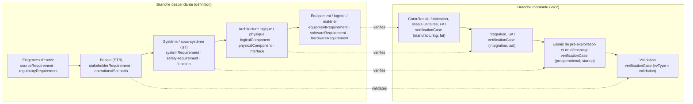
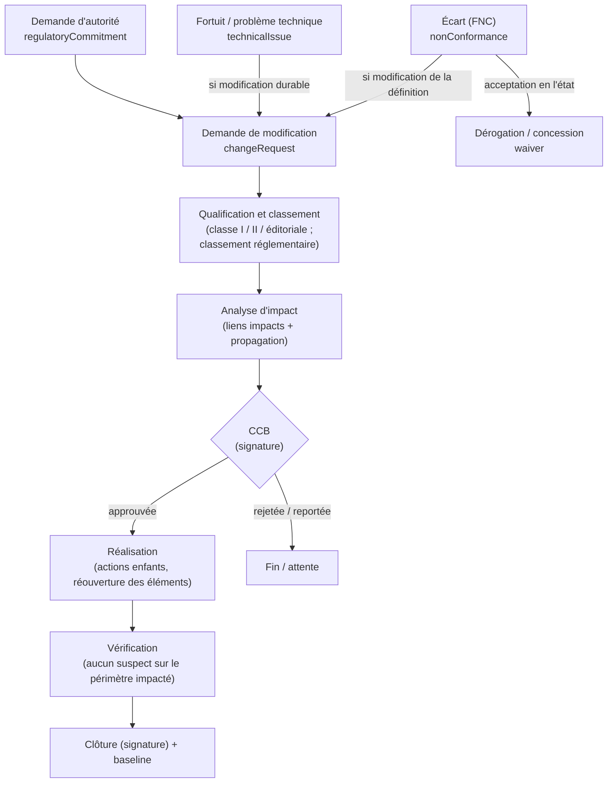

# Partie 3.1 — Méthodologie d'ingénierie système et tailoring

## 1. Cadre de processus : ISO/IEC/IEEE 15288 décliné dans Polarion

| Processus 15288 | Déclinaison opérationnelle | Artefacts Polarion | LiveDocs | Rôles pilotes |
|---|---|---|---|---|
| Analyse de la mission / du besoin métier | Contexte, parties prenantes, concept d'emploi | `operationalScenario`, `sourceRequirement` | `stakeholderSpec` | technicalLead |
| Définition des besoins et des exigences des parties prenantes | Reformulation INCOSE, validation | `stakeholderRequirement`, `assumption` | `stakeholderSpec`, `complianceMatrix` | requirementsManager |
| Définition des exigences système | Déclinaison, catégorisation, méthodes de vérification | `systemRequirement`, `safetyRequirement`, `designParameter` | `systemSpec` | requirementsManager, safetyEngineer |
| Définition de l'architecture | RFLP (Capella maître), allocations, interfaces, décisions | `function`, `logicalComponent`, `physicalComponent`, `interface`, `designDecision` | `systemDesignManual`, `interfaceControlDocument` | technicalLead, interfaceManager |
| Définition de la conception | Exigences équipement, logiciel, matériel ; spécifications d'approvisionnement | `equipmentRequirement`, `softwareRequirement`, `hardwareRequirement` | `equipmentSpec`, `softwareRequirementsSpec` | disciplineEngineer |
| Analyse système | Études, calculs, analyses de sûreté, AMDEC | `analysis`, `hazard`, `fmeaItem`, `safetyClaim` | `safetyCase`, `fmeaWorksheet` | disciplineEngineer, safetyEngineer |
| Réalisation, intégration | Fabrication, montage, intégration (hors Polarion : MES / 3DX) | `verificationCase` (manufacturing, integration) | `testProcedure` | vvLead |
| Vérification | Plan, cas, campagnes, résultats, anomalies | `verificationCase`, Test Runs, `anomaly` | `vvPlan`, `testProcedure` | vvLead |
| Transition / mise en service | Essais de démarrage, requalification | `verificationCase` (startup, requalification) | `testProcedure` | vvLead |
| Validation | Validation dans le contexte d'emploi (scénarios) | `verificationCase` (`vvType = validation`) | `vvPlan` | technicalLead |
| Exploitation, maintenance | Support, fortuits, modifications, REX | `technicalIssue`, `changeRequest` | `justificationNote`, `modificationFile` | projectManager |
| Retrait / démantèlement | Exigences de démantèlement (dès la conception) | `reqCategory = decommissioning` | — | — |
| Planification, pilotage | Plans Polarion, jalons, revues | `review`, `action`, Plans | `managementPlan` | projectManager |
| Gestion des décisions | Registre de décisions | `designDecision` | — | technicalLead |
| Gestion des risques | Registre, traitement, suivi | `risk` | — | projectManager |
| **Gestion de configuration** | Identification, baselines, modifications, état, audits | `changeRequest`, baselines, collections | — | configurationManager |
| Gestion de l'information | LiveDocs, GED, classification | LiveDocs, `deliverable` | — | documentController |
| Mesure | Indicateurs (document 13) | LiveReports | — | projectManager |
| Assurance qualité | Contrôle technique, vérifications, écarts | `nonConformance`, `action` | — | qualityEngineer |

## 2. Le cycle en V outillé (RFLP)

**Règles de passage d'un niveau à l'autre** :
- chaque exigence aval **découle de** (`flowsDownFrom`) une exigence amont, ou porte une justification d'origine interne (TR-01) ;
- chaque exigence est **satisfaite par** (`satisfies`) un élément d'architecture ;
- chaque exigence est **vérifiée par** (`verifies`) un cas de vérification au niveau approprié (TR-03, TR-04) ;
- chaque fonction catégorisée est **réalisée par** (`realizes`) un élément logique ou physique (TR-06).

## 3. Processus détaillés

### 3.1 Gestion des exigences

1. **Capture** : import ReqIF / Word / Excel des exigences d'entrée (`sourceRequirement`, état `imported`, texte original verrouillé à l'acceptation) ; branchement des bibliothèques réglementaires.
2. **Analyse** : position de conformité (`complianceStatus`, `complianceStatement`) ; demandes de clarification (état `clarification`) ; hypothèses (`assumption`).
3. **Rédaction** des exigences Framatome selon les règles INCOSE GtWR (§ 3.2), avec catégorie, force, justification, critères d'acceptation, méthodes de vérification, pertinence sûreté et exigence définie.
4. **Déclinaison** (`flowsDownFrom`) et allocation (`satisfies` depuis l'architecture).
5. **Contrôle technique** : transition `approve`, réalisée par une personne différente de l'auteur, avec signature `verified`. Avis Sûreté si l'exigence est pertinente pour la sûreté ou définie.
6. **Baseline** : approbation du LiveDoc → baseline automatique → export en GED.
7. **Évolution** : réouverture sous demande de modification (`reopen` ← `changeRequest` approuvée), puis nouvelle approbation.

### 3.2 Règles de rédaction (extrait opérationnel, inspiré d'INCOSE GtWR)

| # | Règle | Contrôle outillé |
|---|---|---|
| W1 | Une exigence = un énoncé, un verbe prescriptif (« doit » / *shall*) | Rapport « plusieurs “doit” ou “et” dans un même énoncé » |
| W2 | Sujet explicite (le système, la fonction, l'équipement) | Revue |
| W3 | Pas de termes vagues : *adéquat, suffisant, si possible, approprié, minimiser, maximiser, rapide, facile, etc., environ, notamment, et/ou* | Rapport « termes ambigus » (liste FR / EN, document 13) |
| W4 | Valeurs quantifiées avec unités et tolérances, ou renvoi à un `designParameter` | Rapport « nombres sans unité » |
| W5 | Conditions d'applicabilité explicites (états `plantStates`, conditions `plantConditions`) | Champs |
| W6 | Vérifiable : critère d'acceptation et méthode de vérification renseignés avant approbation | Condition de workflow |
| W7 | Justification (`rationale`) pour toute exigence de sûreté ou dérivée d'une hypothèse | TR-01, rapport |
| W8 | Pas de solution imposée sans justification (exigence vs choix de conception → `designDecision`) | Revue |
| W9 | Terminologie du glossaire (`term`) | Revue |
| W10 | Pas de TBD / TBC à l'approbation (`maturity ≠ tbd`) | Condition de workflow |

### 3.3 Architecture (RFLP) et MBSE

- **Fonctionnel (F)** : arborescence de fonctions (FBS) par lien `parent`. Catégorisation de sûreté (`functionCategory`, `fundamentalSafetyFunction`, `defenceInDepthLevel`).
- **Logique (L)** : systèmes élémentaires, trains, divisions, systèmes de C-C (`logicalComponent`) qui réalisent (`realizes`) les fonctions.
- **Physique (P)** : PBS (`physicalComponent`, proxy du PLM via `plmItemId`) qui réalise les éléments logiques. Classement SSC complet (`sscClassification`).
- **Interfaces** : registre (`interface`, `sideA` / `sideB`), ICD.
- **Décisions** : `designDecision` (options, critères, justification, instance de décision).
- **MBSE** : les éléments F / L / P et les échanges sont créés dans Capella (classes A / B) et synchronisés dans Polarion (`modelElementId`). Les liens de traçabilité vers les exigences sont créés dans Polarion (ADR-08).

### 3.4 Vérification et validation

1. **Stratégie** (`vvPlan`) : niveaux, étapes (`vvStage`), méthodes, indépendance (`independenceLevel`), moyens, points d'arrêt.
2. **Cas** (`verificationCase`) : méthode, étape, critères d'acceptation, étapes d'essai (`testSteps`), point d'inspection, parties convoquées. Approbation avec contrôle technique.
3. **Campagnes** (Test Runs) : regroupent les cas d'une étape (ex. FAT d'un système). Les résultats sont saisis par cas ; une campagne `resultsApproved` vaut PV signé.
4. **Anomalies** : création depuis un résultat non satisfaisant (`anomaly` ou `nonConformance`), correction, non-régression.
5. **Couverture** : statut de vérification calculé sur chaque exigence (`verificationStatus`). Tableaux de couverture par niveau, discipline et classement.
6. **Clôture** : toutes les exigences définies sont vérifiées (TR-03) ; les réserves sont tracées (`passedWithReserves` + `action`).

### 3.5 Gestion des interfaces

Voir la Partie 1.3 § 4. Cycle : identifiée → définie → accordée (A et B) → gelée → révision sous demande de modification. Le `interfaceManager` pilote le registre ; des revues d'interfaces mensuelles sont menées par partenaire.

### 3.6 Gestion de configuration, modifications, écarts et dérogations

- **Identification** : tout artefact approuvé est un élément de configuration. Les `physicalComponent` porteurs de `isConfigurationItem` sont les articles de configuration produit.
- **Baselines** : à chaque jalon (revues), à chaque approbation de LiveDoc (automatique), à chaque clôture de demande de modification. Les collections figent un ensemble cohérent de documents.
- **Classes de modification** (ISO 10007 / EIA-649) :
  - classe I : impact forme, ajustement ou fonction, sûreté, contrat ou référence approuvée → CCB ;
  - classe II : mineure → décision du gestionnaire de configuration et du responsable technique ;
  - éditoriale : traitement direct.
- **Écarts** : workflow `wfNonConformance` conforme aux articles 2.6.x de l'arrêté INB et au guide ASN 21 :
  - examen sans délai ;
  - impact sur les EIP ;
  - suspicion CFSI ;
  - traitement proposé puis approuvé (avis sûreté si EIP ; accord du client ou de l'autorité si requis) ;
  - actions ;
  - **vérification d'efficacité** ;
  - clôture.
- **Dérogations** :
  - avant réalisation : *deviation permit* ;
  - après réalisation : concession ;
  - le workflow `wfWaiver` intègre l'accord du client ou de l'autorité.
- **Audits de configuration** : cohérence documents ↔ éléments ↔ baselines (rapport « éléments modifiés après baseline sans demande de modification »).

### 3.7 Démonstration de sûreté

1. Référentiel de sûreté (bibliothèques LIB-REG et LIB-HAZARD branchées).
2. Événements initiateurs et agressions (`hazard`), criblage.
3. Exigences de sûreté (`safetyRequirement`) dérivées des analyses (`analysis`), qui maîtrisent (`mitigates`) les agressions.
4. Classement des fonctions et des SSC (`classificationList`).
5. Argumentaire (`safetyClaim`, CAE / GSN) étayé (`supportedBy`) par les analyses, la V&V et les livrables.
6. Hypothèses explicites (`assumption`) et confirmées avant clôture (socle NN-08).
7. Engagements envers l'autorité (`regulatoryCommitment`).

## 4. Tailoring (approche graduée)

### 4.1 Principe

La proportionnalité aux enjeux est un principe réglementaire (arrêté INB, AIEA GSR Part 2). Le tailoring **adapte les moyens**, jamais les principes du socle non négociable :

| Socle | Contenu |
|---|---|
| NN-01 | EIP et exigences définies identifiés |
| NN-02 | Contrôle technique par une personne différente, signé |
| NN-03 | Traçabilité exigence définie → vérification → preuve |
| NN-04 | Gestion des écarts |
| NN-05 | Maîtrise des modifications des éléments approuvés |
| NN-06 | Classification de l'information et contrôle export |
| NN-07 | Archivage en GED |
| NN-08 | Hypothèses de sûreté confirmées |

### 4.2 Détermination de la classe

Grille à 7 critères cotés de 0 à 3 : sûreté, nouveauté, taille, disciplines, instruction réglementaire, exigences contractuelles, durée (Annexe A7). Seuils indicatifs :

| Score | Classe |
|---|---|
| ≥ 15 | A |
| 9 à 14 | B |
| 4 à 8 | C |
| ≤ 3, ou urgence | D |

Un enjeu de sûreté maximal (F1A / cat. 1 / N1) impose **au moins la classe B**. La classe est fixée en revue de lancement et tracée dans le plan de management, puis revue à chaque jalon.

### 4.3 Comparaison concrète de trois profils

| Aspect | **NUWARD (classe A)** | **Outillage spécial (classe C)** | **Fortuit (classe D)** |
|---|---|---|---|
| Projet Polarion | `PL-NUWARD` + `P-NUWARD-<lot>` | Space dans `P-TOOLING` | Space dans `P-FORTUIT-<client>` |
| Types actifs | 33 | ~18 (sans `safetyClaim`, `logicalComponent`, `regulatoryCommitment`...) | 10 |
| Niveaux du V | 5 (installation → composant / logiciel) | 3 (besoin → machine → module) | 1 à 2 (critère → justification) |
| Documents | Tous (STB, ST, SDM, ICD, dossier de sûreté, plans) | CdC fonctionnel, ST, procédure d'essais, AMDEC | Note de justification (+ procédure si intervention) |
| Workflow documentaire | `wfDocumentFull` (R / V / A) | `wfDocumentFull` | `wfDocumentLight` (2 signatures) |
| MBSE | Capella obligatoire | Non requis | Non |
| Revues | SRR, PDR, CDR, revues de sûreté, TRR... | Lancement, CDR, réception | Aptitude à l'intervention |
| CCB | 2 niveaux + Design Authority | Allégé | Responsable technique + avis sûreté si EIP |
| Variantes | Feature model / branches par site | Catalogue `PL-TOOLS` (branches) | Non |
| Indépendance de la V&V | Selon catégorie ; V&V indépendante pour le logiciel cat. A | Personne différente | Personne différente (non négociable) |
| Délais | Mois / années | Semaines / mois | Heures / jours (SLA par urgence) |
| Socle non négociable | ✔ | ✔ | ✔ |

### 4.4 Mise en œuvre technique du tailoring

- **Gabarits de projets** (`TPL-*`) : préconfigurent les types visibles, les Spaces, les documents modèles, les tableaux de bord et le workflow documentaire.
- **Menus de création contextuels** : seuls les types du profil sont proposés (configuration des formulaires par projet).
- **Contrôle** : un rapport compare les types utilisés au profil de la classe. Toute dérogation au profil est une `designDecision` approuvée par la Design Authority du projet.

## 5. RACI des processus principaux

| Processus | Chef de projet | Resp. technique | Resp. exigences | Ingénieur discipline | Vérificateur | Sûreté | Qualité | Gest. configuration | V&V |
|---|---|---|---|---|---|---|---|---|---|
| Capture et conformité des exigences d'entrée | I | A | R | C | C | C | I | I | I |
| Rédaction et déclinaison des exigences | I | A | R | R | C | C | I | I | C |
| Contrôle technique / approbation | I | A | C | I | **R** | R (si sûreté) | I | I | I |
| Architecture et interfaces | I | **A/R** | C | R | C | C | I | I | I |
| Classement de sûreté | I | C | I | C | C | **A/R** | I | I | I |
| Plan et cas de V&V | I | A | C | C | C | C | I | I | **R** |
| Campagnes et résultats | I | I | I | C | C | I | C | I | **A/R** |
| Demandes de modification / CCB | R | C | C | C | I | C | I | **A** (président CCB) | C |
| Écarts / FNC | I | C | I | R | C | C (si EIP) | **A** | I | C |
| Fortuits | **A** | R | I | R | R | C | I | I | I |
| Baselines et audits de configuration | I | C | C | I | I | I | C | **A/R** | I |
| Engagements envers l'autorité | A | C | I | R | I | C | I | I | I |

R = réalise · A = approuve / responsable final · C = consulté · I = informé.
