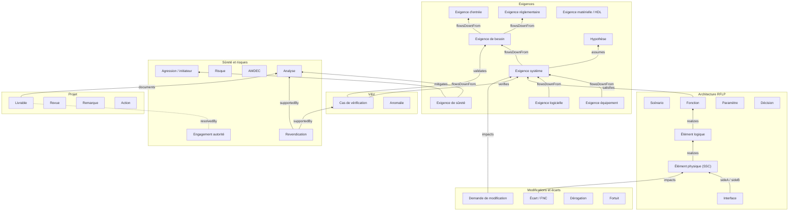

# Partie 3.2 — Modèle de données (ontologie, Work Items, attributs)

> **Référence normative du modèle** : les fichiers `model/*.yaml`. Les catalogues exhaustifs sont **générés** et toujours synchronisés :
> - [A1 Types et attributs](../generated/A1_types_et_attributs.md) (36 types, 325 attributs distincts) ;
> - [A2 Énumérations](../generated/A2_enumerations.md) (111 énumérations) ;
> - [A3 Liens](../generated/A3_liens_et_tracabilite.md) ;
> - [A8 Méta-modèle](../generated/A8_metamodele.md).
>
> Ce document expose les **principes, la structure et les choix** de modélisation.

## 1. Principes de modélisation

| # | Principe | Conséquence |
|---|---|---|
| P1 | Un type = un **cycle de vie** distinct ou une **règle de traçabilité** distincte ; sinon, discrimination par attribut | 36 types ; `reqLevel`, `analysisType`, `fmeaType`... |
| P2 | Ne jamais dupliquer un champ natif Polarion (titre, description, statut, sévérité, priorité, responsable, échéance, catégories, liens, approbations) | Le validateur rejette toute redéfinition (`NATIVE_FIELDS`) |
| P3 | Attributs réutilisables regroupés en **jeux d'attributs** (fieldSets) expansés à la génération | `common`, `requirementCore`, `requirementSafety`, `sscClassification`, `functionSafety`, `documentReference` |
| P4 | Un attribut de sûreté n'a **jamais** de valeur par défaut affirmative : « À déterminer » par défaut | `yesNoTbd` (défaut `tbd`) pour `eip`, `definedRequirement`, `safetyImpact`, `cfsiSuspected`... |
| P5 | Les champs calculés (statut de vérification, criticité, marge, couverture) sont alimentés par script et jamais saisis | Mention « [Calculé] » dans la description générée |
| P6 | Un même identifiant d'attribut a la **même définition** dans tous les types | Contrôle du validateur (ex. `customerApprovalRequired` harmonisé en `yesNoTbd`) |
| P7 | Les multi-valeurs sont réservées aux énumérations (contrainte Polarion) | Contrôle du validateur |
| P8 | L'organisation (BU, BL) n'est jamais codée dans les identifiants | Énumérations révisables |
| P9 | Tout libellé existe en FR et en EN | Génération par instance (`--lang`) |

## 2. Vue d'ensemble de l'ontologie

## 3. Les familles de types et leur raison d'être

### 3.1 Exigences (9 types)

| Type | Pourquoi un type distinct | Attributs saillants |
|---|---|---|
| `sourceRequirement` | Texte du client **verbatim et verrouillé** ; cycle de position de conformité ; jamais modifié par Framatome | `originalText`, `sourceDocument(Revision)`, `sourceParagraph`, `complianceStatus`, `complianceStatement` |
| `regulatoryRequirement` | Vit en bibliothèque (cycle de publication) ; droits d'auteur ; éditions | `regulatoryReference`, `edition`, `jurisdiction`, `copyrightRestricted`, `transitionalProvisions` |
| `stakeholderRequirement` | Niveau besoin (STB), validé par des scénarios (`validates`) | `stakeholder`, `needStatement` |
| `systemRequirement` | Niveaux installation / système / sous-système (`reqLevel`) | `reqLevel` |
| `equipmentRequirement` | Base des spécifications d'approvisionnement, codes de conception, ESPN | `procurementSpec`, `designCode`, `espnRelevant` |
| `softwareRequirement` / `hardwareRequirement` | Règles de traçabilité propres au C-C (IEC 60880 / 62138 / 60987 / 62566) | `softwareItem`, `selfMonitoring`, `hwTechnology` |
| `safetyRequirement` | Portée par la Sûreté ; issue des analyses ; défense en profondeur | `safetyRequirementSource`, `defenceInDepthLevel`, `singleFailureApplicable`, `analysisReference` |
| `assumption` | Cycle propre (à confirmer, confirmée, infirmée) ; propagation par suspicion | `dataOwner`, `validationMethod`, `consequenceIfInvalid`, `confirmationDueDate` |

**Jeu d'attributs `requirementCore`** (toute exigence rédigée) :
- catégorie, force, justification, critères d'acceptation ;
- méthodes de vérification (obligatoires à l'approbation), étapes V&V prévues ;
- maturité (TBD / TBC / préliminaire / consolidée / figée) ;
- états et conditions de fonctionnement ;
- statut de vérification **calculé** ;
- accord client requis.

**Jeu d'attributs `requirementSafety`** :
- pertinence sûreté, **exigence définie (EIP)**, intérêts protégés ;
- schéma, classe et catégorie hérités ;
- pertinence cybersécurité.

### 3.2 Architecture RFLP (7 types)

| Type | Rôle | Attributs saillants |
|---|---|---|
| `operationalScenario` | Concept d'emploi, séquences d'intervention | `scenarioType`, `plantStates`, `doseEstimate` |
| `function` | Arborescence fonctionnelle, catégorisation | `functionLevel`, `functionType` + `functionSafety` (`functionCategory`, `fundamentalSafetyFunction`, `defenceInDepthLevel`) |
| `logicalComponent` | Systèmes élémentaires, trains, systèmes C-C | `logicalType`, `systemCode`, `icSystemClass` |
| `physicalComponent` | Proxy PBS du PLM ; **porteur du classement SSC** | `componentNature`, `pbsLevel`, `functionalTag`, `plmItemId`, `isConfigurationItem`, `qualificationStatus`, `ageingMechanisms` + `sscClassification` |
| `interface` | Registre ICD (les liens Polarion ne portent pas d'attributs, donc l'interface est un élément) | `interfaceType`, `interfaceScope`, `sideAOwner`, `sideBOwner`, `interfaceData`, `freezeDate` |
| `designParameter` | Marges, budgets, limites, paramètres de cœur | `nominalValue`, `limitValue`, `calculatedValue`, `margin` (calculé), `cycleOrConfiguration` |
| `designDecision` | Registre de décisions (options abandonnées comprises) | `alternatives`, `selectionCriteria`, `decisionRationale`, `decisionAuthority` |

**Jeu d'attributs `sscClassification`** (multi-schémas) :
- `safetyClassScheme`, `safetyClass`, `eip`, `protectedInterests`, `ipsLegacy`, `itns`, `qaProgramLevel` ;
- `mechanicalClass`, `electricalClass`, `qualificationClass` (K1 / K2 / K3 / AG), `seismicCategory` (SC1 / SC2), `seismicCriterion` ;
- `espnLevel` (N1-N3), `espnCategory` (0-IV), `icSystemClass`, `securityDegree` ;
- `classificationRationale`, `classificationValidated`.

### 3.3 Sûreté, risques, analyses (6 types)

- `hazard` : initiateurs et agressions ; criblage ; bandes de fréquence (indicatives) ; critères.
- `safetyClaim` : argumentaire CAE / GSN, avec couverture par preuves calculée.
- `risk` : risques et opportunités de projet (ISO 31000) ; criticité P × I calculée.
- `fmeaItem` : ligne d'AMDEC (édition tabulaire recommandée) ; RPN calculé ; cotations résiduelles.
- `analysis` : étude, calcul, note ; code de calcul et statut de qualification ; conclusion ; marge minimale ; **AIP**.
- `regulatoryCommitment` : demandes et prescriptions de l'autorité ; engagements ; échéances ; références.

### 3.4 V&V (2 types)

- `verificationCase` : toutes méthodes, avec :
  - étape, niveau, critères, étapes d'essai (`struct:TestSteps`), environnement ;
  - point d'inspection (H / W / R), parties convoquées ;
  - indépendance ;
  - norme de qualification, preuve ;
  - dernier résultat **calculé**.
- `anomaly` : anomalie de V&V (logiciel, matériel, configuration, spécification d'essai) ; impact sûreté obligatoire.

### 3.5 Modifications, écarts, fortuits (4 types)

- `changeRequest` : origine, classe (I / II / éditoriale), **classement réglementaire de la modification**, analyse d'impact, disciplines impactées, impact sûreté, EIP affectés, effectivité, décision et références CCB, accord client.
- `nonConformance` :
  - origine, phase de détection, gravité ;
  - **impact EIP / exigence définie**, écart important ;
  - action conservatoire, traitement et justification ;
  - accords client et autorité, événement significatif (information exploitant) ;
  - **suspicion CFSI**, Part 21 (US) ;
  - cause racine, coût de non-qualité.
- `waiver` : dérogation avant réalisation ou concession après ; portée ; expiration ; accords.
- `technicalIssue` : catégorie (fortuit, constat ISI, générique, REX, question client) ; urgence ; site, tranche, arrêt, chemin critique ; échéance de réponse (SLA) ; type de solution ; caractère générique ; REX.

### 3.6 Projet (4 types) et bibliothèque (1 type)

- `deliverable` : référence GED, indice, visa client, dates contractuelle et prévisionnelle, R / V / A, LiveDoc source, AIP.
- `review` : type (SRR, PDR, CDR, TRR, revue de sûreté...), critères d'entrée et de sortie, décision.
- `reviewFinding` : remarque de revue ou observation client, gravité, réponse, levée.
- `action` : conservatoire, corrective, préventive, de revue, point ouvert, surveillance, mise en œuvre ; preuve ; efficacité.
- `term` : glossaire FR / EN / DE.

### 3.7 Ajouts v0.2 / v0.3 (revue critique, doc. 18 et 19)

| Type | Famille | Raison d'être (principe P1) |
|---|---|---|
| `unitDeployment` | Modifications | Effectivité **par tranche / cycle / arrêt** avec son propre cycle de vie (prévu → programmé → réalisé → requalifié). Les liens Polarion ne portent pas d'attributs, donc le statut par tranche ne peut pas tenir dans `applicableUnits`. |
| `lessonLearned` | Projet | REX capitalisé, réutilisable entre projets et BU (rôle `capitalizes` vers fortuits, écarts, anomalies, revues…) |
| `workPackage` | Projet | Lot confié à une UO réalisatrice : accord, remise et réception signés ; rattachement des artefacts par `inWorkPackage` (doc. 21) |

Attributs ajoutés (sélection) :

| Attributs | Porteur | Objet |
|---|---|---|
| `responsibleUnit`, `performingUnit`, `applicableTechnologies` | Commun | Organisation matricielle ; abstraction de filière |
| `requirementPattern`, `requirementQualityScore` | Exigences rédigées | EARS ; qualité de rédaction |
| `supplierComplianceStatus` / `Statement` / `DocumentReference` | Exigences équipement, logiciel, matériel | Réponse fournisseur (aller-retour ReqIF / Excel) |
| `cfr5059Screening` / `Outcome` / `Reference`, `safetyReportImpact` | `changeRequest` | Pack US ; impact sur le rapport de sûreté |
| `commercialGradeDedication`, `criticalCharacteristics`, `expectedWasteClass` | `physicalComponent` | Obsolescence / CGD ; démantèlement |
| `requiredHabilitation` | Analyses, livrables, cas V&V, LiveDocs | Signatures habilitées (condition `qualifiedSignatory`) |
| `sdrlReference`, `submittalPurpose` | `deliverable` | Livrables contractuels |
| `regulatoryFramework` | Exigences réglementaires, engagements | Pack réglementaire |
| `bindingLevel` | `sourceRequirement` | Force (doit / devrait / peut) posée à l'import Word |

## 4. Attributs transverses (`common`)

| Attribut | Raison d'être |
|---|---|
| `discipline` / `contributingDisciplines` | Pilotage par discipline, routage des revues, indicateurs |
| `externalId`, `sourceReference` | Traçabilité vers le client, ReqIF, documents sources, outils hérités |
| `applicablePlantSeries`, `applicableUnits`, `applicabilityCondition` | Variantes et effectivité (ADR-05) |
| `lifecyclePhase` | Filtrage par phase |
| `informationClassification` (obligatoire) | Sécurité de l'information ; blocage des données interdites sur STD |
| `exportControl` (obligatoire) | Contrôle export ; droits d'accès |
| `wbsCode` | Lien avec la planification et l'ERP |
| `transitionNote` | Motif des transitions de retour, rejet, réouverture, annulation (historisé) |
| `responsibleUnit`, `performingUnit` | Organisation matricielle BU × UO, tableaux de bord par UO (doc. 21) |
| `applicableTechnologies` | Filière (REP, REB, VVER, CANDU, MTR, Gen IV, hors réacteur) |

## 5. Concepts nucléaires et leur représentation

| Concept | Représentation | Commentaire |
|---|---|---|
| EIP (arrêté INB 2.5.1) | `physicalComponent.eip` + `classificationList` | Le classement est porté par le SSC ; les exigences en héritent (`safetyClass`) |
| Exigence définie | `definedRequirement` sur toute exigence | Déclenche le socle (TR-03, signature, avis sûreté) |
| AIP | `aip` sur `analysis`, `deliverable` et document | Déclenche le contrôle technique indépendant |
| Contrôle technique | Transition d'approbation + `approverNotAuthor` + signature `verified` | Bloquant |
| IPS (terminologie historique) | `ipsLegacy` | Pour le parc existant |
| ITNS / CFSI (ISO 19443) | `itns`, `cfsiSuspected`, `rootCauseCategory = cfsi` | Obligatoire sur les FNC |
| Classes F1A / F1B / F2 ; catégories 1-3 ; A / B / C | `functionCategory` + `safetyClassScheme` | Multi-schémas (ADR-10) |
| Classes M, EE / E, K, SC | `mechanicalClass`, `electricalClass`, `qualificationClass`, `seismicCategory` | |
| ESPN N1-N3 et catégories | `espnLevel`, `espnCategory` | |
| États et conditions de fonctionnement | `plantStates` (RP, AN/GV, AN/RRA, API, APR, RCD), `plantConditions` (PCC / DBC / DEC) | |
| Défense en profondeur | `defenceInDepthLevel` | |
| Modification notable | `regulatoryModificationClass` | Qualification par l'exploitant |
| Événement significatif | `significantEventType` | Information de l'exploitant |
| Points d'arrêt / de notification | `inspectionPoint`, `witnessParties` | |
| Visa client | `customerVisa` (VSO, VSO-SR, VAO...) | |
| Dose ALARA | `operationalScenario.doseEstimate`, `analysisType = doseAlara` | |
| Vieillissement / LTO | `ageingMechanisms`, `analysisType = ageingLto` | |

## 6. Correspondance avec les fichiers Polarion générés

| Élément du modèle | Fichier Polarion généré (`generated/polarion/<lang>/.polarion/`) |
|---|---|
| Types de Work Items | `tracker/fields/workitem-type-enum.xml` |
| Rôles de liens + règles | `tracker/fields/workitem-link-role-enum.xml` (éléments `<rule from to>` ; `__other` pour les liens inter-projets) |
| Énumérations | `tracker/fields/<enumId>-enum.xml` |
| Attributs par type | `tracker/fields/<typeId>-custom-fields.xml` |
| Statuts par type | `tracker/fields/<typeId>-status-enum.xml` |
| Workflows par type | `tracker/workflow/<typeId>-workflow.xml` (`prototype="WorkItem"`) |
| Types de documents | `documents/fields/document-type-enum.xml` |
| Attributs de document | `documents/fields/custom-fields.xml` |
| Statuts de document | `documents/fields/document-status-enum.xml` |
| Workflows de document | `documents/workflow/<docTypeId>-workflow.xml` (`prototype="Module"`) |
| Statuts de Test Run | `testing/configuration/testrun-status-enum.xml` |

Correspondance des types d'attributs :

| Modèle | Polarion |
|---|---|
| string | `string` |
| text | `text` |
| richtext | `text/html` |
| integer / float / currency / date | idem |
| datetime | `date-time` |
| duration | `duration` |
| boolean | `boolean` |
| user | `enum:@user` |
| testSteps | `struct:TestSteps` |
| enum:X | `enum:X` |

## 7. Gouvernance du modèle

1. Toute évolution passe par une **demande de modification du modèle** (CCB du modèle, Design Authority) et une demande de fusion sur ce dépôt.
2. La CI exécute le **validateur** (référentiel, cohérence des champs, atteignabilité des états, rôles, champs requis, tailoring, socle), puis régénère la configuration et les annexes.
3. **Compatibilité ascendante** :
   - on n'efface jamais un identifiant (type, attribut, option) : on le déprécie ;
   - on ne renomme jamais un identifiant : on migre ;
   - les options obsolètes restent présentes, masquées par la configuration des formulaires.
4. Versionnement sémantique du modèle :
   - **majeure** : rupture nécessitant une migration de données ;
   - **mineure** : ajout ;
   - **correctif** : libellés, descriptions.
