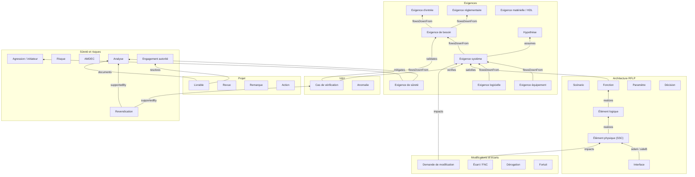

# Partie 3.2 — Modèle de données (ontologie, Work Items, attributs)

> *Version du plan : 0.5 (octobre 2026) · Dépendance à l'outil Polarion : **faible** · Historique : [CHANGELOG](../../CHANGELOG.md) · Carte du dépôt : [guide de lecture](../GUIDE_DE_LECTURE.md).*
>
> **En bref**
> - Ce document explique **pourquoi** le modèle de données est construit ainsi : principes, familles de types de Work Items (éléments de travail typés de Polarion : exigence, fonction, écart…), attributs transverses, représentation des concepts nucléaires.
> - Lecteurs : SE Referents, ingénieurs configuration, Sûreté et Qualité ; support des ateliers d'onboarding (doc. 24).
> - À lire avant : doc. 07 (méthodologie et tailoring). À lire ensuite : doc. 09 (liens), doc. 10 (workflows).
>
> **Référence normative du modèle** : les fichiers `model/*.yaml`. Les catalogues exhaustifs sont **générés** et toujours synchronisés :
> - [A1 Types et attributs](../generated/A1_types_et_attributs.md) (36 types, 327 attributs distincts) ;
> - [A2 Énumérations](../generated/A2_enumerations.md) (112 énumérations, c'est-à-dire listes de valeurs fermées) ;
> - [A3 Liens](../generated/A3_liens_et_tracabilite.md) ;
> - [A8 Méta-modèle](../generated/A8_metamodele.md).
>
> Ce document expose les **principes, la structure et les choix** de modélisation.

## 1. Principes de modélisation

| # | Principe | Conséquence |
|---|---|---|
| P1 | Un type = un **cycle de vie** distinct ou une **règle de traçabilité** distincte ; sinon, discrimination par attribut | 36 types ; `reqLevel`, `analysisType`, `fmeaType`... |
| P2 | Ne jamais dupliquer un champ natif Polarion (titre, description, statut, sévérité, priorité, responsable, échéance, catégories, liens, approbations) | Le validateur rejette toute redéfinition (`NATIVE_FIELDS`) |
| P3 | Attributs réutilisables regroupés en **jeux d'attributs** (`fieldSets`) expansés à la génération | 7 jeux : `common`, `requirementCore`, `supplierFlowdown`, `requirementSafety`, `sscClassification`, `functionSafety`, `documentReference` |
| P4 | Un attribut de sûreté n'a **jamais** de valeur par défaut affirmative : « À déterminer » par défaut | `yesNoTbd` (défaut `tbd`) pour `eip`, `definedRequirement`, `safetyImpact`, `cfsiSuspected`... |
| P5 | Les champs calculés (statut de vérification, criticité, marge, couverture) sont alimentés par script et jamais saisis | Mention « [Calculé] » dans la description générée |
| P6 | Un même identifiant d'attribut a la **même définition** dans tous les types | Contrôle du validateur (ex. `customerApprovalRequired` harmonisé en `yesNoTbd`) |
| P7 | Les multi-valeurs sont réservées aux énumérations (contrainte Polarion) | Contrôle du validateur |
| P8 | L'organisation (BU, BL) n'est jamais codée dans les identifiants | Énumérations révisables |
| P9 | Tout libellé existe en FR et en EN | Génération par instance (`--lang`) |

**Obligation portée par la transition (état de soumission).** Un champ n'est rendu obligatoire dès la création (`required: true`) que s'il a une valeur par défaut ou s'il est posé par un import ; sinon l'obligation est portée par le workflow (`requiredAt`), pour ne jamais bloquer un import ReqIF / Word ni une synchronisation Capella ou PLM. Chaque workflow déclare un **état de soumission** (`submitState` : vérification, caractérisation, accord…) ; les champs marqués « requis à la soumission » sont exigés par le générateur sur toutes les transitions qui mènent à cet état. Les commentaires de `model/work_item_types.yaml` et du générateur appellent cette règle « principe P7 » ; la numérotation ci-dessus (P1–P9) est celle du plan directeur.

## 2. Vue d'ensemble de l'ontologie

L'ontologie est l'ensemble des types et de leurs relations. Les flèches portent les rôles de liens du doc. 09 (sens aval → amont).

Les trois types ajoutés en v0.2 / v0.3 (`unitDeployment`, `lessonLearned`, `workPackage`, § 3.7) ne figurent pas sur ce schéma simplifié.

## 3. Les familles de types et leur raison d'être

### 3.1 Exigences (9 types)

| Type | Pourquoi un type distinct | Attributs saillants |
|---|---|---|
| `sourceRequirement` | Texte du client **verbatim et verrouillé** ; cycle de position de conformité ; jamais modifié par Framatome | `originalText`, `sourceDocument(Revision)`, `sourceParagraph`, `complianceStatus`, `complianceStatement` |
| `regulatoryRequirement` | Vit en bibliothèque (cycle de publication) ; droits d'auteur ; éditions | `regulatoryReference`, `edition`, `jurisdiction`, `copyrightRestricted`, `transitionalProvisions` |
| `stakeholderRequirement` | Niveau besoin (STB, spécification technique de besoin), validé par des scénarios (`validates`) | `stakeholder`, `needStatement` |
| `systemRequirement` | Niveaux installation / système / sous-système (`reqLevel`) | `reqLevel` |
| `equipmentRequirement` | Base des spécifications d'approvisionnement, codes de conception, ESPN (équipements sous pression nucléaires) | `procurementSpec`, `designCode`, `espnRelevant` |
| `softwareRequirement` / `hardwareRequirement` | Règles de traçabilité propres au contrôle-commande (C-C) : normes IEC 60880 / 62138 (logiciel) et 60987 / 62566 (matériel, HDL — langage de description matérielle des FPGA) | `softwareItem`, `selfMonitoring`, `hwTechnology` |
| `safetyRequirement` | Portée par la Sûreté ; issue des analyses ; défense en profondeur (niveaux successifs de protection) | `safetyRequirementSource`, `defenceInDepthLevel`, `singleFailureApplicable`, `analysisReference` |
| `assumption` | Cycle propre (à confirmer, confirmée, infirmée) ; propagation par suspicion ; nature typée (`assumptionType` : donnée de site, client, fournisseur, hypothèse d'étude, d'exploitation, OSINT) | `assumptionType`, `dataOwner`, `validationMethod`, `consequenceIfInvalid`, `confirmationDueDate` |

**Jeu d'attributs `requirementCore`** (toute exigence rédigée) :
- catégorie, force, justification, critères d'acceptation ;
- méthodes de vérification (obligatoires à l'approbation), étapes V&V prévues ;
- maturité (TBD / TBC / préliminaire / consolidée / figée) ;
- états et conditions de fonctionnement ;
- statut de vérification **calculé** ;
- accord client requis.

**Jeu d'attributs `supplierFlowdown`** (exigences équipement, logiciel, matériel) : conformité déclarée par le fournisseur, réponse et référence du document fournisseur (aller-retour ReqIF / Excel, doc. 22).

**Jeu d'attributs `requirementSafety`** :
- pertinence sûreté, **exigence définie** (exigence assignée à un EIP ou à une AIP, arrêté INB), intérêts protégés ;
- schéma, classe et catégorie hérités ;
- pertinence cybersécurité.

### 3.2 Architecture RFLP (7 types)

RFLP = *Requirements – Functional – Logical – Physical* (doc. 07 § 3.3).

| Type | Rôle | Attributs saillants |
|---|---|---|
| `operationalScenario` | Concept d'emploi, séquences d'intervention | `scenarioType`, `plantStates`, `doseEstimate` |
| `function` | Arborescence fonctionnelle, catégorisation | `functionLevel`, `functionType` + `functionSafety` (`functionCategory`, `fundamentalSafetyFunction`, `defenceInDepthLevel`) |
| `logicalComponent` | Systèmes élémentaires, trains, systèmes C-C | `logicalType`, `systemCode`, `icSystemClass` |
| `physicalComponent` | Proxy (représentant local) de l'arborescence produit (PBS) tenue dans le PLM ; **porteur du classement SSC** (structures, systèmes et composants) | `componentNature`, `pbsLevel`, `functionalTag`, `plmItemId`, `isConfigurationItem`, `qualificationStatus`, `ageingMechanisms` + `sscClassification` |
| `interface` | Registre ICD (document de contrôle d'interfaces) ; les liens Polarion ne portent pas d'attributs, donc l'interface est un élément | `interfaceType`, `interfaceScope`, `sideAOwner`, `sideBOwner`, `interfaceData`, `freezeDate` |
| `designParameter` | Marges, budgets, limites, paramètres de cœur | `nominalValue`, `limitValue`, `calculatedValue`, `margin` (calculé), `cycleOrConfiguration` |
| `designDecision` | Registre de décisions (options abandonnées comprises) | `alternatives`, `selectionCriteria`, `decisionRationale`, `decisionAuthority` |

**Jeu d'attributs `sscClassification`** (multi-schémas, ADR-10) :
- `safetyClassScheme`, `safetyClass`, `eip`, `protectedInterests`, `ipsLegacy`, `itns`, `qaProgramLevel` ;
- `mechanicalClass`, `electricalClass`, `qualificationClass` (conditions de qualification K1 / K2 / K3 / AG — option `sa` — ou *harsh environment* US), `seismicCategory` (SC1 / SC2 : options `seis1` / `seis2` ; catégories I / II US), `seismicCriterion` ;
- `espnLevel` (N1-N3), `espnCategory` (0-IV), `icSystemClass`, `securityDegree` ;
- `classificationRationale`, `classificationValidated`.

### 3.3 Sûreté, risques, analyses (6 types)

- `hazard` : initiateurs et agressions ; criblage ; bandes de fréquence (indicatives) ; critères.
- `safetyClaim` : argumentaire CAE / GSN (*Claims-Arguments-Evidence* / *Goal Structuring Notation* : revendication → arguments → preuves), avec couverture par preuves calculée.
- `risk` : risques et opportunités de projet (ISO 31000, norme de management des risques) ; criticité P × I (probabilité × impact) calculée.
- `fmeaItem` : ligne d'AMDEC (édition tabulaire recommandée) ; RPN (indice de criticité *Risk Priority Number*) calculé ; cotations résiduelles.
- `analysis` : étude, calcul, note ; code de calcul et statut de qualification ; conclusion ; marge minimale ; **AIP** (activité importante pour la protection des intérêts, arrêté INB).
- `regulatoryCommitment` : demandes et prescriptions de l'autorité ; engagements ; échéances ; références.

### 3.4 V&V (2 types)

- `verificationCase` : toutes méthodes, avec :
  - étape, niveau, critères, étapes d'essai (`struct:TestSteps`), environnement ;
  - point d'inspection (H / W / R : *Hold*, *Witness*, *Review*), parties convoquées ;
  - indépendance ;
  - norme de qualification, preuve ;
  - dernier résultat **calculé**.
- `anomaly` : anomalie de V&V (logiciel, matériel, configuration, spécification d'essai) ; impact sûreté obligatoire.

### 3.5 Modifications, écarts, fortuits (4 types)

- `changeRequest` (demande de modification, DM) : origine, classe (I / II / éditoriale), **classement réglementaire de la modification** (modification notable ou non, au sens du code de l'environnement), analyse d'impact, disciplines impactées, impact sûreté, EIP affectés, effectivité, décision et références CCB, accord client.
- `nonConformance` (fiche de non-conformité, FNC) :
  - origine, phase de détection, gravité ;
  - **impact EIP / exigence définie**, écart important ;
  - action conservatoire, traitement et justification ;
  - accords client et autorité, événement significatif (information exploitant) ;
  - **suspicion CFSI** (articles contrefaits, frauduleux ou suspects), Part 21 (US : obligation de signalement des défauts à la NRC, 10 CFR Part 21) ;
  - cause racine, coût de non-qualité.
- `waiver` : dérogation avant réalisation ou concession après ; portée ; expiration ; accords.
- `technicalIssue` (fortuit) : catégorie (fortuit, constat ISI — inspection en service —, générique, REX, question client) ; urgence ; site, tranche, arrêt, chemin critique ; échéance de réponse (SLA, délai de réponse engagé) ; type de solution ; caractère générique ; REX.

### 3.6 Projet (4 types) et bibliothèque (1 type)

- `deliverable` : référence GED, indice, visa client, dates contractuelle et prévisionnelle, R / V / A (rédigé / vérifié / approuvé), LiveDoc source, AIP.
- `review` : type (revues d'exigences SRR, de conception préliminaire PDR, de conception détaillée CDR, d'aptitude aux essais TRR, revue de sûreté...), critères d'entrée et de sortie, décision.
- `reviewFinding` : remarque de revue ou observation client, gravité, réponse, levée.
- `action` : conservatoire, corrective, préventive, de revue, point ouvert, surveillance, mise en œuvre ; preuve ; efficacité.
- `term` : glossaire FR / EN / DE.

### 3.7 Ajouts v0.2 / v0.3 (revue critique, doc. 18 et 19)

| Type | Famille | Raison d'être (principe P1) |
|---|---|---|
| `unitDeployment` (v0.2) | Modifications | Effectivité **par tranche / cycle / arrêt** avec son propre cycle de vie (prévu → programmé → réalisé → requalifié). Les liens Polarion ne portent pas d'attributs, donc le statut par tranche ne peut pas tenir dans `applicableUnits`. |
| `lessonLearned` (v0.2) | Projet | REX capitalisé, réutilisable entre projets et BU (rôle `capitalizes` vers fortuits, écarts, anomalies, revues…) |
| `workPackage` (v0.3) | Projet | Lot confié à une UO (unité opérationnelle) réalisatrice : accord, remise et réception signés ; rattachement des artefacts par `inWorkPackage` (doc. 21) |

Attributs ajoutés (sélection) :

| Attributs | Porteur | Objet |
|---|---|---|
| `responsibleUnit`, `performingUnit`, `applicableTechnologies` | Commun | Organisation matricielle ; abstraction de filière |
| `requirementPattern`, `requirementQualityScore` | Exigences rédigées | Patron de rédaction EARS (*Easy Approach to Requirements Syntax*) ; qualité de rédaction |
| `supplierComplianceStatus`, `supplierComplianceStatement`, `supplierDocumentReference` | Exigences équipement, logiciel, matériel (jeu `supplierFlowdown`) | Réponse fournisseur (aller-retour ReqIF / Excel) |
| `cfr5059Screening`, `cfr5059Outcome`, `cfr5059Reference`, `safetyReportImpact` | `changeRequest` | Pack US (criblage 10 CFR 50.59 : règle NRC sur les modifications sans autorisation préalable) ; impact sur le rapport de sûreté |
| `commercialGradeDedication`, `criticalCharacteristics`, `expectedWasteClass` | `physicalComponent` | Obsolescence / CGD (dédicace d'un article commercial à un usage de sûreté) ; démantèlement |
| `requiredHabilitation` | Analyses, livrables, cas V&V, LiveDocs | Signatures habilitées (condition `qualifiedSignatory`, doc. 21 § 3) |
| `sdrlReference`, `submittalPurpose` | `deliverable` | Livrables contractuels (SDRL : liste des documents à fournir au client) |
| `regulatoryFramework` | Exigences réglementaires, engagements | Pack réglementaire |
| `bindingLevel` | `sourceRequirement` | Force (doit / devrait / peut) posée à l'import Word |

## 4. Attributs transverses (`common`)

| Attribut | Raison d'être |
|---|---|
| `discipline` / `contributingDisciplines` | Pilotage par discipline, routage des revues, indicateurs |
| `externalId`, `sourceReference` | Traçabilité vers le client, ReqIF, documents sources, outils hérités |
| `applicablePlantSeries`, `applicableUnits`, `applicabilityCondition` | Variantes et effectivité (ADR-05) |
| `lifecyclePhase` | Filtrage par phase |
| `informationClassification` (obligatoire) | Sécurité de l'information ; blocage des données interdites sur l'instance standard STD |
| `exportControl` (obligatoire) | Contrôle export ; droits d'accès |
| `wbsCode` | Lien avec la planification et l'ERP (progiciel de gestion intégré) via le WBS (arborescence des travaux) |
| `transitionNote` | Motif des transitions de retour, rejet, réouverture, annulation (historisé) |
| `responsibleUnit`, `performingUnit` | Organisation matricielle BU × UO, tableaux de bord par UO (doc. 21) |
| `applicableTechnologies` | Filière (énumération `reactorTechnology` : REP, REB / BWR, VVER, CANDU, AGR, SMR, réacteur de recherche / MTR, installations hors réacteur) |

## 5. Concepts nucléaires et leur représentation

| Concept | Représentation | Commentaire |
|---|---|---|
| EIP (élément important pour la protection des intérêts, arrêté INB art. 2.5.1) | `physicalComponent.eip` + LiveDoc `classificationList` | Le classement est porté par le SSC ; les exigences en héritent (`safetyClass`) |
| Exigence définie | `definedRequirement` sur toute exigence | Déclenche le socle (TR-03, avis sûreté, signature du document porteur) |
| AIP (activité importante pour la protection) | `aip` sur `analysis`, `deliverable` et document | Déclenche le contrôle technique indépendant |
| Contrôle technique | Transition d'approbation + condition `approverNotAuthor` (tracée par les Approvals) ; signature `verified` / `approved` là où le workflow la porte (analyses, livrables, documents, doc. 10 § 2) ; pour les exigences, éléments d'architecture, cas de vérification et éléments de sûreté, la signature est portée par le LiveDoc | Bloquant |
| IPS (important pour la sûreté, terminologie historique du parc) | `ipsLegacy` | Pour le parc existant |
| ITNS / CFSI (ISO 19443, norme qualité du nucléaire) | `itns`, `cfsiSuspected`, `rootCauseCategory = cfsi` | Obligatoire sur les FNC |
| Classes F1A / F1B / F2 ; catégories 1-3 ; A / B / C (catégories de fonctions de sûreté) | `functionCategory` + `safetyClassScheme` | Multi-schémas (ADR-10) |
| Classes M, EE / E, K, SC (classes mécanique, électrique, de qualification, sismique) | `mechanicalClass`, `electricalClass`, `qualificationClass`, `seismicCategory` | |
| ESPN N1-N3 et catégories | `espnLevel`, `espnCategory` | |
| États et conditions de fonctionnement | `plantStates` (RP, AN/GV, AN/RRA, API, APR, RCD : états standard du réacteur, de la production au cœur déchargé), `plantConditions` (PCC / DBC / DEC : conditions de dimensionnement et conditions étendues) | |
| Défense en profondeur | `defenceInDepthLevel` | |
| Modification notable | `regulatoryModificationClass` | Qualification par l'exploitant |
| Événement significatif | `significantEventType` | Information de l'exploitant |
| Points d'arrêt / de notification | `inspectionPoint`, `witnessParties` | |
| Visa client | `customerVisa` (VSO, VSO-SR, VAO... : vu sans observation, sous réserve, avec observations) | |
| Dose ALARA (radioprotection : aussi bas que raisonnablement possible) | `operationalScenario.doseEstimate`, `analysisType = doseAlara` | |
| Vieillissement / LTO (exploitation à long terme) | `ageingMechanisms`, `analysisType = ageingLto` | |

## 6. Correspondance avec les fichiers Polarion générés

La configuration générée compte **249 fichiers XML par langue** (186 sous `tracker/fields/`, 36 sous `tracker/workflow/`, 25 sous `documents/`, 2 sous `testing/`), plus le manifeste `generated/polarion/<lang>/SIGNATURES_ET_SCRIPTS.md` (scripts attendus, points de signature, constructions à confirmer).

| Élément du modèle | Fichier Polarion généré (`generated/polarion/<lang>/.polarion/`) |
|---|---|
| Types de Work Items | `tracker/fields/workitem-type-enum.xml` |
| Rôles de liens + règles | `tracker/fields/workitem-link-role-enum.xml` (éléments `<rule from to>` ; jeton `__other` = élément d'un autre projet, pour les liens inter-projets) |
| Énumérations | `tracker/fields/<enumId>-enum.xml` |
| Attributs par type | `tracker/fields/<typeId>-custom-fields.xml` |
| Statuts par type | `tracker/fields/<typeId>-status-enum.xml` |
| Workflows par type | `tracker/workflow/<typeId>-workflow.xml` (`prototype="WorkItem"`) |
| Types de documents | `documents/fields/document-type-enum.xml` |
| Attributs de document | `documents/fields/custom-fields.xml` |
| Statuts de document | `documents/fields/document-status-enum.xml` |
| Workflows de document | `documents/workflow/<docTypeId>-workflow.xml` (`prototype="Module"`) |
| Statuts de Test Run | `testing/configuration/testrun-status-enum.xml` |
| Résultats de Test Record | `testing/configuration/testrecord-result-enum.xml` (nom de fichier à confirmer, annexe D) |

Correspondance des types d'attributs :

| Modèle | Polarion |
|---|---|
| string | `string` |
| text | `text` |
| richtext | `text/html` |
| integer / float / currency / date | idem |
| datetime | `date-time` |
| duration | `duration` |
| boolean | `boolean` |
| user | `enum:@user` |
| testSteps | `struct:TestSteps` |
| enum:X | `enum:X` |

## 7. Gouvernance du modèle

Le processus complet (CCB du modèle, Design Authority, qualification mineure / majeure / rupture, recette, versionnement) est décrit au **doc. 17 § 2** ; la politique d'extensions locales et de promotion au doc. 25 § 5 (ADR-29). Rappel des règles intangibles : toute évolution passe par une demande de modification du modèle et une demande de fusion sur ce dépôt validée par la CI (validateur + régénération) ; un identifiant n'est jamais renommé ni supprimé (il est déprécié ou migré) ; versionnement sémantique (majeure = migration de données, mineure = ajout, correctif = libellés).
