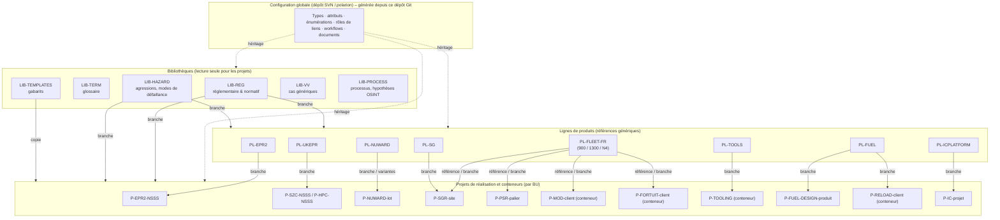

# Partie 3.5 — Topologie des projets, réutilisation, variantes et baselines

> Source : `model/project_topology.yaml`. Décisions : ADR-01 à ADR-06.

## 1. Vue d'ensemble

## 2. Instances (ADR-03)

| Instance | Contenu autorisé | Utilisateurs | Hébergement | Échanges |
|---|---|---|---|---|
| **STD** | Public, interne, confidentiel, confidentiel client ; export non contrôlé, UE double usage, contrôle national FR / DE | Salariés France / Allemagne ; externes nominatifs restreints | Sur site, datacenters France, cluster | ReqIF vers les clients et partenaires ; REST / OSLC vers 3DX, GED, MES |
| **SENS** (si ADR-03 la confirme) | Sensible sécurité nucléaire, Diffusion Restreinte | Personnes habilitées | Réseau isolé homologué | ReqIF manuel contrôlé uniquement |
| **US** (si ADR-03 la confirme) | Données soumises aux réglementations US | US persons / autorisés | Sur site, États-Unis | ReqIF contrôlé (contrôle export) |

La configuration est **identique** sur toutes les instances (générée depuis ce dépôt) : seuls diffèrent les énumérations de classification autorisées, les projets et les utilisateurs.

## 3. Groupes de projets et projets

| Groupe | Projets | Type | Propriétaire |
|---|---|---|---|
| CORP | LIB-REG, LIB-TERM, LIB-TEMPLATES, LIB-HAZARD, LIB-VV, LIB-PROCESS, SANDBOX | Bibliothèques | Design Authority ALM + référents |
| PL | PL-EPR2, PL-UKEPR, PL-NUWARD, PL-FLEET-FR, PL-SG, PL-FUEL, PL-ICPLATFORM, PL-TOOLS | Lignes de produits | Autorités de conception produit |
| PCM | P-EPR2-NSSS, P-SZC-NSSS, P-HPC-NSSS, P-COMP-\<code\> | Réalisation | Directions de projets |
| DTI | P-NUWARD-\<lot\>, P-RD-\<code\> | Réalisation | DTI |
| IB | P-SGR-\<site\>, P-PSR-\<palier\>, P-MOD-\<client\>, P-FORTUIT-\<client\>, P-TOOLING | Réalisation / conteneurs | BU Base installée |
| FUEL | P-FUEL-DESIGN-\<produit\>, P-RELOAD-\<client\> | Réalisation / conteneurs | BU Combustible |
| ICS | P-IC-\<projet\> | Réalisation | BU C-C |

## 4. Gabarits de projets et structure en Spaces

> **v0.3 : hiérarchie master → archétypes → spécialisations.** Le tableau ci-dessous décrit les gabarits de la v0.1, devenus des **spécialisations**. Ils héritent désormais d'un master (`TPL-00-MASTER`, non instanciable) et de l'un des 6 archétypes : `TPL-01-PRODUCT`, `TPL-02-IB`, `TPL-03-EXPRESS`, `TPL-04-SERVICES`, `TPL-05-SERIES`, `TPL-06-LIBRARY`. Seuls le master et les archétypes sont maintenus comme gabarits complets ; une spécialisation ne porte que ses écarts. Le graphe d'héritage figure dans l'[annexe A7](../generated/A7_tailoring.md), la logique de provisioning dans le [doc. 21](21_Organisation_matricielle_provisioning_habilitations.md).
>
> **Correction v0.3 (PR-09).** Un Space organise, il ne protège pas : la recherche et les requêtes ignorent le rangement en Space. Tout cloisonnement client, fournisseur ou UO passe par un projet distinct (`EXT-*`) ou par des permissions fondées sur une requête.

| Gabarit | Usage | Spaces (dossiers de LiveDocs) |
|---|---|---|
| TPL-NEWBUILD | EPR2, UK EPR, NUWARD | 00-Management · 10-Input & Regulatory · 20-Stakeholder · 30-System · 40-Architecture · 50-Equipment · 60-Safety · 70-V&V · 80-Interfaces · 90-Change & NC · 95-Deliverables |
| TPL-IB-PROJECT | RGV, rénovations | 00-Management · 10-Input · 30-Requirements · 40-Solution · 60-Safety & RP · 70-V&V & Requalification · 80-Site interfaces · 90-Change & NC · 95-Deliverables |
| TPL-IB-PSR | Réexamens | 00-Management · 10-Regulatory & commitments · 20-Conformity review · 30-Reassessment studies · 40-Ageing / LTO · 90-Deviations · 95-Deliverables |
| TPL-IB-MOD / TPL-IB-FORTUIT / TPL-TOOLING | Conteneurs | Un Space par affaire : `<ID> <site> <objet>` |
| TPL-FUEL-DESIGN | Conception combustible | 00-Management · 10-Regulatory & customer · 30-Design requirements & criteria · 50-Design · 60-Safety analyses · 70-Qualification · 90-Change & NC · 95-Licensing deliverables |
| TPL-FUEL-RELOAD | Recharges | `<tranche>/<cycle>` |
| TPL-IC-PLATFORM / TPL-IC-PROJECT | C-C | Étapes IEC 61513 (exigences globales → architecture → systèmes → logiciel / matériel → V&V → interfaces) |
| TPL-COMPONENT | Composants ESPN | 00-Management · 10-Procurement spec & codes · 30-Design requirements · 50-Design & analyses · 70-Manufacturing & inspection · 90-NC & waivers · 95-ESPN file |
| TPL-RD / TPL-LIBRARY | R&D, bibliothèques | Libre / par texte |

Chaque gabarit embarque :
- les LiveDocs modèles (document 12), avec les types de Work Items autorisés ;
- les tableaux de bord du rôle (document 13) ;
- les requêtes sauvegardées ;
- les plans (jalons) ;
- le profil de tailoring par défaut (types visibles, workflow documentaire).

## 5. Patrons de réutilisation (ADR-06)

| Patron | Mécanisme Polarion | Modifiable localement | Mise à jour depuis la source | Usage |
|---|---|---|---|---|
| **Référence vivante** | Élément référencé (live) | Non | Automatique | Consultation d'éléments de bibliothèque toujours à jour (glossaire) |
| **Référence figée** | Élément référencé à une révision (frozen) | Non | Manuelle (changement de révision) | Citer une édition précise sans engagement de suivi |
| **Document dérivé** | Réutilisation en document dérivé (`derived_from`) | Seulement les champs autorisés | « Mettre à jour depuis la source » | Spécification générique imposée sans adaptation locale |
| **Branche** | Branchement de document (`branched_from`) | Oui | **Fusion 3-way au niveau champ** (2404+), maître → branche et branche → maître | **Défaut** : bibliothèque réglementaire (champs de conformité locaux), référence produit → réalisation |
| **Copie** | Copie de document | Oui | Aucune | Gabarits |

**Règles de gestion** :
1. La bibliothèque est publiée par version (`wfDocumentLibrary`, baseline `LIB-<doc>-<indice>`).
2. Le projet branche **une version publiée**, jamais un brouillon.
3. À la publication d'une nouvelle version, les liens `branched_from` deviennent suspects. Le responsable des exigences du projet décide : fusionner, ou maintenir l'ancienne édition avec une `designDecision`.
4. Les fusions branche → maître (remontée d'améliorations d'un projet vers la référence) passent par une demande de modification de la ligne de produits.

## 6. Gestion des variantes (ADR-05)

### 6.1 Niveau 1 : attributs d'applicabilité (parc existant, recharges)

- `applicablePlantSeries` (CP0, CPY, P4, P'4, N4, EPR..., générique) et `applicableUnits` (énumération par projet).
- `applicabilityCondition` (règle en clair).
- Vues filtrées par palier ou tranche ; rapports « exigences applicables à la tranche X ».

### 6.2 Niveau 2 : branches par variante (projets dérivés d'une référence)

- `PL-EPR2` → `P-EPR2-NSSS` (6 tranches). Les adaptations de site sont faites dans la branche et tracées par des `designDecision`. Les différences sont visibles par comparaison de documents.

### 6.3 Niveau 3 : module Polarion Variants (produits configurables)

- Modèle de caractéristiques (*feature model*, un par projet) : options du produit, par exemple :
  - NUWARD : site, cogénération, options ;
  - plateforme C-C : configuration matérielle ;
  - gamme combustible : type de réseau, enrichissements ;
  - catalogue d'outillages : variantes de machines.
- Spécification maître avec conditions de variante en pvSCL par élément (ex. `Cogeneration AND NOT InlandSite`).
- Génération des spécifications de variante (documents) et gestion des variantes inter-projets.
- **À évaluer en pilote (phase 3)** sur PL-ICPLATFORM ou PL-TOOLS avant toute généralisation.

## 7. Baselines, collections et états de configuration

| Objet | Création | Nommage | Usage |
|---|---|---|---|
| Baseline de document | Automatique à l'approbation (`fra-baseline.js`) | `<document>-<indice>` | Référence d'un LiveDoc diffusé |
| Baseline de jalon | Gestionnaire de configuration, à la revue (SRR, PDR, CDR...) | `<projet>-<jalon>-<AAAAMMJJ>` | Référence de configuration contractuelle |
| Baseline de clôture de demande de modification | Automatique à la clôture | `CR-<id>-closure` | Preuve de l'état après modification |
| Collection | Gestionnaire de configuration | `<projet>-<jalon>` | Ensemble cohérent de documents à des révisions données (inter-projets possible) ; hiérarchie de collections (2410+) : la collection d'un projet de réalisation dépend de la collection de la ligne de produits |
| Baseline de bibliothèque | Design Authority à la publication | `LIB-<doc>-<indice>` | Version branchable |

**Audit de configuration** (rapport mensuel) :
- éléments modifiés après la dernière baseline sans demande de modification ;
- documents approuvés dont un élément est en révision ;
- collections incohérentes (documents remplacés).

## 8. Liens inter-projets

- Autorisés par les règles de rôles (`__other`) pour :
  - `flowsDownFrom`, `refines`, `satisfies`, `verifies`, `validates`, `mitigates`, `supportedBy`, `assumes`, `impacts`, `resolves` ;
  - `sideA`, `sideB`, `documents`.
- Interdits vers les projets d'autres instances (inexistants techniquement).
- Les projets d'externes (collaboration) n'ont pas de liens sortants vers les projets internes.
- Les rapports de portefeuille s'exécutent au niveau du dépôt (`project.id:(A B)`), en lecture seule.
