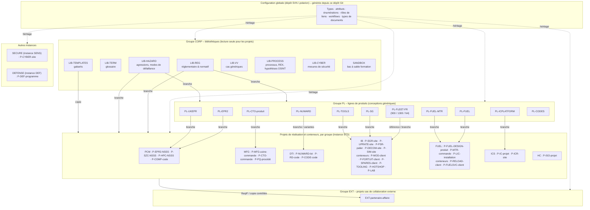

# Partie 3.5 — Topologie des projets, réutilisation, variantes et baselines

> *Version du plan : 0.5 (octobre 2026) · Dépendance à l'outil Polarion : **moyenne** (§ 5 et § 7 reposent sur des mécanismes natifs de Polarion) · Historique : [CHANGELOG](../../CHANGELOG.md) · Carte du dépôt : [guide de lecture](../GUIDE_DE_LECTURE.md).*
>
> Source : `model/project_topology.yaml` (instances, groupes de projets, gabarits, conventions de nommage). Décisions : ADR-01 à ADR-06 et ADR-28 ([doc. 06](../partie2/06_Decisions_architecture_ADR.md)). Les tableaux générés depuis le modèle sont dans l'[annexe A7](../generated/A7_tailoring.md). Les cotes [C] / [P] / [H] reprennent l'échelle de confiance du doc. 05 § 3 ; « [à vérifier] » signale une capacité Polarion dépendante de la version cible (annexe D).

> **En bref**
> - Ce document explique **comment les projets Polarion sont organisés** : sur quelles *instances* (installations Polarion distinctes) ils vivent, comment ils sont regroupés, comment un projet réutilise une bibliothèque ou une conception générique, comment on gère les *variantes* (paliers, tranches, options d'un produit) et comment on fige une référence (*baseline*).
> - Lecteurs : chefs de projet, responsables des exigences, gestionnaires de configuration, Design Authority ALM (propriétaire du modèle, doc. 17), administrateurs Polarion.
> - À lire avant : doc. 08 (modèle de données) et doc. 09 (liens). Pour le détail des gabarits et de la création des projets (*provisioning*) : [doc. 21](../partie4/21_Organisation_matricielle_provisioning_habilitations.md) et annexe A7.
> - Vocabulaire Polarion utilisé ici : un **projet** est l'unité de cloisonnement et de droits ; un **Space** est un dossier de documents à l'intérieur d'un projet ; un **LiveDoc** est un document vivant composé d'éléments (*Work Items* : exigences, cas de vérification, risques…) ; une **baseline** est une photographie figée de tout un projet ; une **Collection** est un ensemble de documents pris chacun à une révision donnée.

## 1. Vue d'ensemble

Architecture « *hub & spoke* » (ADR-01, ADR-02) : une configuration globale unique (le *hub*, générée depuis ce dépôt) héritée par tous les projets (les *spokes*), et quatre natures de projets : bibliothèques, lignes de produits, projets de réalisation (dont les conteneurs) et projets sas de collaboration externe.

Lecture du schéma : la configuration globale est stockée dans le dépôt SVN (Subversion, gestionnaire de versions interne à Polarion, doc. 15 § 1) et produite depuis ce dépôt Git ; `LIB-PROCESS` conserve aussi le REX (retour d'expérience) et les hypothèses OSINT (faits établis à partir de sources ouvertes, doc. 05). Une flèche « branche » signifie qu'un projet reprend un document publié par la source et le fait vivre localement (§ 5) ; « copie » désigne une duplication sans suivi (gabarits) ; « référence » désigne une consultation sans copie. Les projets sas `EXT-*` ne reçoivent que des copies contrôlées (fichiers ReqIF — format standard OMG d'échange d'exigences —, branchement), jamais de lien direct vers un projet interne (ADR-28).

## 2. Instances (ADR-03)

Une *instance* est une installation Polarion complète et séparée (serveurs, base de données, utilisateurs). Le modèle en distingue quatre ; seule STD est obligatoire.

| Instance | Contenu autorisé | Utilisateurs | Hébergement | Échanges |
|---|---|---|---|---|
| **STD** (standard, multi-BU France + Allemagne) | Classifications `public`, `internal`, `confidential`, `customerConfidential` ; contrôle export : non contrôlé, UE double usage, contrôle national FR, Allemagne AWG, à évaluer | Salariés Framatome France / Allemagne ; externes par comptes nominatifs restreints aux projets sas `EXT-*` (PR-06, PR-11) | Sur site, datacenters France, grappe de serveurs (doc. 15 § 1) | ReqIF vers les clients et partenaires ; REST / OSLC (interface de programmation web de Polarion / standard de liens entre outils du cycle de vie) vers le PLM (gestion du cycle de vie produit), la GED (gestion électronique des documents) et le MES (système d'exécution de la fabrication) — doc. 14 |
| **SENS** (sensible ; création conditionnée à ADR-03 et à l'homologation sécurité) | `sensitiveSecurity` (sécurité nucléaire), `restricted` (Diffusion Restreinte, DR) ; héberge notamment les projets de mise en conformité cybersécurité des installations (groupe SECURE) | Personnes habilitées | Réseau isolé homologué, administration séparée | ReqIF manuel contrôlé uniquement ; aucune intégration automatique avec STD |
| **US** (Framatome Inc. ; à confirmer par l'analyse juridique export, ADR-03) | Données soumises aux réglementations US (10 CFR 810 / 110, EAR) ; pack réglementaire `usNrc` activé par défaut | *US persons* et personnes autorisées | Sur site, États-Unis | ReqIF contrôlé (contrôle export) |
| **DEF** (défense : programmes de propulsion / défense) | `restricted` ; contrôle national FR / PPST | Personnel habilité | **Hors périmètre de ce plan** : réseau classifié, administration habilitée | **Principe seul** : aucun contenu n'est modélisé (contrainte OSINT et secret de la défense nationale) ; reprend la configuration globale par import contrôlé (règle de provisioning D03 : typologie `defenseProgram` → DEF) |

La configuration est **identique** sur toutes les instances (générée depuis ce dépôt) : seuls diffèrent les valeurs de classification et de contrôle export autorisées (`classificationsAllowed`, `exportControlAllowed`), les projets et les utilisateurs. Il n'existe aucun lien automatique entre instances (ADR-03) : les échanges passent par ReqIF, revus par le contrôle export.

## 3. Groupes de projets et projets

> **Référence unique : `model/project_topology.yaml` (section `projectGroups`)**, restitué dans l'[annexe A7](../generated/A7_tailoring.md) ; la logique de création des projets est au [doc. 21 § 2](../partie4/21_Organisation_matricielle_provisioning_habilitations.md). Ce paragraphe n'en donne que la structure (le tableau détaillé de la v0.1 est retiré : il était périmé).

- **12 groupes de projets** : `CORP` (bibliothèques `LIB-*` et bac à sable `SANDBOX`), `PL` (lignes de produits `PL-*`), puis les groupes de réalisation par BU ou activité : `PCM` (projets et composants), `MFG` (unités opérationnelles usines, option), `DTI` (direction technique et ingénierie), `IB` (base installée), `FUEL` (combustible), `ICS` (contrôle-commande), `HC` (santé), `SECURE` (instance SENS), `DEFENSE` (instance DEF) et `EXT` (projets sas de collaboration externe).
- **Natures de projets** (`kind`) : *library* (bibliothèque, lecture seule pour les autres projets), *productLine* (ligne de produits : conception générique de référence), *delivery* (projet de réalisation dédié : contrat, lot, tranche), *container*, *collaboration* (sas `EXT-*`) et *sandbox*. Un **conteneur** regroupe les affaires courtes et nombreuses (fortuits, modifications, pièces de rechange, outillages, recharges) : un projet par client ou par parc, **un Space par affaire**.
- **Conventions d'identifiants** (`conventions.projectId`) : préfixes `P-` (réalisation), `PL-` (ligne de produits), `LIB-` (bibliothèque), `EXT-` (sas) ; majuscules, 20 caractères au plus, aucune donnée client sensible dans l'identifiant. Le préfixe des identifiants de Work Items est l'identifiant court du projet (ex. `EPR2N-1234`) ; les identifiants externes (client, ReqIF, DOORS) sont portés par le champ `externalId` (ADR-22).
- **Propriétaires** : bibliothèques → Design Authority ALM et référents ; lignes de produits → autorités de conception produit (rôle projet `libraryDesignAuthority`) ; projets de réalisation → directions de projets des BU.

## 4. Gabarits de projets et structure en Spaces

> **Référence unique : `model/project_topology.yaml` (section `projectTemplates`)** et l'[annexe A7](../generated/A7_tailoring.md) (« Gabarits : master → archétypes → spécialisations », graphe d'héritage) ; logique de provisioning au [doc. 21 § 2.2](../partie4/21_Organisation_matricielle_provisioning_habilitations.md). Le tableau des Spaces de la v0.1 est retiré (il divergeait du modèle).

- **28 gabarits** (*templates* : projets modèles que le guichet de provisioning instancie) en trois niveaux : 1 master `TPL-00-MASTER` (socle commun, non instanciable seul) → 6 archétypes instanciables (`TPL-01-PRODUCT` produit neuf, `TPL-02-IB` base installée, `TPL-03-EXPRESS` conteneur express, `TPL-04-SERVICES` outillages et interventions, `TPL-05-SERIES` fabrication et série, `TPL-06-LIBRARY` bibliothèque) → 21 spécialisations (ex. `TPL-NEWBUILD`, `TPL-IB-PSR`, `TPL-COMPONENT`, `TPL-EXT`). Seuls le master et les archétypes sont maintenus comme gabarits complets ; une spécialisation ne porte que ses écarts (`extends`).
- **Chaque gabarit embarque** : les Spaces (dossiers de LiveDocs, nommés `NN-Libellé` pour un tri numérique, en anglais pour les projets internationaux), les LiveDocs modèles (doc. 12) avec les types de Work Items autorisés, les tableaux de bord du rôle (doc. 13), les requêtes sauvegardées, les plans (jalons) et le profil de tailoring par défaut (types visibles, workflow documentaire — doc. 07 § 4).
- **Correction v0.3 (PR-09).** Un Space organise, il ne protège pas : la recherche et les requêtes ignorent le rangement en Space. Tout cloisonnement client, fournisseur ou UO passe par un projet distinct (sas `EXT-*`) ou par des permissions fondées sur une requête (détail au doc. 21 § 4). Un Space par lot de travaux ou par UO reste admis pour la navigation ; la responsabilité est portée par les champs `responsibleUnit` / `performingUnit` et par l'élément `workPackage` (ADR-24).

## 5. Patrons de réutilisation (ADR-06)

Polarion offre cinq façons de réutiliser un contenu publié ailleurs. Le tableau indique, pour chacune, si le projet peut modifier localement ce qu'il a repris et comment il reçoit les évolutions de la source.

| Patron | Mécanisme Polarion | Modifiable localement | Mise à jour depuis la source | Usage |
|---|---|---|---|---|
| **Référence vivante** | Élément référencé (*live*) : le projet affiche l'élément de la source, sans copie | Non | Automatique | Consultation d'éléments de bibliothèque toujours à jour (glossaire) |
| **Référence figée** | Élément référencé à une révision donnée (*frozen*) | Non | Manuelle (changement de révision) | Citer une édition précise sans engagement de suivi |
| **Document dérivé** | Réutilisation en document dérivé (lien `derived_from`) | Seulement les champs autorisés | « Mettre à jour depuis la source » | Spécification générique imposée sans adaptation locale |
| **Branche** | Branchement de document (lien `branched_from`) : copie qui garde la mémoire de son origine | Oui | **Fusion à trois sources** (*3-way merge* : source, branche et ancêtre commun comparés champ par champ), maître → branche et branche → maître [à vérifier, spike S1 / Q-TOOL-01 : fonction annoncée 2404+] | **Défaut** : bibliothèque réglementaire (champs de conformité locaux), référence produit → réalisation |
| **Copie** | Copie de document | Oui | Aucune | Gabarits |

**Règles de gestion** :
1. La bibliothèque est publiée par version (workflow documentaire `wfDocumentLibrary`, baseline `LIB-<document>-<indice>`).
2. Le projet branche **une version publiée**, jamais un brouillon.
3. À la publication d'une nouvelle version, les liens `branched_from` deviennent *suspects* (marqués « à revoir », doc. 09 § 5). Le responsable des exigences du projet décide : fusionner, ou maintenir l'ancienne édition avec une `designDecision` (décision de conception tracée).
4. Les fusions branche → maître (remontée d'améliorations d'un projet vers la référence) passent par une demande de modification de la ligne de produits.

## 6. Gestion des variantes (ADR-05)

Trois niveaux, du plus simple au plus outillé ; on n'emploie le niveau supérieur que si le niveau inférieur ne suffit pas.

### 6.1 Niveau 1 : attributs d'applicabilité (parc existant, recharges)

- `applicablePlantSeries` (paliers du parc français : CP0, CPY, P4, P'4, N4 — familles de centrales 900, 1300 et 1450 MWe —, EPR, EPR2, NUWARD… ; énumération `plantSeries`) et `applicableUnits` (tranches, énumération `plantUnit` surchargée par projet).
- `applicabilityCondition` (règle en clair).
- Vues filtrées par palier ou tranche ; rapports « exigences applicables à la tranche X ».

### 6.2 Niveau 2 : branches par variante (projets dérivés d'une référence)

- `PL-EPR2` → `P-EPR2-NSSS` (6 tranches ; NSSS = chaudière nucléaire). Les adaptations de site sont faites dans la branche et tracées par des `designDecision`. Les différences sont visibles par comparaison de documents.

### 6.3 Niveau 3 : module Polarion Variants (produits configurables)

- Module payant (licence additionnelle, ADR-18) fondé sur un **modèle de caractéristiques** (*feature model* : l'arbre des options et contraintes d'un produit), un par projet. Exemples d'options :
  - NUWARD : site, cogénération, options ;
  - plateforme de contrôle-commande : configuration matérielle ;
  - gamme combustible : type de réseau, enrichissements ;
  - catalogue d'outillages : variantes de machines.
- Spécification maître avec conditions de variante par élément, écrites en pvSCL (langage de conditions du module, ex. `Cogeneration AND NOT InlandSite`).
- Génération des spécifications de variante (documents) et gestion des variantes inter-projets.
- **À évaluer en pilote (phase 3)** sur `PL-ICPLATFORM` (ou `PL-TOOLS`) avant toute généralisation ; la licence est alors évaluée sur cette ligne de produits (ADR-05). **`PL-NUWARD` est différé** : le pilote NUWARD (doc. 23 § 6) ne couvre qu'une seule conception et reporte Variants.

## 7. Baselines, collections et états de configuration

Une **baseline** Polarion fige **tout un projet** (révision du dépôt) ; une **Collection** fige un ensemble de documents, chacun à une révision choisie, et peut traverser plusieurs projets. Conventions de nommage : `conventions.baselineNaming` et `conventions.collectionNaming` du modèle.

| Objet | Création | Nommage | Usage |
|---|---|---|---|
| Baseline de document | Automatique à l'approbation du LiveDoc (fonction `createBaseline`, script `fra-baseline.js`) | `<document>-<indice>` | Référence d'un LiveDoc diffusé |
| Baseline de jalon (projet dédié) | Gestionnaire de configuration, à la revue (SRR, PDR, CDR : revues des exigences, de conception préliminaire, de conception détaillée) | `<projet>-<jalon>-<AAAAMMJJ>` (ex. `P-EPR2-NSSS-CDR-20270315`) | Référence de configuration contractuelle |
| Baseline de clôture de demande de modification | Automatique à la clôture (`wfChangeRequest.close`) | `CR-<id>-closure` | Preuve de l'état après modification |
| Collection | Gestionnaire de configuration | Projets conteneurs et base installée : `<projet>-<tranche>-<arrêt>` (ex. `P-SGR-X-T2-VD4`) ou `<projet>-<affaire>-<AAAAMMJJ>` (`collectionNaming`, doc. 21 § 5) | Ensemble cohérent de documents à des révisions données (inter-projets possible) ; état d'une affaire à sa clôture, d'une tranche après un arrêt. Hiérarchie de collections (la collection d'un projet de réalisation dépend de celle de la ligne de produits) [à vérifier, spike S1 / Q-TOOL-01 : fonction annoncée 2410+] |
| Baseline de bibliothèque | Design Authority à la publication (`wfDocumentLibrary.publish`) | `LIB-<document>-<indice>` | Version branchable |

**Audit de configuration** (rapport mensuel) :
- éléments modifiés après la dernière baseline sans demande de modification ;
- documents approuvés dont un élément est en révision ;
- collections incohérentes (documents remplacés).

## 8. Liens inter-projets

- Autorisés par les règles de rôles de liens (jeton `__other` = « tout autre projet », annexe D PF-01, [à vérifier au spike S1]) pour les rôles déclarés `crossProject` dans `model/link_roles.yaml` :
  - `flowsDownFrom`, `refines`, `satisfies`, `verifies`, `validates`, `mitigates`, `supportedBy`, `assumes`, `impacts`, `resolves` ;
  - `sideA`, `sideB`, `documents` ;
  - `dependsOn`, `supersedes`, `inWorkPackage` (lots de travaux confiés à une UO, ADR-24).
- Interdits vers les projets d'autres instances (inexistants techniquement).
- Les projets sas `EXT-*` n'ont pas de liens sortants vers les projets internes (ADR-28, PR-09).
- Les rapports de portefeuille s'exécutent au niveau du dépôt (requête `project.id:(A B)`), en lecture seule.
