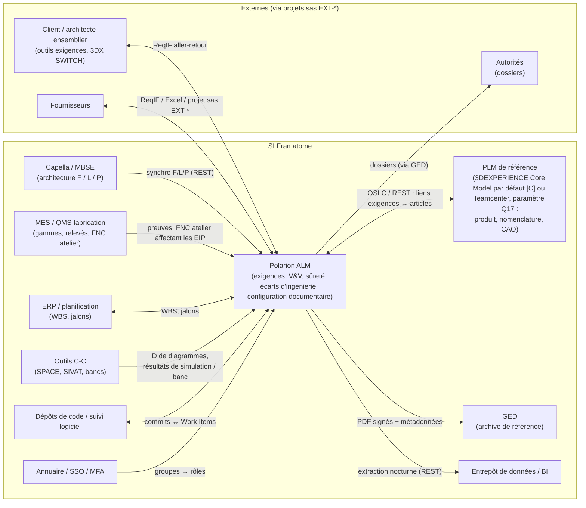

# Partie 3.8 — Intégrations et échanges de données

> *Version du plan : 0.5 (octobre 2026) · Dépendance à l'outil Polarion : **forte** · Historique : [CHANGELOG](../../CHANGELOG.md) · Carte du dépôt : [guide de lecture](../GUIDE_DE_LECTURE.md).*
>
> Principe directeur (ADR-07) : **une donnée = un système maître**. Les autres systèmes en détiennent un *proxy* (fiche représentante) ou un lien, jamais une copie éditable. La spécification contrôlée des échanges (profils ReqIF `RIF-*`, règles Word `W-*`, gabarits Excel `XL-*`, connecteurs `CX-*`) est au [doc. 22](../partie4/22_Import_export_parsing_connecteurs.md) et dans l'[annexe A11](../generated/A11_import_export.md) ; ce document garde le paysage, l'essentiel de chaque fiche, la sécurité et le long terme. « [à vérifier] » signale une capacité Polarion dépendante de la version cible (annexe D, spike S1).

> **En bref**
> - Ce document décrit **avec quels autres outils Polarion échange des données** (client, maquette d'architecture, PLM, usine, GED, ERP, contrôle-commande, code, annuaire, décisionnel, fournisseurs) et selon quelles règles de sécurité.
> - Lecteurs : DSI et intégrateur, Design Authority ALM, responsables des exigences (échanges client), responsables PLM / MBSE.
> - À lire avant : doc. 06 (ADR-07, ADR-08, ADR-12, ADR-28), doc. 11 § 2 (instances) ; ensuite doc. 22 pour les profils détaillés.
> - Sigles récurrents : **ReqIF** (format standard OMG d'échange d'exigences), **OSLC** (standard d'interopérabilité des outils du cycle de vie, par liens), **REST** (API web de Polarion), **PLM** (gestion du cycle de vie produit : articles, nomenclatures, CAO), **MBSE** (ingénierie système fondée sur les modèles), **GED** (gestion électronique des documents), **MES** (système d'exécution de la fabrication), **ERP** (progiciel de gestion intégré), **BI** (informatique décisionnelle), **SSO / MFA** (authentification unique / à plusieurs facteurs).

## 1. Paysage applicatif cible

Capella est l'atelier MBSE open source fondé sur la méthode Arcadia ; « F / L / P » désigne ses couches fonctionnelle, logique et physique. 3DX SWITCH est la plateforme 3DEXPERIENCE d'EDF ; SPACE et SIVAT sont les outils d'ingénierie et de validation de la plateforme de contrôle-commande TELEPERM XS (C-C = contrôle-commande). L'architecte-ensemblier est le maître d'œuvre d'ensemble de l'installation (ADR-12) ; EIP = éléments importants pour la protection des intérêts (arrêté INB) ; FNC = fiches de non-conformité ; WBS = structure de découpage des travaux.

## 2. Fiches d'intégration

Chaque fiche donne l'essentiel (objet, sens, mécanisme, règles propres) et renvoie à la spécification contrôlée du doc. 22 (connecteurs `CX-*`, § 5 ; profils ReqIF `RIF-*`, § 2 ; gabarits Excel `XL-*`, § 4). Les connecteurs sans fiche (`CX-MBSE-CAMEO`, `CX-CALC`, `CX-DOORS-MIG`) ne sont décrits qu'au doc. 22.

### I-01 — Client / architecte-ensemblier (ReqIF)

| Attribut | Valeur |
|---|---|
| Objet et sens | Entrant : exigences du client → `sourceRequirement` (texte verbatim). Sortant : positions de conformité, exigences Framatome à valider, ICD (document de contrôle d'interfaces), visas |
| Mécanisme | OMG ReqIF 1.1 / 1.2 (lecture de 1.0.1 si partenaire ancien) [à vérifier sur la version cible] (`.reqif`, `.reqifz` compressé) ; gabarits de correspondance par client dans `.polarion/reqif/templates` ; ID client → `externalId`, document et révision → `sourceDocument` / `sourceDocumentRevision` ; réception dans le projet sas `EXT-*` puis transfert (XC-03) |
| Règles propres | Texte original verrouillé après acceptation (permissions par état, PR-03) ; au **ré-import d'une révision client**, les éléments dont le texte a changé repassent en `underAnalysis` par la transition `reassess` (attribut `onChangedReimport: reassess` du profil `RIF-CUSTOMER-IN` ; script d'import à construire, étape S11) et les éléments disparus passent en `superseded` ; contrôle export avant tout export (XC-01) ; gabarit négocié dans le plan de management de l'interface |
| Spécification | `RIF-CUSTOMER-IN`, `RIF-CUSTOMER-COMPLIANCE-OUT` (doc. 22 § 2) |

### I-02 — Capella (MBSE) → Polarion

| Attribut | Valeur |
|---|---|
| Objet et sens | Fonctions, composants logiques et physiques, échanges et interfaces, scénarios, diagrammes (images) ; Capella → Polarion, unidirectionnel (ADR-08) |
| Mécanisme | API REST de Polarion (activation par propriété de configuration [à vérifier, Q-TOOL-01]) ; patron de synchronisation de type *capella2polarion* (outil libre ; configuration YAML, LiveDocs en autorité complète ou mixte) ; UUID Capella (identifiant unique universel de l'élément de modèle) → `modelElementId` ; à chaque livraison du modèle ou quotidienne |
| Règles propres | Champs maîtres en lecture seule dans Polarion ; liens de traçabilité vers les exigences créés dans Polarion ; une suppression dans Capella donne l'état `obsolete` dans Polarion (jamais de suppression) |
| Spécification | `CX-MBSE-CAPELLA` ; option Cameo / CATIA Magic : `CX-MBSE-CAMEO` (doc. 22 § 5.2) |

### I-03 — PLM de référence (3DEXPERIENCE Core Model ou Teamcenter)

| Attribut | Valeur |
|---|---|
| Objet et sens | Articles de configuration (PBS, arborescence produit), nomenclatures, CAO, modifications produit (ECO, *engineering change order*) ; bidirectionnel par **liens** (pas de copie) : `physicalComponent` (proxy) ↔ article PLM |
| Mécanisme | Le PLM est un **paramètre de création de projet** (Q17) : 3DEXPERIENCE par défaut (Core Model attesté [C], ADR-07 ; connecteur OSLC / REST à développer, confiance P) ou Teamcenter (intégration Siemens native, confiance H) ; identifiants `plmItemId`, `plmRevision` |
| Règles propres | Création du proxy Polarion à la création de l'article (ou import planifié) ; classement de sûreté porté par Polarion, répliqué en attribut PLM si nécessaire (un seul maître) ; frontière exacte avec le Core Model à trancher (ADR-07, Q-PCM-03) |
| Spécification | `CX-PLM-3DX`, `CX-PLM-TC` (doc. 22 § 5.1) |

### I-04 — MES / QMS (fabrication)

| Attribut | Valeur |
|---|---|
| Objet et sens | Preuves de fabrication et de contrôle (PV, relevés), FNC d'atelier ; MES → Polarion (REST, événements MES) |
| Règles propres | Résultats de contrôle référencés dans `verificationCase` (étape `vvStage = manufacturing`) via `evidenceReference` ; les FNC d'atelier affectant une exigence définie créent un proxy `nonConformance` (`externalId` = n° MES) (ADR-13) |
| Spécification | Aucun connecteur `CX-*` modélisé à ce stade : à spécifier en cadrage avec la frontière Polarion / PLM / MES (Q-PCM-03) |

### I-05 — GED (archive de référence)

| Attribut | Valeur |
|---|---|
| Objet et sens | Polarion → GED : PDF signés (PDF/A, format d'archivage pérenne, + manifeste des signatures), métadonnées (n°, indice, classification, export) ; GED → Polarion : n° de document, visa |
| Mécanisme | Connecteur (CMIS, standard d'accès aux GED, ou API de la GED) déclenché par la fonction `exportToEdms` (script `fra-export-edms.js`) |
| Règles propres | La GED fait foi ; Polarion conserve `edmsReference` ; conservation selon la politique d'archivage (arrêté INB art. 2.5.6 « durée justifiée », Q-REG-04) |
| Spécification | `CX-EDMS` (doc. 22 § 5) |

### I-06 — ERP / planification

| Attribut | Valeur |
|---|---|
| Objet et sens | ERP → Polarion : codes WBS / OTP (structure de découpage des travaux / ordre de travail), commandes internes, jalons ; Polarion → planification : avancement des livrables et de la V&V |
| Mécanisme | REST, fichiers ; `wbsCode`, `internalOrderReference` sur les lots de travaux ; Plans Polarion (jalons) |
| Spécification | `CX-ERP` (doc. 22 § 5, confiance P) |

### I-07 — Outils de contrôle-commande (SPACE, SIVAT, bancs, Simulink)

| Attribut | Valeur |
|---|---|
| Objet et sens | Identifiants des diagrammes fonctionnels, versions applicatives, résultats de simulation et de banc ; outils C-C → Polarion |
| Règles propres | `softwareRequirement` → diagramme (`modelElementId`) ; résultats → Test Records (import xUnit) ou `evidenceReference` ; les outils de génération de code relèvent de la qualification des outils IEC 60880 (norme des logiciels de catégorie A), hors Polarion |
| Spécification | `CX-SIMULINK`, `CX-TEST-BENCH` (doc. 22 § 5) |

### I-08 — Dépôts de code et suivi logiciel

- Liaison des révisions de code aux Work Items (dépôts Git ou SVN externes ; liaison par identifiant dans les messages de *commit*).
- Connecteur Jira bidirectionnel si des équipes l'utilisent (outillages logiciels, numérique) ; les exigences et la V&V restent dans Polarion.
- Spécification : `CX-JIRA`, `CX-TEST-BENCH` (doc. 22 § 5).

### I-09 — Annuaire, SSO, MFA

- Groupes d'annuaire → rôles projet et globaux, et groupes d'habilitation `HAB-<domaine>-<niveau>` (doc. 21 § 3) ; provisionnement automatique ; revue semestrielle (PR-08).
- SSO (Kerberos — authentification intégrée au domaine Windows — ou fédération d'identité SAML / OIDC, selon la version cible et Q-TOOL-01) + **authentification alternative LDAP (annuaire d'entreprise) pour les signatures électroniques** (PR-04).
- MFA à l'ouverture de session (porté par le fournisseur d'identité).
- Spécification : `CX-DIRECTORY` (doc. 22 § 5).

### I-10 — Entrepôt de données / BI

- Extraction nocturne en lecture seule (REST), avec propagation de la classification (document 13 § 7).

### I-11 — Fournisseurs

| Mode | Usage |
|---|---|
| Projet sas `EXT-<fournisseur>-<affaire>` (gabarit `TPL-EXT`, rôle `supplierContributor`, licence PRO, comptes nominatifs à expiration — ADR-28, PR-06, PR-11) | Fournisseurs stratégiques ESPN (équipements sous pression nucléaires) : matrices de conformité, FNC fournisseurs, documents |
| ReqIF | Fournisseurs équipés d'un outil d'exigences (`RIF-SUPPLIER-OUT`, `RIF-SUPPLIER-RETURN`, doc. 22 § 2) |
| Excel aller-retour | Petits fournisseurs (matrice de conformité, gabarit `XL-SUPPLIER`, doc. 22 § 4) |

## 3. Sécurité des intégrations

| Exigence | Mise en œuvre |
|---|---|
| Comptes de service dédiés, moindre privilège | Un compte par intégration, rôle technique limité aux projets concernés |
| Jetons d'API (clés d'accès des programmes) | Jetons personnels / de service (en-tête HTTP de l'API REST [à vérifier, Q-TOOL-01]) stockés dans le gestionnaire de secrets de l'entreprise (gestionnaire de secrets intégré à Polarion [à vérifier, Q-TOOL-01 : annoncé en 2606]) ; rotation |
| Traçabilité | Toute écriture par intégration est historisée sous le compte de service ; journal des événements de sécurité de Polarion [à vérifier, Q-TOOL-01 : annoncé en 2606] |
| Contrôle export | Aucune intégration automatique vers une instance ou un tiers d'une autre juridiction ; filtrage sur `exportControl` et `informationClassification` (XC-01) |
| Validation | Chaque intégration fait l'objet de tests de recette et entre dans le périmètre de validation de l'outil (document 15 § 4 ; recette des échanges : doc. 22 § 7) |

## 3 bis. Spécification contrôlée (v0.3)

Les profils ReqIF, les règles d'analyse des imports Word, les gabarits Excel et les connecteurs (y compris Teamcenter, CATIA Magic / Cameo, Simulink, chaînes de calcul, bancs d'essais, migration DOORS) sont spécifiés dans `model/import_export.yaml`. Cette spécification est contrôlée contre le modèle (`tools/model_checks.py` : tout champ ou toute valeur cités doivent exister) et présentée au [doc. 22](../partie4/22_Import_export_parsing_connecteurs.md) et dans l'[annexe A11](../generated/A11_import_export.md). Le PLM y est paramétrable (`CX-PLM-3DX` par défaut [C], `CX-PLM-TC` Teamcenter ; Q17).

## 4. Interopérabilité de long terme

- **Formats ouverts** pour l'archive : PDF/A (documents), ReqIF (exigences), export XML / JSON des Work Items et des liens à chaque baseline majeure.
- **SysML v2** (langage de modélisation système de l'OMG, doté d'une API normalisée) : veille ; préparation d'un connecteur à moyen terme si les outils MBSE la supportent.
- **OSLC** : préféré aux intégrations propriétaires point à point.
