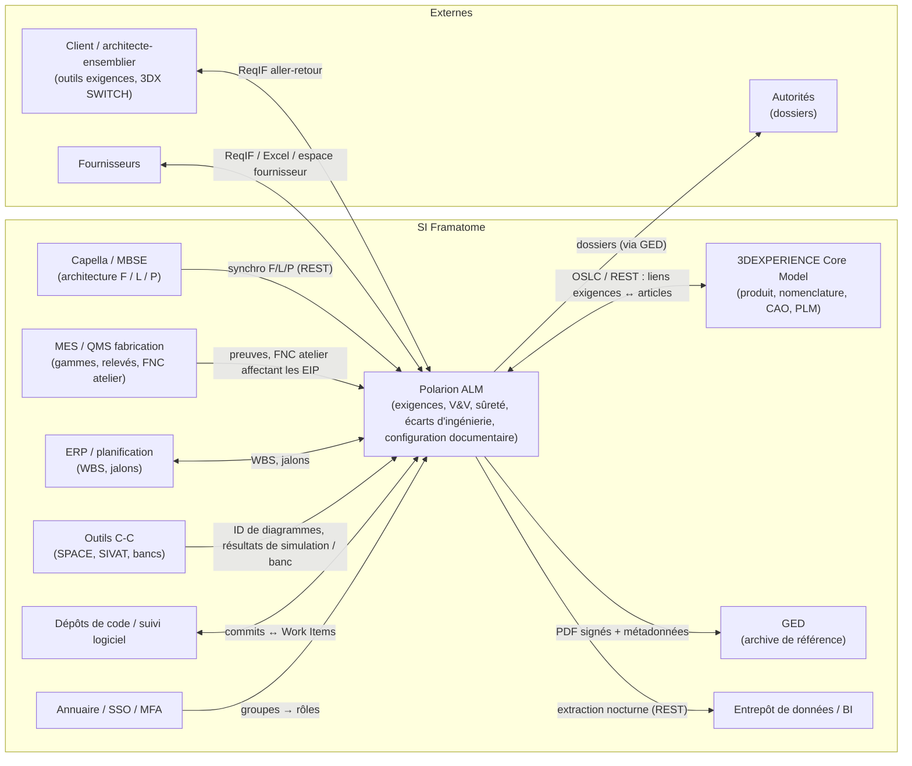

# Partie 3.8 — Intégrations et échanges de données

> Principe directeur (ADR-07) : **une donnée = un système maître**. Les autres systèmes en détiennent un proxy ou un lien, jamais une copie éditable.

## 1. Paysage applicatif cible

## 2. Fiches d'intégration

### I-01 — Client / architecte-ensemblier (ReqIF)

| Attribut | Valeur |
|---|---|
| Objet | Exigences d'entrée, positions de conformité, ICD, visas |
| Sens | Entrant (exigences du client → `sourceRequirement`) ; sortant (positions de conformité, exigences Framatome à valider, ICD) |
| Protocole | ReqIF 1.0.1 / 1.1 (`.reqif`, `.reqifz`) ; gabarits de correspondance par client dans `.polarion/reqif/templates` |
| Identifiants | ID client → `externalId` ; document et révision → `sourceDocument` / `sourceDocumentRevision` |
| Fréquence | À chaque révision du document client ; réimport incrémental (mise à jour du même document) |
| Règles | Texte original verrouillé après acceptation ; une nouvelle révision du client passe les éléments modifiés en `underAnalysis` (script) ; contrôle export avant tout export |
| Risques | Hétérogénéité des modèles ReqIF (types d'attributs) → gabarit négocié dans le plan de management de l'interface |

### I-02 — Capella (MBSE) → Polarion

| Attribut | Valeur |
|---|---|
| Objet | Fonctions, composants logiques et physiques, échanges et interfaces, diagrammes (images) |
| Sens | Capella → Polarion (unidirectionnel, ADR-08) |
| Protocole | API REST Polarion (activée par `com.siemens.polarion.rest.enabled`), patron de synchronisation de type *capella2polarion* (configuration YAML, LiveDocs en autorité complète ou mixte) |
| Identifiants | UUID Capella → `modelElementId` |
| Fréquence | À chaque livraison du modèle (pipeline), ou quotidienne |
| Règles | Champs maîtres en lecture seule dans Polarion ; liens de traçabilité vers les exigences créés dans Polarion ; une suppression dans Capella donne l'état `obsolete` dans Polarion (pas de suppression) |

### I-03 — 3DEXPERIENCE (Core Model SE / PLM)

| Attribut | Valeur |
|---|---|
| Objet | Articles de configuration (PBS), nomenclatures, CAO, modifications produit (ECO) |
| Sens | Bidirectionnel par **liens** (pas de copie) : `physicalComponent` (proxy) ↔ article 3DX |
| Protocole | OSLC (Polarion fournisseur RM / CM, interfaces déléguées), REST des deux côtés |
| Identifiants | `plmItemId`, `plmRevision` ; URL OSLC |
| Règles | Création du proxy Polarion à la création de l'article 3DX (ou import planifié) ; classement de sûreté porté par Polarion, répliqué en attribut 3DX si nécessaire (un seul maître) |
| Points à trancher | Frontière exacte avec le Core Model (ADR-07, Q-PCM-03) |

### I-04 — MES / QMS (fabrication)

| Attribut | Valeur |
|---|---|
| Objet | Preuves de fabrication et de contrôle (PV, relevés), FNC d'atelier |
| Sens | MES → Polarion |
| Protocole | REST (Polarion) ; événements MES |
| Règles | Les résultats de contrôle référencés dans `verificationCase` (étape `manufacturing`) via `evidenceReference` ; les FNC d'atelier affectant une exigence définie créent un proxy `nonConformance` (`externalId` = n° MES) (ADR-13) |

### I-05 — GED (archive de référence)

| Attribut | Valeur |
|---|---|
| Objet | PDF signés (PDF/A + manifeste des signatures), métadonnées (n°, indice, classification, export), visas |
| Sens | Polarion → GED (diffusion) ; GED → Polarion (n° de document, visa) |
| Protocole | Connecteur (CMIS ou API de la GED) déclenché par `exportToEdms` |
| Règles | La GED fait foi ; Polarion conserve `edmsReference` ; conservation selon la politique d'archivage (arrêté INB 2.5.6 « durée justifiée ») |

### I-06 — ERP / planification

| Attribut | Valeur |
|---|---|
| Objet | Codes WBS / OTP, jalons, avancement des livrables |
| Sens | ERP → Polarion (WBS, jalons) ; Polarion → planification (avancement des livrables et de la V&V) |
| Protocole | REST, fichiers |
| Identifiants | `wbsCode` ; Plans Polarion (jalons) |

### I-07 — Outils de contrôle-commande (SPACE, SIVAT, bancs)

| Attribut | Valeur |
|---|---|
| Objet | Identifiants des diagrammes fonctionnels, versions applicatives, résultats de simulation et de banc |
| Sens | Outils C-C → Polarion |
| Règles | `softwareRequirement` → diagramme (`modelElementId`) ; résultats → Test Records (import) ou `evidenceReference` ; les outils de génération de code relèvent de la qualification des outils IEC 60880 (hors Polarion) |

### I-08 — Dépôts de code et suivi logiciel

- Liaison des révisions de code aux Work Items (dépôts Git ou SVN externes ; liaison par ID dans les messages de commit).
- Connecteur Jira bidirectionnel si des équipes l'utilisent (outillages logiciels, numérique).

### I-09 — Annuaire, SSO, MFA

- Groupes d'annuaire → rôles projet et globaux (provisionnement automatique ; revue PR-08).
- SSO (Kerberos ou fédération, selon la version cible et Q-TOOL-01) + **authentification alternative LDAP pour les e-signatures**.
- MFA à l'ouverture de session (porté par le fournisseur d'identité).

### I-10 — Entrepôt de données / BI

- Extraction nocturne en lecture seule (REST), avec propagation de la classification (document 13 § 7).

### I-11 — Fournisseurs

| Mode | Usage |
|---|---|
| Projet de collaboration fournisseur (licence PRO, droits restreints) | Fournisseurs stratégiques ESPN : matrices de conformité, FNC fournisseurs, documents |
| ReqIF | Fournisseurs équipés d'un outil d'exigences |
| Excel aller-retour | Petits fournisseurs (matrice de conformité) |

## 3. Sécurité des intégrations

| Exigence | Mise en œuvre |
|---|---|
| Comptes de service dédiés, moindre privilège | Un compte par intégration, rôle technique limité aux projets concernés |
| Jetons d'API | Jetons personnels / de service (`X-Polarion-REST-Token`) stockés dans le gestionnaire de secrets (2606 : Secrets Manager) ; rotation |
| Traçabilité | Toute écriture par intégration est historisée sous le compte de service ; journal des événements de sécurité (2606) |
| Contrôle export | Aucune intégration automatique vers une instance ou un tiers d'une autre juridiction ; filtrage sur `exportControl` et `informationClassification` |
| Validation | Chaque intégration fait l'objet de tests de recette et entre dans le périmètre de validation de l'outil (document 15) |

## 4. Interopérabilité de long terme

- **Formats ouverts** pour l'archive : PDF/A (documents), ReqIF (exigences), export XML / JSON des Work Items et des liens à chaque baseline majeure.
- **SysML v2** (API normalisée) : veille ; préparation d'un connecteur à moyen terme si les outils MBSE la supportent.
- **OSLC** : préféré aux intégrations propriétaires point à point.
