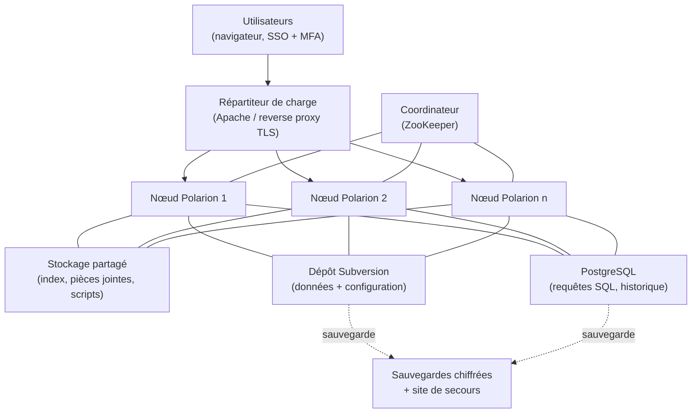

# Partie 3.9 — Infrastructure, sécurité, configuration « as code » et validation de l'outil

## 1. Architecture technique (instance STD)

| Composant | Faits techniques [C] | Exigence de conception |
|---|---|---|
| Stockage | Subversion = dépôt de référence (configuration et données sous `.polarion/`) ; PostgreSQL intégré pour les requêtes et l'historique | Sauvegarde cohérente SVN + PostgreSQL + stockage partagé ; restauration testée chaque trimestre |
| Cluster | Coordinateur (ZooKeeper), nœuds, dossier partagé, répartiteur Apache ; tâches planifiées réparties | Au moins 2 nœuds en production ; dimensionnement à confirmer avec l'éditeur (Q-TOOL-04) |
| Environnements | — | DEV (intégrateur), RECETTE (validation), PRÉPROD (miroir de données anonymisées ou de test), PROD ; et PRA |
| Version | 2606 (mai 2026) ; 2404 en fin de vie | Politique N-1, au moins 1 montée de version par an (ADR-21) |
| API REST | Désactivée par défaut ; propriétés `rest.enabled`, `swaggerUi.enabled`, jetons | Activée en PROD pour les intégrations, Swagger désactivé en PROD |
| IA | Copilot (2512+) | Désactivé (ADR-17) |

**Repères de performance** :
- chargement à la demande des documents à partir de 200 éléments ;
- `luceneMaxClauseCount = 20000`.

Les plafonds recommandés de volumétrie ne sont pas publics : ils sont à obtenir de l'éditeur. Règles de conception prudentes :
- LiveDocs de quelques milliers d'éléments au plus (scinder par chapitre ou sous-système) ;
- projets conteneurs archivés annuellement (Spaces clos) ;
- requêtes de portefeuille pré-calculées par script planifié.

## 2. Sécurité de l'information

| Domaine | Mesures |
|---|---|
| Classification | Champ `informationClassification` obligatoire (éléments et documents) ; conditions de workflow bloquant `sensitiveSecurity` / `restricted` sur STD ; rapport quotidien de détection (K-ADO-03) ; procédure de purge et de transfert vers SENS |
| Contrôle export | Champ `exportControl` obligatoire ; abaissement réservé (PR-07) ; projets « US 810 » restreints ; instance US (ADR-03) ; journalisation des accès aux projets contrôlés |
| Identités | SSO + MFA ; groupes d'annuaire → rôles ; comptes externes nominatifs, à durée limitée, restreints aux projets de collaboration ; revue semestrielle (PR-08) |
| Administration | Comptes à privilèges nominatifs, bastion, journalisation ; séparation administration plateforme / administration fonctionnelle (Design Authority) |
| Réseau | Exposition interne uniquement ; accès externe via passerelle sécurisée dédiée aux projets de collaboration (ou échanges ReqIF hors ligne) |
| Données au repos / en transit | TLS 1.2+ ; chiffrement des volumes et des sauvegardes |
| Journalisation | Journaux applicatifs, authentification, signatures, événements de sécurité (2606), envoyés au SOC ; conservation alignée sur la politique d'archivage |
| Cadre réglementaire | Politique de sécurité de l'entreprise ; NIS2 selon la transposition française (à vérifier, Q-REG-02) ; doctrine ANSSI ; homologation spécifique de l'instance SENS |
| Chaîne logicielle | Extensions open source revues (code, licences, maintenance) ; scripts versionnés dans ce dépôt ; aucune extension non qualifiée en production (ADR-16) |

## 3. Configuration « as code »

| Étape | Outil / livrable |
|---|---|
| Source | `model/*.yaml` (ce dépôt) |
| Validation | `tools/almmodel.py` : intégrité référentielle, cohérence des champs homonymes, champs natifs protégés, multi-valeurs, atteignabilité des états, rôles, conditions et fonctions connues, champs requis présents, tailoring et socle |
| Génération | `tools/generate_polarion.py --lang fr|en` → `generated/polarion/<lang>/.polarion/` ; `tools/generate_docs.py` → `docs/generated/` |
| CI | `.github/workflows/validate.yml` : validation + génération + contrôle que les fichiers générés commités sont à jour |
| Déploiement | Configuration globale (`/.polarion/` du dépôt SVN) ou gabarit de projet (ZIP importé dans l'administration) ; scripts dans `$POLARION_HOME/scripts` |
| Dérive | Comparaison périodique du dépôt SVN avec la génération ; toute modification manuelle en production est un écart |

## 4. Validation de l'outil (qualification d'un logiciel support d'AIP)

Polarion n'est pas un logiciel de sûreté, mais il **supporte des AIP** : contrôle technique, documentation et traçabilité (arrêté INB 2.5.6), gestion des écarts. Sa validation est donc requise par le système de management (ISO 19443 / NQA-1 selon l'entité). Approche fondée sur les risques :

| Étape | Livrable | Contenu |
|---|---|---|
| 1. Évaluation des risques | Analyse de criticité des fonctions de l'outil | Fonctions critiques (impact sur la démonstration ou l'intégrité des enregistrements) : signatures, workflows du socle, historique, baselines, suspicion, export GED, contrôles de classification. Fonctions non critiques : tableaux de bord de pilotage, ergonomie |
| 2. Exigences utilisateur (URS) | Spécification des exigences de l'outil | Tracée vers ce dépôt (modèle) et vers le socle NN-01 à NN-08 |
| 3. Spécification fonctionnelle et de configuration | Ce dépôt (modèle + XML générés + scripts) | Version étiquetée |
| 4. Qualification d'installation (IQ) | PV d'installation par environnement | Versions, paramètres (`secure.approvals`, REST, SSO, LDAP e-signature), certificats |
| 5. Qualification opérationnelle (OQ) | Jeux d'essais des fonctions critiques | Indépendance (auteur ≠ vérificateur bloqué), signatures (ré-authentification, signification, horodatage), états bloquants (suspects, champs requis), PDF signé, interdiction de suppression, classification interdite |
| 6. Qualification de performance (PQ) | Pilotes en conditions réelles | Volumétrie, temps de réponse, ergonomie, adéquation aux processus |
| 7. Rapport de validation | Synthèse et réserves | Décision de mise en service |
| 8. Maintien | Revue périodique + revalidation ciblée à chaque montée de version ou évolution du modèle | Analyse d'impact par version (notes de version Siemens) ; non-régression automatisée |

> **Les tests OQ sont dérivés du modèle** : chaque condition bloquante du socle (`approverNotAuthor`, `noSuspectLinks`, `noForbiddenClassification`, `safetyApprovalIf`, signatures) a au moins un cas de test positif et un cas négatif. Ces cas peuvent eux-mêmes être gérés dans un projet Polarion de validation (`verificationCase` + Test Runs), avec des preuves signées.

## 5. Intégrité des données (leçons de l'affaire du Creusot)

L'affaire du Creusot (irrégularités découvertes en 2016, environ 430 « dossiers barrés », revue d'environ 6 000 dossiers, dispositif CFSI de l'ASN puis de l'ASNR) impose des principes d'intégrité de type ALCOA+ sur les enregistrements d'ingénierie :

| Principe | Mise en œuvre Polarion |
|---|---|
| **A**ttribuable | Comptes nominatifs, aucun compte partagé ; signatures avec ré-authentification |
| **L**isible | Formats texte enrichi standardisés ; export PDF/A |
| **C**ontemporain | Horodatage serveur de chaque modification et signature |
| **O**riginal | Historique SVN immuable ; texte original des exigences d'entrée verrouillé ; pièces jointes versionnées |
| **A**ccurate (exact) | Champs obligatoires, énumérations fermées, contrôles de cohérence, contrôle technique indépendant |
| **+ Complet** | Interdiction de suppression ; états terminaux motivés |
| **+ Cohérent** | Baselines, collections, audits de configuration |
| **+ Durable** | Sauvegardes, PRA, archivage GED (formats pérennes) |
| **+ Disponible** | Rôles d'auditeur (inspection autorité, client) en lecture seule tracée |

## 6. Sauvegarde, continuité, archivage

| Objet | Exigence |
|---|---|
| Sauvegardes | Quotidiennes, cohérentes (SVN + PostgreSQL + stockage partagé), chiffrées, externalisées ; tests de restauration trimestriels |
| PRA / PCA | Objectifs RPO / RTO à fixer par la direction (ex. RPO 24 h / RTO 48 h pour STD ; plus strict pendant les arrêts de tranche, pour les fortuits) |
| Archivage | Documents → GED (archive de référence) ; export structuré (ReqIF / XML) des projets clos ; durée « justifiée » (arrêté INB 2.5.6) à fixer par catégorie (Q-REG-04) ; conservation sur toute la vie de l'installation pour les éléments de démonstration |
| Fin de vie d'un projet | Passage en lecture seule ; archivage des Spaces des conteneurs ; conservation des baselines |

## 7. Exploitation

| Activité | Fréquence |
|---|---|
| Supervision (disponibilité, temps de réponse, files d'indexation, licences) | Continue |
| Revue des indicateurs K-OPS | Mensuelle |
| Revue des habilitations | Semestrielle |
| Montées de version | Annuelle (N-1) |
| Revue de la validation de l'outil | Annuelle + à chaque version |
| Exercice de PRA | Annuel |
