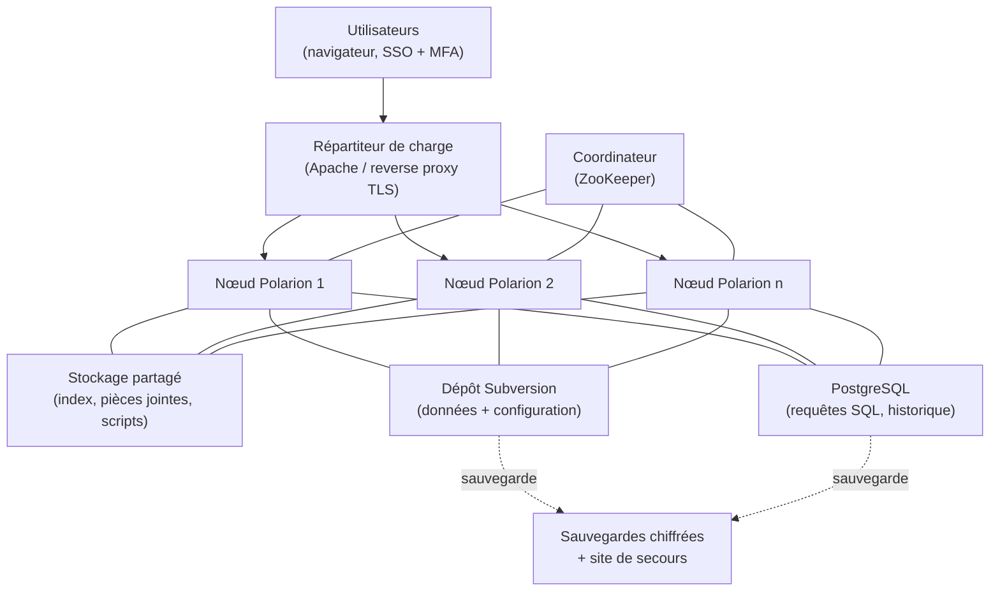

# Partie 3.9 — Infrastructure, sécurité, configuration « as code » et validation de l'outil

> *Version du plan : 0.5 (octobre 2026) · Dépendance à l'outil Polarion : **forte** · Historique : [CHANGELOG](../../CHANGELOG.md) · Carte du dépôt : [guide de lecture](../GUIDE_DE_LECTURE.md).*
>
> Les cotes [C] / [P] reprennent l'échelle de confiance du doc. 05 § 3 ; « [à vérifier] » signale une capacité Polarion dépendante de la version cible (annexe D, spike S1 du doc. 23, questions Q-TOOL-01..04 du doc. 05).

> **En bref**
> - Ce document traite de **la plateforme elle-même** : architecture technique (serveurs, stockage), sécurité de l'information, chaîne « configuration as code » (le modèle de ce dépôt devient la configuration de Polarion par génération automatique), validation de l'outil (dossier IQ / OQ / PQ) et intégrité des données.
> - Lecteurs : DSI (direction des systèmes d'information), RSSI (responsable de la sécurité des systèmes d'information), Qualité (validation de l'outil), Design Authority ALM (propriétaire du modèle, doc. 17), intégrateur.
> - Sigles récurrents : **SSO / MFA** (authentification unique / à plusieurs facteurs), **GED** (gestion électronique des documents, archive de référence), **ReqIF** (format standard d'échange d'exigences), **AIP** (activité importante pour la protection des intérêts, arrêté INB).
> - À lire avant : doc. 06 (ADR-03, ADR-04, ADR-16, ADR-21), doc. 10 (signatures). La mécanique de déploiement côté instance est au [doc. 23 § 4](../partie4/23_Kit_deploiement_guide_pas_a_pas.md) ; les scripts de workflow au doc. 23 § 3.

## 1. Architecture technique (instance STD)

Lecture : les utilisateurs arrivent par un *reverse proxy* (serveur frontal qui termine le chiffrement TLS et répartit la charge) sur plusieurs nœuds Polarion ; ZooKeeper coordonne la grappe (*cluster*) ; Subversion (SVN, gestionnaire de versions) est le dépôt de référence des données et de la configuration ; PostgreSQL (base de données relationnelle) sert les requêtes SQL et l'historique.

| Composant | Faits techniques [C] | Exigence de conception |
|---|---|---|
| Stockage | Subversion = dépôt de référence (configuration et données sous `.polarion/`) ; PostgreSQL intégré pour les requêtes et l'historique | Sauvegarde cohérente SVN + PostgreSQL + stockage partagé ; restauration testée chaque trimestre |
| Cluster | Coordinateur (ZooKeeper), nœuds, dossier partagé, répartiteur Apache ; tâches planifiées réparties | Au moins 2 nœuds en production ; dimensionnement à confirmer avec l'éditeur (Q-TOOL-04) |
| Environnements | — | DEV (intégrateur), RECETTE (validation), PRÉPROD (miroir de données anonymisées ou de test), PROD ; et PRA (plan de reprise d'activité) |
| Version | 2606 (juin 2026 [P] ; numérotation AAMM de Siemens) ; 2404 en fin de vie [à vérifier, Q-TOOL-01] | Politique N-1 (au plus une version de retard), au moins 1 montée de version par an (ADR-21) |
| API REST | Désactivée par défaut ; activation, interface Swagger (documentation interactive de l'API) et jetons réglés par propriétés de configuration [à vérifier, Q-TOOL-01 : noms de propriétés selon la version cible] | Activée en PROD pour les intégrations (doc. 14), Swagger désactivé en PROD |
| IA | Polarion Copilot (assistant fondé sur un grand modèle de langage, annoncé 2512+ [P]) | Désactivé (ADR-17) |

**Repères de performance** [à vérifier, Q-TOOL-04 : valeurs issues de la documentation publique, à confirmer sur la version cible] :
- chargement à la demande des documents à partir de 200 éléments ;
- `luceneMaxClauseCount = 20000` (nombre maximal de termes d'une requête de l'index de recherche Lucene).

Les plafonds recommandés de volumétrie ne sont pas publics : ils sont à obtenir de l'éditeur (Q-TOOL-04). Règles de conception prudentes :
- LiveDocs de quelques milliers d'éléments au plus (scinder par chapitre ou sous-système) ;
- projets conteneurs archivés annuellement (Spaces clos) ;
- requêtes de portefeuille pré-calculées par script planifié (doc. 13 § 6).

## 2. Sécurité de l'information

| Domaine | Mesures |
|---|---|
| Classification | Champ `informationClassification` obligatoire (éléments et documents) ; condition de workflow `noForbiddenClassification` bloquant `sensitiveSecurity` / `restricted` sur STD ; rapport quotidien de détection (K-ADO-03) ; procédure de purge et de transfert vers SENS |
| Contrôle export | Champ `exportControl` obligatoire ; abaissement réservé au `exportControlOfficer` (PR-07) ; projets « US 10 CFR 810 » (réglementation américaine sur l'assistance technique nucléaire) restreints ; instance US (ADR-03) ; journalisation des accès aux projets contrôlés |
| Identités | SSO + MFA ; groupes d'annuaire → rôles ; comptes externes nominatifs, à durée limitée, restreints aux projets sas `EXT-*` (ADR-28, PR-06, PR-11) ; revue semestrielle (PR-08) |
| Administration | Comptes à privilèges nominatifs, bastion (poste d'administration isolé et tracé), journalisation ; séparation administration plateforme (DSI) / administration fonctionnelle (Design Authority) |
| Réseau | Exposition interne uniquement ; accès externe via passerelle sécurisée dédiée aux projets sas `EXT-*` (ou échanges ReqIF hors ligne) |
| Données au repos / en transit | TLS 1.2+ ; chiffrement des volumes et des sauvegardes |
| Journalisation | Journaux applicatifs, authentification, signatures, événements de sécurité (journal de sécurité Polarion [à vérifier, Q-TOOL-01 : annoncé en 2606]), envoyés au SOC (centre de supervision de la sécurité) ; conservation alignée sur la politique d'archivage |
| Cadre réglementaire | Politique de sécurité de l'entreprise ; directive NIS2 (directive européenne 2022/2555 sur la cybersécurité des entités essentielles) selon la transposition française (à vérifier, Q-REG-02) ; doctrine ANSSI (agence nationale de la sécurité des systèmes d'information) ; homologation spécifique (décision formelle d'autorisation de mise en service au regard de la sécurité) de l'instance SENS |
| Chaîne logicielle | Extensions open source revues (code, licences, maintenance) ; scripts versionnés dans ce dépôt ; aucune extension non qualifiée en production (ADR-16) |

## 3. Configuration « as code »

> Ce paragraphe décrit la **chaîne amont** (du modèle YAML aux fichiers générés, intégration continue). La **mécanique côté instance** — emplacement de la configuration dans le dépôt Polarion, rechargement, dépôt des scripts sur chaque nœud, surcharges projet — est décrite au [doc. 23 § 4](../partie4/23_Kit_deploiement_guide_pas_a_pas.md) ; les deux se complètent sans se recouvrir.

```mermaid
flowchart LR
  A["Demande de modification du modèle<br/>(CCB modèle / Design Authority)"] --> B["Branche Git<br/>modification YAML"]
  B --> C["CI : validateur<br/>tools/almmodel.py"]
  C --> D["CI : génération XML FR/EN<br/>+ annexes A1-A11"]
  D --> E["Revue (pull request)<br/>DA + référents"]
  E --> F["Déploiement DEV<br/>(gabarit / dépôt SVN)"]
  F --> G["Recette : tests de non-régression<br/>(workflows, conditions, rapports)"]
  G --> H["PROD : déploiement<br/>(fenêtre planifiée, étiquette de version)"]
  H --> I["Contrôle de dérive<br/>SVN vs fichiers générés"]
```

CI = intégration continue (exécution automatique des contrôles à chaque modification du dépôt Git) ; *pull request* = demande de fusion relue avant intégration.

| Étape | Outil / livrable |
|---|---|
| Source | `model/*.yaml` (ce dépôt) |
| Validation | `tools/almmodel.py` : intégrité référentielle, cohérence des champs homonymes, champs natifs protégés, multi-valeurs, atteignabilité des états, rôles, conditions et fonctions connues, champs requis présents, cascade documentaire, tailoring et socle (`python3 tools/almmodel.py -v` imprime le détail) |
| Génération | `tools/generate_polarion.py --lang fr\|en` → `generated/polarion/<lang>/.polarion/` (249 fichiers XML par langue : 186 `tracker/fields/`, 36 `tracker/workflow/`, 25 `documents/`, 2 `testing/`) + manifeste `SIGNATURES_ET_SCRIPTS.md` ; `tools/generate_docs.py` → `docs/generated/` (annexes A1–A11) ; `tools/generate_project.py` → surcharges projet (`generated/projects/`) |
| CI | `.github/workflows/validate.yml` : validation + tests (`tests/`, 46 tests en v0.5) + génération + contrôle que les fichiers générés commités sont à jour |
| Déploiement | Configuration globale (`.polarion/` à la racine du dépôt SVN) ou gabarit de projet (ZIP importé dans l'administration) ; scripts `fra-*.js` (17 scripts, doc. 23 § 3) déposés sur chaque nœud [emplacement à vérifier, spike S1] ; procédure détaillée : doc. 23 § 4 |
| Dérive | Comparaison périodique du dépôt SVN avec la génération ; toute modification manuelle en production est un écart (ADR-04) |

## 4. Validation de l'outil (qualification d'un logiciel support d'AIP)

Polarion n'est pas un logiciel de sûreté, mais il **supporte des AIP** (activités importantes pour la protection des intérêts, arrêté INB) : contrôle technique, documentation et traçabilité (arrêté INB art. 2.5.6), gestion des écarts. Sa validation est donc requise par le système de management (ISO 19443 / NQA-1 selon l'entité : normes qualité du nucléaire, internationale et américaine). Approche fondée sur les risques :

| Étape | Livrable | Contenu |
|---|---|---|
| 1. Évaluation des risques | Analyse de criticité des fonctions de l'outil | Fonctions critiques (impact sur la démonstration ou l'intégrité des enregistrements) : signatures, workflows du socle, historique, baselines, suspicion, export GED, contrôles de classification. Fonctions non critiques : tableaux de bord de pilotage, ergonomie |
| 2. Exigences utilisateur (URS, *user requirements specification*) | Spécification des exigences de l'outil | Tracée vers ce dépôt (modèle) et vers le socle NN-01 à NN-08 (doc. 07 § 4) |
| 3. Spécification fonctionnelle et de configuration | Ce dépôt (modèle + XML générés + scripts) | Version étiquetée |
| 4. Qualification d'installation (IQ) | PV d'installation par environnement | Versions, paramètres (`secure.approvals`, REST, SSO, LDAP e-signature), certificats |
| 5. Qualification opérationnelle (OQ) | Jeux d'essais des fonctions critiques | Indépendance (auteur ≠ vérificateur bloqué, `approverNotAuthor`) ; **signatures** (ré-authentification, signification, horodatage) sur les transitions qui en déclarent une : triptyque R / V / A des LiveDocs (`wfDocumentFull` / `wfDocumentLight` / `wfDocumentLibrary`) et les workflows de Work Items signés (`wfAnalysis`, `wfAnomaly`, `wfAssumption`, `wfChangeRequest`, `wfCommitment`, `wfDecision`, `wfDeliverable`, `wfInterface`, `wfNonConformance`, `wfReview`, `wfTechnicalIssue`, `wfUnitDeployment`, `wfWaiver`, `wfWorkPackage` — liste à jour dans `generated/polarion/<lang>/SIGNATURES_ET_SCRIPTS.md`) ; **approbation sans signature** pour `wfRequirement`, `wfArchitecture`, `wfVerificationCase`, `wfSafetyAnalysisItem`, `wfLibraryItem` (contrôle technique tracé par Approvals + `approverNotAuthor`, signature portée par le LiveDoc qui déclenche la transition en cascade — décision explicitée au doc. 10 § 5) ; cascade document → éléments (`InvokeAction`, `cascadedItemsApproved`) ; états bloquants (suspects, champs requis, politique d'habilitation `qualifiedSignatory` — cas du doc. 21 § 3.3) ; PDF signé ; interdiction de suppression (PR-01) ; classification interdite (`noForbiddenClassification`) |
| 6. Qualification de performance (PQ) | Pilotes en conditions réelles | Volumétrie, temps de réponse, ergonomie, adéquation aux processus (pilote NUWARD puis pilote court, doc. 23 § 6) |
| 7. Rapport de validation | Synthèse et réserves | Décision de mise en service |
| 8. Maintien | Revue périodique + revalidation ciblée à chaque montée de version ou évolution du modèle | Analyse d'impact par version (notes de version Siemens) ; non-régression automatisée |

> **Les tests OQ sont dérivés du modèle.** Chaque condition bloquante du socle (`approverNotAuthor`, `noSuspectLinks`, `noForbiddenClassification`, `safetyApprovalIf`, `cascadedItemsApproved`, `qualifiedSignatory`) a au moins un cas de test positif et un cas négatif. Il en va de même pour chaque signature déclarée dans `model/workflows.yaml` (bloc `<signatures>` généré, annexe D PF-02) — et pour aucune autre : un cas OQ ne doit pas attendre de signature sur une transition qui n'en déclare pas. Les cas minimaux par script figurent au doc. 23 § 3. Ces cas peuvent eux-mêmes être gérés dans un projet Polarion de validation (`verificationCase` + Test Runs), avec des preuves signées.

## 5. Intégrité des données (leçons de l'affaire du Creusot)

L'affaire du Creusot (irrégularités découvertes en 2016 dans les dossiers de fabrication de l'usine du Creusot : environ 430 « dossiers barrés » — dossiers portant des anomalies non déclarées —, revue d'environ 6 000 dossiers, dispositif CFSI de l'ASN puis de l'ASNR contre les articles contrefaits, frauduleux ou suspects) impose des principes d'intégrité de type ALCOA+ (acronyme des propriétés attendues d'un enregistrement, ci-dessous) sur les enregistrements d'ingénierie :

| Principe | Mise en œuvre Polarion |
|---|---|
| **A**ttribuable | Comptes nominatifs, aucun compte partagé ; signatures avec ré-authentification |
| **L**isible | Formats texte enrichi standardisés ; export PDF/A (format d'archivage pérenne) |
| **C**ontemporain | Horodatage serveur de chaque modification et signature |
| **O**riginal | Historique SVN immuable ; texte original des exigences d'entrée verrouillé ; pièces jointes versionnées |
| **A**ccurate (exact) | Champs obligatoires, énumérations fermées, contrôles de cohérence, contrôle technique indépendant |
| **+ Complet** | Interdiction de suppression ; états terminaux motivés |
| **+ Cohérent** | Baselines, collections, audits de configuration |
| **+ Durable** | Sauvegardes, PRA, archivage GED (formats pérennes) |
| **+ Disponible** | Rôles d'auditeur (inspection autorité, client) en lecture seule tracée |

## 6. Sauvegarde, continuité, archivage

| Objet | Exigence |
|---|---|
| Sauvegardes | Quotidiennes, cohérentes (SVN + PostgreSQL + stockage partagé), chiffrées, externalisées ; tests de restauration trimestriels |
| PRA / PCA (plan de reprise / de continuité d'activité) | Objectifs RPO / RTO (perte de données maximale admise / durée maximale d'interruption) à fixer par la direction (ex. RPO 24 h / RTO 48 h pour STD ; plus strict pendant les arrêts de tranche, pour les fortuits) |
| Archivage | Documents → GED (archive de référence) ; export structuré (ReqIF / XML) des projets clos ; durée « justifiée » (arrêté INB art. 2.5.6) à fixer par catégorie (Q-REG-04) ; conservation sur toute la vie de l'installation pour les éléments de démonstration |
| Fin de vie d'un projet | Passage en lecture seule ; archivage des Spaces des conteneurs ; conservation des baselines |

## 7. Exploitation

| Activité | Fréquence |
|---|---|
| Supervision (disponibilité, temps de réponse, files d'indexation, licences) | Continue |
| Revue des indicateurs K-OPS (doc. 13 § 2.7) | Mensuelle |
| Revue des habilitations (PR-08) | Semestrielle |
| Montées de version | Annuelle (N-1) |
| Revue de la validation de l'outil | Annuelle + à chaque version |
| Exercice de PRA | Annuel |
