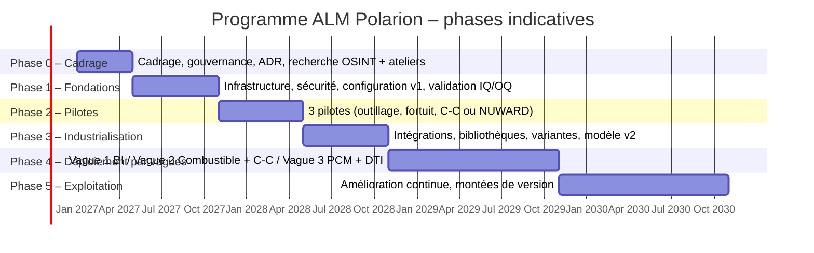

# Partie 3.10 — Feuille de route de déploiement « de A à Z »

> Durées indicatives pour un déploiement multi-BU partant d'une instance vierge. M0 = lancement officiel du programme. Les jalons sont des **portes** (*gates*) avec critères de sortie, prononcées par le comité de pilotage.

## 1. Vue d'ensemble

> Les dates du diagramme sont un exemple (lancement en janvier 2027) : recaler sur la date réelle du lancement.

## 2. Phase 0 — Cadrage (M0 → M4)

| Lot | Activités | Livrables |
|---|---|---|
| Gouvernance | Sponsor au Comex, comité de pilotage, Design Authority ALM, référents BU | Charte du programme, RACI, comitologie |
| Recherche et validation | Plan de recherche (document 05) : lots R-ORG, R-REG, R-BU, 20 à 24 ateliers internes | Registre d'hypothèses confirmé ; ADR validés |
| Architecture | Décisions ADR-01 à ADR-23 ; frontière Polarion / 3DX / MES (ADR-07) ; instances (ADR-03) | Dossier d'architecture v1 |
| Licences et achats | Chiffrage des licences (ALM / REQUIREMENTS / QA / REVIEWER / Variants) selon la matrice des rôles ; intégrateur ; licences de normes (AFCEN, IEC) | Stratégie d'achat |
| Sécurité | Analyse de risques SSI, classification, contrôle export, homologation (STD, éventuellement SENS) | Dossier de sécurité |
| Conduite du changement | Cartographie des populations, des impacts et des champions | Plan de conduite du changement |

**Ajouts v0.3 (doc. 20)** : information-consultation des instances représentatives du personnel (CSE, Betriebsrat), qui est sur le chemin critique ; fiche RGPD et AIPD ; criblage PPST ; accord de principe des clients majeurs sur les signatures électroniques ; mesure de maturité IS initiale ; ADR-24 à ADR-28.

**Critères de sortie G0** :
- ADR P1 validés ;
- dossier d'information-consultation du personnel déposé (F-01) ;
- périmètre de la vague 1 arrêté ;
- budget engagé ;
- hypothèses P1 du plan de recherche confirmées ou levées.

## 3. Phase 1 — Fondations (M4 → M10)

| Lot | Activités | Livrables |
|---|---|---|
| Infrastructure | Environnements DEV, RECETTE, PRÉPROD, PROD et PRA ; cluster ; sauvegardes ; supervision | PV d'installation (IQ) |
| Identité | SSO + MFA, provisionnement depuis l'annuaire, LDAP e-signature | Matrice groupes → rôles |
| Configuration v1 | Modèle YAML v1.0 (ce dépôt, après ateliers) ; génération ; scripts de workflow (indépendance, suspects, classification, sûreté, SLA, baseline, indice) ; formulaires par type | Configuration étiquetée v1.0 |
| Gabarits | TPL-TOOLING, TPL-IB-FORTUIT, TPL-IC-PROJECT (ou TPL-NEWBUILD allégé) ; LiveDocs modèles ; tableaux de bord par rôle | Gabarits v1 |
| Bibliothèques | Amorçage LIB-REG (arrêté INB, arrêté ESPN, décisions clés, EES ; normes en références et paraphrases) ; LIB-TERM ; LIB-TEMPLATES | Bibliothèques publiées v1 |
| Export documentaire | Gabarit PDF de l'entreprise, manifeste des signatures, connecteur GED | Chaîne de diffusion |
| Validation de l'outil | Analyse de risques, URS, OQ des fonctions critiques | Rapport OQ |
| Formation | Supports par rôle (§ 7), environnement bac à sable | Kit de formation v1 |

**Ajouts v0.3** :
- master + archétypes et assistant de provisioning (`project_setup.yaml`, doc. 21) ;
- packs réglementaires des pilotes ;
- profils ReqIF et règles d'import (doc. 22) ;
- référentiel des habilitations (F-18) ;
- tirs de charge (F-17) ;
- homologation de sécurité (F-06) ;
- mise à jour des procédures du système de management (F-09).

**Critères de sortie G1** :
- OQ concluante sur les fonctions critiques, y compris les cas de signature habilitée (doc. 21 § 3.3) et d'échange (doc. 22 § 7) ;
- gabarits pilotes prêts ;
- utilisateurs pilotes formés.

## 4. Phase 2 — Pilotes (M10 → M16)

Trois pilotes **contrastés** pour éprouver le tailoring :

| Pilote | Typologie / classe | Pourquoi | Ce qu'il éprouve |
|---|---|---|---|
| **P1 – Outillage spécial** | `specialTooling` / C | Périmètre maîtrisé, mécatronique, cycle de 6 à 12 mois | CdC fonctionnel, RFLP léger, AMDEC d'intervention, V&V sur maquette, catalogue PL-TOOLS |
| **P2 – Fortuits d'une campagne d'arrêts** | `fortuit` / D | Valeur visible immédiate, forte contrainte de délai | Workflow express, SLA, note de justification, socle non négociable en conditions réelles, REX générique |
| **P3 – Projet C-C (application) ou lot NUWARD** | `icApplication` / B, ou `newBuildSmr` / A | Complexité, normes IEC, V&V indépendante, MBSE | Déclinaison multi-niveaux, Test Runs (FAT), anomalies, Capella → Polarion, interfaces |

**Mesures de succès des pilotes** :
- couverture des exigences définies : 100 % ;
- temps de cycle des fortuits : au moins aussi bon qu'avant ;
- taux de bon du premier coup des livrables ;
- satisfaction des utilisateurs (≥ 3,5 / 5) ;
- bruit de suspicion mesuré ;
- performances (K-OPS-01).

**Critères de sortie G2** :
- bilan des pilotes ;
- modèle v1.x corrigé ;
- PQ concluante ;
- décision de généralisation par vague.

## 5. Phase 3 — Industrialisation (M16 → M22)

| Lot | Activités |
|---|---|
| Intégrations | ReqIF client (gabarits par client), Capella → Polarion, OSLC 3DEXPERIENCE (ADR-07), GED (production), MES (proxys FNC et preuves), ERP (WBS), BI |
| Bibliothèques | LIB-HAZARD, LIB-VV, extension de LIB-REG (licences AFCEN / IEC, import RCC-E 2025 si licence) |
| Lignes de produits | PL-FLEET-FR (paliers), PL-SG, PL-ICPLATFORM, PL-FUEL, PL-TOOLS ; pilote du module Variants (ADR-05) |
| Suspicion phase 2 | Hook de filtrage par champ ; rapport de cône d'impact (ADR-20) |
| Modèle v2 | Retours des pilotes ; énumérations réelles (BL, codes documentaires, visas par client) |
| Validation | Revalidation ciblée (OQ des nouvelles fonctions) |
| Support | Mise en place des niveaux de support 1 / 2 / 3, base de connaissances |

**Critères de sortie G3** : intégrations P1 en production ; gabarits de toutes les typologies prêts ; capacité de support dimensionnée.

## 6. Phase 4 — Déploiement par vagues (M22 → M34)

| Vague | BU / typologies | Justification de l'ordre | Points d'attention |
|---|---|---|---|
| **V1** (M22-M26) | Base installée : fortuits, outillages, modifications, inspection ; puis RGV et réexamens | Pilotes déjà réalisés dans la BU ; volumes élevés ; gains rapides | Projets conteneurs, effectivité par tranche, interface client EDF (visas) |
| **V2** (M25-M30) | Combustible (recharges, conception) ; C-C (projets, rénovations, plateformes) | Processus normés (IEC 61513), forte réutilisation | Recharges automatisées (imports de calcul) ; V&V indépendante ; anomalies génériques de plateforme |
| **V3** (M28-M34) | PCM (EPR2, SZC, HPC selon le calendrier contractuel) ; DTI (NUWARD) ; composants (ESPN) | Volumétrie et criticité maximales : bénéficier de la maturité acquise | Bascule à un jalon (ADR-23) ; ReqIF avec l'architecte-ensemblier ; collections et baselines contractuelles |
| **Hors vague** | Healthcare, Space ; Defense (instance dédiée si requis) ; entité US (instance US) | Périmètres spécifiques | Décision ADR-03 |

Chaque vague suit le même cycle :
1. ateliers de déclinaison BU ;
2. paramétrage des énumérations projet ;
3. formation (juste à temps) ;
4. démarrage accompagné (hypercare de 6 semaines) ;
5. bilan.

## 7. Formation (cursus par rôle)

| Cursus | Public | Durée | Contenu |
|---|---|---|---|
| F0 — Lecteur / relecteur | Lecteurs, relecteurs, clients | 2 h (e-learning) | Navigation, LiveDocs, commentaires, approbations |
| F1 — Contributeur | Ingénieurs discipline | 1 j | Rédaction INCOSE, Work Items, liens (convention aval → amont), suspects, workflows, signatures |
| F2 — Vérificateur / approbateur | Vérificateurs, approbateurs, sûreté | 0,5 j | Contrôle technique, indépendance, signatures et leur signification |
| F3 — Responsable exigences / technique | RE, RT, gestionnaires d'interfaces | 2 j | Déclinaison, conformité, ReqIF, couverture, baselines, branches, analyses d'impact |
| F4 — V&V | V&V, essais | 1,5 j | Cas, Test Runs, résultats, anomalies, couverture |
| F5 — Configuration / CCB | Gestionnaires de configuration, présidents de CCB | 1 j | Demandes de modification, CCB, baselines, collections, audits |
| F6 — Qualité | Qualité, surveillance | 1 j | FNC, CAPA, CFSI, indicateurs, audits |
| F7 — Administrateur projet / référent | Champions BU | 3 j | Gabarits, requêtes, tableaux de bord, support de niveau 1 |
| F8 — Design Authority / administrateurs | DA ALM, DSI | 5 j + éditeur | Configuration as code, scripts, validation, montées de version |

## 8. Risques du programme de déploiement

| Risque | Prob. | Impact | Parade |
|---|---|---|---|
| Doublon avec le Core Model 3DEXPERIENCE (conflit de source de vérité) | Élevée | Élevé | ADR-07 tranché en phase 0 ; gouvernance commune des identifiants |
| Rejet par les utilisateurs (outil perçu comme bureaucratique) | Moyenne | Élevé | Tailoring réel, workflows express, champions, mesure de la satisfaction, simplification continue |
| Bruit de suspicion | Élevée | Moyen | ADR-20 phase 2, indicateur de bruit |
| Performances sur grands projets | Moyenne | Élevé | Découpage des projets et documents, cluster, tests de charge en PQ |
| Données sensibles introduites par erreur sur STD | Moyenne | Très élevé | Champs obligatoires, conditions bloquantes, détection quotidienne, sensibilisation |
| Dépendance aux scripts ou extensions | Moyenne | Moyen | ADR-16, versionnement, tests de non-régression à chaque version |
| Interopérabilité ReqIF avec les clients | Moyenne | Moyen | Gabarits négociés, essais d'échange en phase 3 |
| Licences de normes (AFCEN / IEC) | Moyenne | Moyen | Références et paraphrases par défaut (ADR-14) |
| Réorganisation interne en cours de programme | Élevée | Faible (si P8) | Organisation dans des énumérations, jamais dans les identifiants |
| Montée de version perturbatrice | Moyenne | Moyen | N-1, recette automatisée, revalidation ciblée |

## 9. Facteurs de coût (sans chiffrage)

1. Licences : nombre d'utilisateurs par type de licence (matrice des rôles), module Variants, Copilot (non retenu).
2. Infrastructure : instances (STD, SENS ?, US ?), cluster, PRA, environnements.
3. Intégrateur : configuration, scripts, intégrations (ReqIF, Capella, OSLC 3DX, GED, MES, ERP, BI).
4. Validation de l'outil (IQ / OQ / PQ, revalidations).
5. Conduite du changement et formation (cursus F0 à F8 × populations).
6. Licences de normes pour la bibliothèque.
7. Run : Design Authority, support de niveaux 1 à 3, montées de version.

## 10. Indicateurs du programme

| Indicateur | Cible fin de V3 |
|---|---|
| Projets actifs dans Polarion / projets éligibles | > 90 % |
| Utilisateurs actifs mensuels / utilisateurs licenciés | > 80 % |
| Livrables produits depuis les LiveDocs / livrables éligibles | > 70 % |
| Couverture des exigences définies vérifiée à la clôture | 100 % |
| Fortuits traités dans Polarion avec SLA respecté | > 95 % |
| Satisfaction des utilisateurs | ≥ 3,5 / 5 |
| Écarts de validation de l'outil ouverts | 0 critique |
