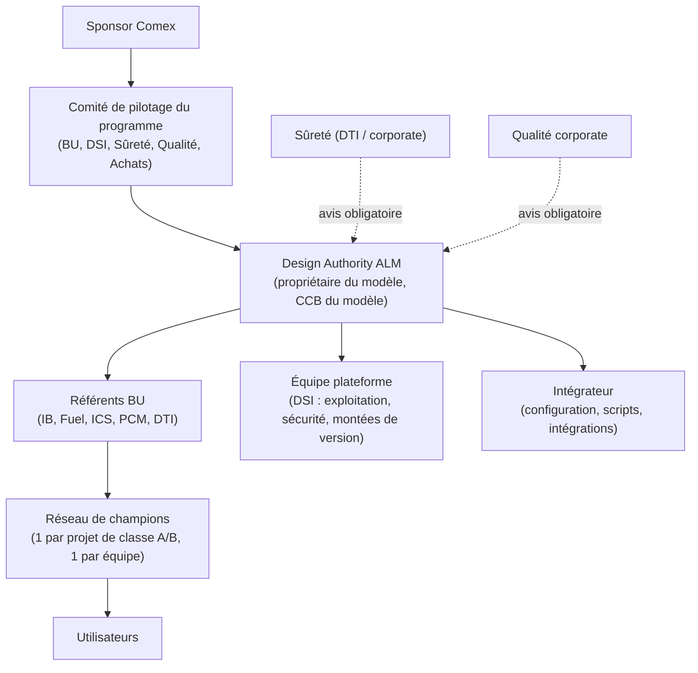

# Partie 3.11 — Gouvernance du référentiel ALM et conduite du changement

## 1. Organisation de la gouvernance

| Instance | Mission | Fréquence | Décisions |
|---|---|---|---|
| Comité de pilotage | Arbitrages de périmètre, budget, vagues, risques du programme | Mensuelle (trimestrielle en run) | Portes G0 à G3, priorités |
| **Design Authority ALM** | Garante de la cohérence du modèle et de la configuration ; CCB du modèle ; ADR | Toutes les deux semaines (mensuelle en run) | Évolutions du modèle, dérogations de tailoring, extensions |
| Référents BU | Déclinaison métier, gabarits, énumérations projet, remontée des besoins | Hebdomadaire en déploiement | Propositions d'évolution |
| Équipe plateforme | Exploitation, sécurité, performance, versions | Continue | Changements techniques |
| Communauté de pratique | Partage, bonnes pratiques, REX | Mensuelle | — |

## 2. Processus d'évolution du modèle (CCB du modèle)

1. **Demande** : Work Item `changeRequest` dans le projet `LIB-PROCESS` (origine, justification, BU, urgence).
2. **Qualification** par la Design Authority :
   - **mineure** : libellés, nouvelles options d'énumération, nouveaux rapports ;
   - **majeure** : nouveau type, nouvel attribut transverse, workflow, rôle de lien ;
   - **rupture** : renommage ou suppression, qui implique une migration.
3. **Analyse d'impact** :
   - projets concernés ;
   - validation de l'outil (revalidation nécessaire ?) ;
   - formation ;
   - intégrations (ReqIF, Capella, 3DX, BI).
4. **Avis** obligatoires de la Sûreté et de la Qualité pour tout ce qui touche au socle non négociable.
5. **Réalisation** dans ce dépôt (branche + demande de fusion) ; CI : validation et génération.
6. **Recette** (tests de non-régression, OQ ciblée), puis **déploiement** planifié avec note de version aux utilisateurs.
7. **Versionnement** du modèle (sémantique : majeure, mineure, correctif) et étiquette Git.

**Règles intangibles** :
- un identifiant n'est jamais renommé ni supprimé : il est déprécié ou migré ;
- aucune modification en production hors de ce processus ;
- toute dérogation locale (projet) au modèle est une `designDecision` approuvée par la Design Authority et réévaluée chaque année.

## 3. Rôles du référentiel

| Rôle | Responsabilités |
|---|---|
| Propriétaire produit ALM (Design Authority) | Feuille de route du modèle, arbitrages, qualité du référentiel |
| Architecte du modèle | Cohérence ontologique, ADR, validation des demandes de fusion |
| Référent métier BU | Besoins, gabarits, énumérations projet, formation de niveau 1 |
| Référent Sûreté | Classements, socle, workflows de sûreté, bibliothèque d'agressions |
| Référent Qualité | Workflows des écarts, validation de l'outil, audits |
| Gestionnaire de configuration du référentiel | Versions du modèle, déploiements, contrôle de dérive |
| Curateurs de bibliothèques | LIB-REG (veille réglementaire), LIB-TERM, LIB-HAZARD, LIB-VV, LIB-TEMPLATES |
| Administrateurs plateforme | Exploitation, sécurité, performance |

## 4. Support

| Niveau | Acteur | Périmètre | Engagement indicatif |
|---|---|---|---|
| N0 | Base de connaissances, FAQ, vidéos | Usage courant | — |
| N1 | Champions / référents BU | Questions d'usage, droits projet, requêtes, tableaux de bord | Même jour |
| N2 | Équipe ALM (Design Authority + plateforme) | Configuration, scripts, incidents fonctionnels | 2 jours ouvrés (priorité haute pendant les arrêts de tranche pour les fortuits) |
| N3 | Intégrateur / éditeur | Anomalies logicielles, performances, montées de version | Contrat |

## 5. Conduite du changement

### 5.1 Populations et impacts

| Population | Effectif relatif | Changement principal | Levier |
|---|---|---|---|
| Ingénieurs discipline | Très élevé | Rédiger dans des LiveDocs structurés, créer des liens, gérer les suspects | Gain de temps sur les matrices de traçabilité (fin des tableurs), gabarits |
| Vérificateurs / approbateurs | Élevé | Contrôle technique et signature dans l'outil | Licence REVIEWER, interface simple, signature intégrée |
| Responsables techniques / exigences | Moyen | Pilotage par la couverture et l'impact | Tableaux de bord, analyse d'impact automatisée |
| Sûreté | Moyen | Classement et argumentaire structurés | Vue consolidée EIP / exigences définies |
| Qualité | Moyen | FNC et CAPA dans l'outil d'ingénierie | Indicateurs temps réel, CFSI |
| Chefs de projet | Moyen | Indicateurs de maturité technique | Tableaux de bord de jalons |
| Clients / fournisseurs | Faible | Échanges ReqIF ou espaces de collaboration | Accompagnement contractuel |

### 5.2 Leviers

1. **Valeur d'abord** : démarrer par les irritants (matrices de traçabilité manuelles, suivi des fortuits, visas) ; montrer des gains mesurés (pilotes).
2. **Simplicité** : tailoring réel (classe D réellement légère), formulaires par type, champs masqués hors profil.
3. **Champions** : un par équipe, formés en F7, animés en communauté de pratique.
4. **Formation juste à temps** (cursus F0 à F8), mises en situation sur le bac à sable avec les gabarits réels.
5. **Communication** : notes de version, démonstrations mensuelles, témoignages de projets pilotes.
6. **Mesure** : satisfaction trimestrielle, indicateurs d'adoption (K-ADO), boucle d'amélioration publique (backlog visible des évolutions du modèle).
7. **Cohérence managériale** : revues de projet conduites à partir des tableaux de bord Polarion, et non de tableurs parallèles.

## 6. Feuille de route du référentiel (après déploiement)

| Horizon | Évolutions envisagées |
|---|---|
| Court terme | Suspicion filtrée par champ ; cône d'impact ; contrôles de rédaction automatisés ; gabarits ReqIF par client |
| Moyen terme | Module Variants sur les produits génériques ; intégration OSLC 3DX complète ; import structuré du RCC-E (licence) ; tableaux de bord de portefeuille BI |
| Long terme | Connecteur SysML v2 ; IA générative encadrée (LLM sur site, ADR-17) pour l'aide à la rédaction et à l'analyse d'impact ; fédération des instances (indicateurs consolidés) |
