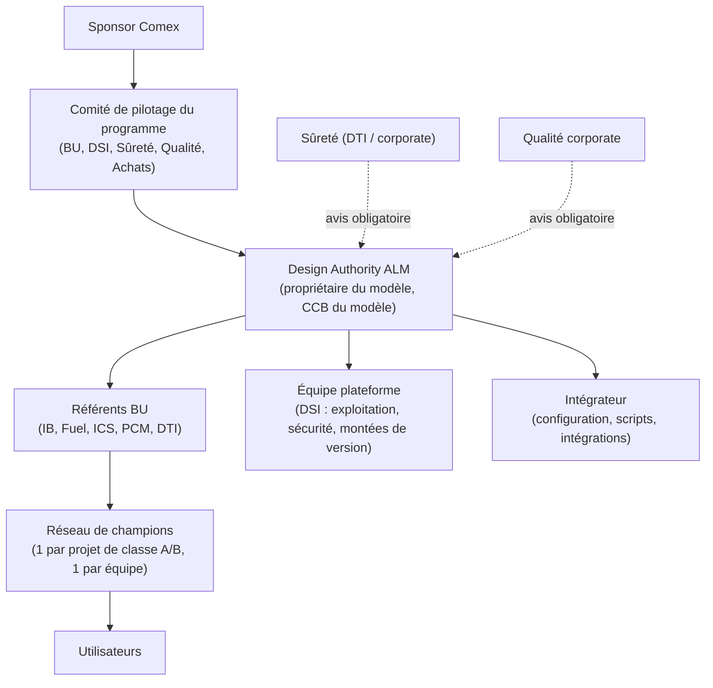

# Partie 3.11 — Gouvernance du référentiel ALM et conduite du changement

> *Version du plan : 0.5 (octobre 2026) · Dépendance à l'outil Polarion : **faible** · Historique : [CHANGELOG](../../CHANGELOG.md) · Carte du dépôt : [guide de lecture](../GUIDE_DE_LECTURE.md).*

> **En bref**
> - Ce document fixe qui décide des évolutions du référentiel ALM (*Application Lifecycle Management* : ici, le modèle de données et la configuration Polarion) et comment une demande d'évolution est traitée. Le § 2 est le **foyer unique** de la gouvernance du modèle : les doc. 08 § 7 et 25 § 5.2 y renvoient.
> - Il décrit aussi le support aux utilisateurs (§ 4), la conduite du changement (§ 5) et la feuille de route du référentiel après déploiement (§ 6).
> - Lecteurs : comité de pilotage, Design Authority ALM, référents BU, Qualité, Sûreté, DSI. À lire avant : doc. 16 (feuille de route) ; pour la politique d'extensions locales, doc. 25 et ADR-29.

## 1. Organisation de la gouvernance

Lecture du schéma : le sponsor au Comex (comité exécutif) porte le programme ; le comité de pilotage arbitre ; la **Design Authority ALM** (autorité de conception : propriétaire du modèle de données) anime le **CCB du modèle** (*Change Control Board* : comité qui statue sur chaque demande d'évolution) ; la DSI (direction des systèmes d'information) exploite la plateforme ; les champions sont des utilisateurs relais, formés en premier.

| Instance | Mission | Fréquence | Décisions |
|---|---|---|---|
| Comité de pilotage | Arbitrages de périmètre, budget, vagues, risques du programme | Mensuelle (trimestrielle en run, c'est-à-dire en exploitation courante) | Portes G0 à G3, priorités |
| **Design Authority ALM** | Garante de la cohérence du modèle et de la configuration ; CCB du modèle ; ADR (décisions d'architecture tracées, doc. 06) | Toutes les deux semaines (mensuelle en run) | Évolutions du modèle, dérogations de tailoring, extensions |
| Référents BU | Déclinaison métier, gabarits, énumérations projet, remontée des besoins | Hebdomadaire en déploiement | Propositions d'évolution |
| Équipe plateforme | Exploitation, sécurité, performance, versions | Continue | Changements techniques |
| Communauté de pratique | Partage, bonnes pratiques, REX (retour d'expérience) | Mensuelle | — |

## 2. Processus d'évolution du modèle (CCB du modèle)

Ce paragraphe est la référence unique de la gouvernance du modèle ; les doc. 08 § 7 et 25 § 5.2 y renvoient. Les règles d'extension et de promotion sont codées dans `model/extension_policy.yaml` (ADR-29, doc. 25).

**Composition du CCB du modèle** : responsable IS (ingénierie système), président ; Design Authority ALM ; ingénieur configuration ; SE Referents (référents ingénierie système) des BU ; Sûreté et Qualité invités selon le sujet, avec avis obligatoire pour tout ce qui touche le socle non négociable (NN-01..08 : exigences réglementaires minimales dues dans toutes les classes de tailoring, doc. 07).

**Cadence** : toutes les deux semaines pendant les pilotes, mensuelle ensuite. **Délais cibles** : 10 jours ouvrés pour une évolution du cœur ; voie rapide de 3 jours pour une valeur d'énumération ; 20 jours ouvrés pour décider d'une incubation (nouveau type, rôle de lien ou workflow). **Délégation** : les valeurs des énumérations de portée projet (`plantUnit`, `operationalUnit`, `businessLine`) relèvent des SE Referents de BU, sans passage en CCB.

**Étapes :**
1. **Demande** : Work Item `changeRequest` dans le projet `LIB-PROCESS` (origine, justification, BU, urgence).
2. **Qualification** par la Design Authority :
   - **mineure** : libellés, nouvelles options d'énumération, nouveaux rapports ;
   - **majeure** : nouveau type, nouvel attribut transverse, workflow, rôle de lien. Un besoin de type, de rôle de lien ou de workflow passe d'abord par l'**incubation** : prototype en bac à sable, scénario de couverture (`model/coverage_scenarios.yaml`), décision du CCB ; s'il est accepté, il entre dans le cœur pour tous les projets ;
   - **rupture** : renommage ou suppression, qui implique une migration.
3. **Analyse d'impact** :
   - projets concernés ;
   - validation de l'outil (revalidation nécessaire ?) ;
   - formation ;
   - intégrations (ReqIF, Capella, PLM, BI).
4. **Avis** obligatoires de la Sûreté et de la Qualité pour tout ce qui touche au socle non négociable.
5. **Réalisation, recette et déploiement** : branche et demande de fusion dans ce dépôt ; CI (intégration continue : validation et génération automatiques) ; recette (tests de non-régression, OQ ciblée) ; déploiement planifié avec note de version aux utilisateurs. La chaîne outillée est décrite au doc. 15 § 3 (configuration « as code ») et la mécanique sur l'instance au doc. 23 § 4.
6. **Versionnement** du modèle (sémantique : majeure = rupture avec migration de données, mineure = ajout, correctif = libellés et descriptions) et étiquette Git.

**Extensions locales et promotion (ADR-29, doc. 25)** : un projet peut ajouter, sans passer par le CCB, des champs informatifs préfixés `x_` (au plus 5 par type et 15 par projet), des énumérations locales, des valeurs d'énumérations de portée projet, des gabarits de LiveDocs, pages, requêtes et Spaces locaux (zones d'extension EXT-FIELD à EXT-SPACE de `extension_policy.yaml`, à ne pas confondre avec les projets sas `EXT-*`). Jamais un type, un rôle de lien, un workflow, ni la redéfinition d'un champ du cœur. Ces extensions sont déclarées dans la fiche du projet et **revues chaque trimestre** : le CCB promeut dans le cœur ce qui sert au moins deux projets ou BU, ou ce qu'exige un client ou une autorité (champ du cœur créé, valeurs recopiées par script, champ `x_` déprécié puis retiré) ; sinon l'extension reste locale ou est retirée.

**Règles intangibles** :
- un identifiant n'est jamais renommé ni supprimé : il est déprécié ou migré ; les options obsolètes restent présentes, masquées par la configuration des formulaires ;
- aucune modification en production hors de ce processus ;
- les extensions locales suivent ADR-29 / doc. 25 (zones d'extension déclarées, revue trimestrielle) ; toute autre dérogation locale (projet) au modèle est une `designDecision` approuvée par la Design Authority.

## 3. Rôles du référentiel

| Rôle | Responsabilités |
|---|---|
| Propriétaire produit ALM (Design Authority) | Feuille de route du modèle, arbitrages, qualité du référentiel |
| Architecte du modèle | Cohérence ontologique, ADR, validation des demandes de fusion |
| Référent métier BU | Besoins, gabarits, énumérations projet, formation de niveau 1 |
| Référent Sûreté | Classements, socle, workflows de sûreté, bibliothèque d'agressions (LIB-HAZARD) |
| Référent Qualité | Workflows des écarts, validation de l'outil, audits |
| Gestionnaire de configuration du référentiel | Versions du modèle, déploiements, contrôle de dérive |
| Administrateur des habilitations (rôle global `habilitationAdministrator`) | Groupes `HAB-<domaine>-<niveau>` tenus à jour depuis le référentiel RH-compétences ; revue semestrielle (F-18, doc. 20) |
| Curateurs de bibliothèques | LIB-REG (veille réglementaire), LIB-TERM, LIB-HAZARD, LIB-VV, LIB-TEMPLATES |
| Administrateurs plateforme | Exploitation, sécurité, performance |

## 4. Support

Les niveaux N0 à N3 sont les échelons de support, du libre-service (N0) à l'éditeur (N3).

| Niveau | Acteur | Périmètre | Engagement indicatif |
|---|---|---|---|
| N0 | Base de connaissances, FAQ, vidéos | Usage courant | — |
| N1 | Champions / référents BU | Questions d'usage, droits projet, requêtes, tableaux de bord | Même jour |
| N2 | Équipe ALM (Design Authority + plateforme) | Configuration, scripts, incidents fonctionnels | 2 jours ouvrés (priorité haute pendant les arrêts de tranche pour les fortuits) |
| N3 | Intégrateur / éditeur | Anomalies logicielles, performances, montées de version | Contrat |

## 5. Conduite du changement

### 5.1 Populations et impacts

| Population | Effectif relatif | Changement principal | Levier |
|---|---|---|---|
| Ingénieurs discipline | Très élevé | Rédiger dans des LiveDocs structurés, créer des liens, gérer les suspects | Gain de temps sur les matrices de traçabilité (fin des tableurs), gabarits |
| Vérificateurs / approbateurs | Élevé | Contrôle technique et signature dans l'outil | Licence REVIEWER (licence Polarion de relecture et d'approbation, moins coûteuse qu'une licence de contribution), interface simple, signature intégrée |
| Responsables techniques / exigences | Moyen | Pilotage par la couverture et l'impact | Tableaux de bord, analyse d'impact automatisée |
| Sûreté | Moyen | Classement et argumentaire structurés | Vue consolidée EIP (éléments importants pour la protection des intérêts, arrêté INB) / exigences définies |
| Qualité | Moyen | FNC (fiches de non-conformité) et CAPA (actions correctives et préventives) dans l'outil d'ingénierie | Indicateurs temps réel, CFSI (articles contrefaits, frauduleux ou suspects) |
| Chefs de projet | Moyen | Indicateurs de maturité technique | Tableaux de bord de jalons |
| Clients / fournisseurs | Faible | Échanges ReqIF ou projets sas `EXT-*` (ADR-28 : projet d'échange dédié, seul accès des comptes externes — PR-09, PR-11) | Accompagnement contractuel |

### 5.2 Leviers

1. **Valeur d'abord** : démarrer par les irritants (matrices de traçabilité manuelles, suivi des fortuits, visas) ; montrer des gains mesurés (pilotes).
2. **Simplicité** : tailoring réel (classe D réellement légère), formulaires par type, champs masqués hors profil.
3. **Champions** : un par équipe, formés en F7 (cursus du doc. 16 § 7), animés en communauté de pratique.
4. **Formation juste à temps** (cursus F0 à F8), mises en situation sur le bac à sable avec les gabarits réels.
5. **Communication** : notes de version, démonstrations mensuelles, témoignages de projets pilotes.
6. **Mesure** : satisfaction trimestrielle, indicateurs d'adoption (K-ADO, doc. 13 § 2.7), boucle d'amélioration publique (backlog visible : liste priorisée des évolutions du modèle).
7. **Cohérence managériale** : revues de projet conduites à partir des tableaux de bord Polarion, et non de tableurs parallèles.

## 6. Feuille de route du référentiel (après déploiement)

| Horizon | Évolutions envisagées |
|---|---|
| Court terme | Suspicion filtrée par champ (ADR-20) ; cône d'impact ; contrôles de rédaction automatisés ; gabarits ReqIF par client |
| Moyen terme | Module Variants sur les produits génériques (ADR-05) ; intégration OSLC / REST PLM complète (ADR-07, doc. 22 § 5.1) ; import structuré du RCC-E (code AFCEN des matériels électriques et de contrôle-commande, sous licence) ; tableaux de bord de portefeuille BI (informatique décisionnelle) |
| Long terme | Connecteur SysML v2 (langage de modélisation système, version 2) ; IA générative encadrée (LLM — grand modèle de langage — hébergé sur site, ADR-17 ; capacités Copilot dépendantes de la version Polarion [à vérifier, spike S1 / Q-TOOL-01]) pour l'aide à la rédaction et à l'analyse d'impact ; fédération des instances (indicateurs consolidés) |
